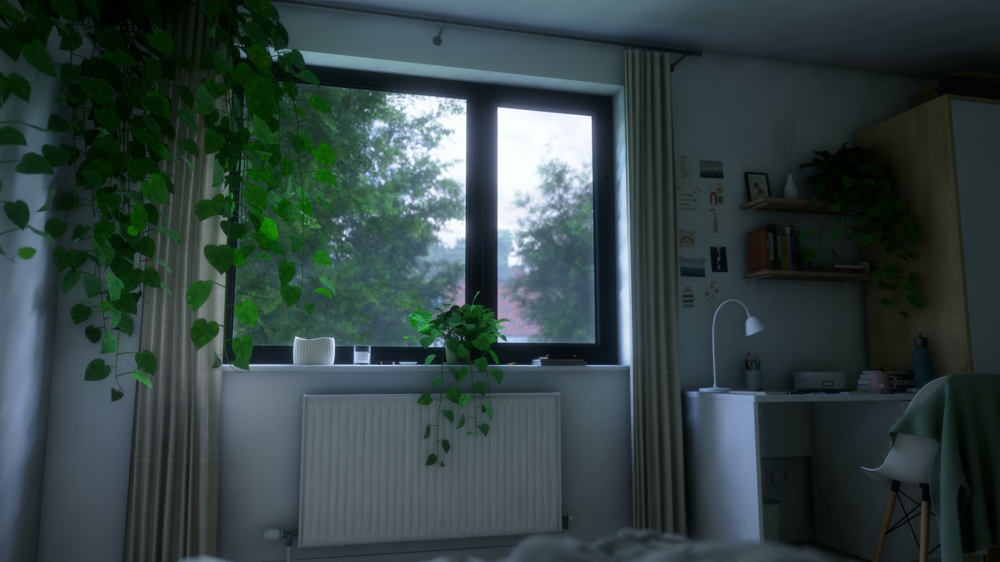

# 晨光卧室 · 6:51 程序化 3D 漫游

> 原作 Agent 未记录 + Claude Fable 5.2（模型仅依据原作提交署名）

[打开案例](index.html) · [原作源码与完整开发说明](https://github.com/Leonxlnx/room-at-dawn) · [用户指定来源](https://github.com/WangXP7/room-at-dawn)

WASD / 方向键移动，鼠标环视，Shift 慢走，Ctrl / Q 下蹲，C 镜头漫游，M 静音，Esc 释放鼠标。触屏点击进入自动镜头漫游，再点画面返回，不提供虚拟摇杆。

原作者 Leon Lin，MIT 许可。原作两次提交均标记 Claude Fable 5.2 联合署名，但 Agent 工具、独立完成程度和制作耗时没有可核实记录。本次由 Codex 完成中文界面、触屏漫游适配、构建验证与发布；当前整理模型的精确名称未提供。整理验证耗时约 10 分钟（截至提交准备），部署复核另记本地正式发布记录，不含原作制作时间。

本页面为可运行静态构建；开发请访问上方源码仓库，执行 npm ci 和 npm run dev；静态输出由 npm run build 生成。修改家具、布局或影响光照的材质后须重新烘焙光照。

完整保留 [MIT 许可证](LICENSE) 和 [音频署名及许可](CREDITS.md)。
