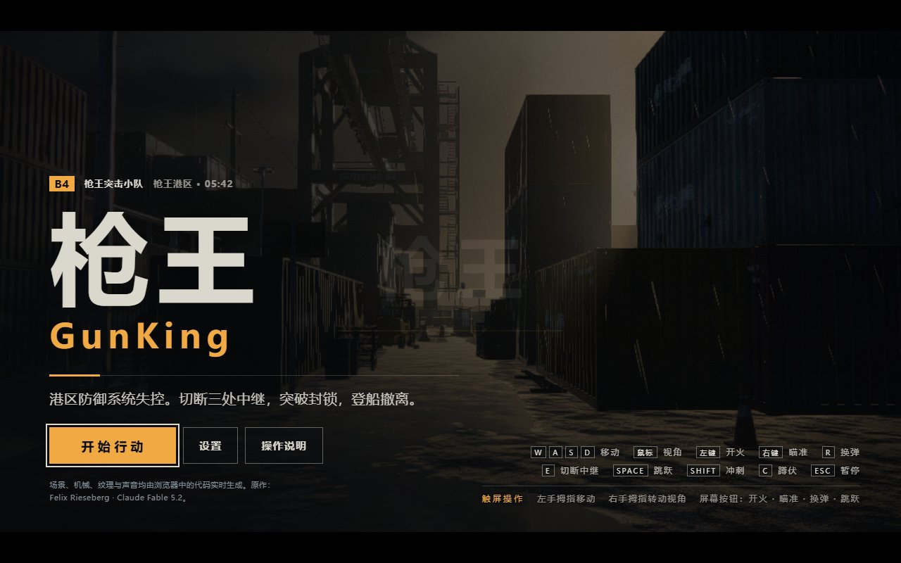

# 枪王 GunKing · 港区突围（中文还原版）

> **Codex + GPT-6.1 Sol**

本次完成 Saltline 溯源、程序还原、中文汉化保留与用户授权的“枪王 / GunKing”标识替换。这里的署名与总耗时只指本轮工作，不代表游戏由 Codex 原创。本轮未优化玩法、数值或画质，停在可在本机修改的阶段。

## 来源与还原依据

GitHub 基准是 [realcodebear/saltline-fable-5.2](https://github.com/realcodebear/saltline-fable-5.2)，这是第三方原版镜像，不是原作者仓库。固定文件为 [index.html @ 09d5fc9](https://github.com/realcodebear/saltline-fable-5.2/blob/09d5fc9a5678eb398edfd7d0f0be6ef7754f6538/index.html)，SHA-256：`f34e6debbfa7526b72be2daa24595c2f195e102a7aede4f22e59138c99cd6852`。

镜像 README 记载原作发布者为 Felix Rieseberg，生成模型为 Claude Fable 5.2，链接了 [原始 Artifact](https://claude.ai/artifact/BGY1SztrAYcJQHSsnHHGmp) 与 [发布帖](https://x.com/felixrieseberg/status/2119925633564463609)。具体运行 Agent 未据此推定。本次没有直接取得原发布帖和 Artifact 的完整内容，精确比较基准是上述固定 GitHub 文件。

镜像自述未改游戏代码，只去掉 Claude 页面宿主脚本并加上独立网页基础标签。镜像没有独立游戏代码许可证声明；Three.js 的 MIT 许可仅覆盖该第三方库。

去除了“几猫”“国产3A”“自主研发”宣传，及额外项目介绍按钮、页签、面板和事件分支；恢复原作枪械、厂商、船名等身份或对应译名。保留中文菜单、HUD、操作、设置、任务、无线电、结算、场景标识与字体适配。按本轮用户补充要求，可见游戏名称和相关港区标识使用“枪王 / GunKing”，原作署名独立保留。

本轮从固定上游程序应用 193 处审查后的中文与标识补丁。排除三处纯显示语言映射后，非文本程序结构、数值和控制流程一致；153 段 GLSL 模板不变，Three.js 运行时忽略换行符后相同。证据见 [source-audit.json](source-audit.json) 与 [补丁清单](localization/zh-CN.patches.json)。汉化版不会与英文上游逐字节相同。

## 本机运行与后续修改

双击 **`启动.cmd`**，打开 `http://127.0.0.1:8765/`。只需已有 Node.js，不用 npm install，不下载字体或游戏资产。

```powershell
node tools/build.mjs
node tools/serve.mjs --open
node tools/build.mjs --check
node tools/verify-source.mjs

# 日后获准优化时，编辑 src/ 后生成独立实验入口
node tools/build.mjs --editable
# http://127.0.0.1:8765/editable.html
```

默认构建把已审计的 `GunKing_中文还原版.html` 复制为 `index.html`。`--editable` 只生成实验文件，不覆盖发布基线。恢复副本保留压缩变量名，没有原始 TypeScript、源目录或 source map；必须由构建脚本按顺序拼接，不能直接作为独立 ES Module 使用。

| 文件 | 用途 |
|---|---|
| `index.html`、`GunKing_中文还原版.html` | 当前中文还原版与发布基线 |
| `src/game.js`、`src/ui.css`、`src/page.html` | 可读、可修改的独立副本 |
| `reference/saltline-upstream.html` | 固定上游单文件；未克隆仓库 |
| `reference/UPSTREAM-README.txt` | 同版本来源说明 |
| `localization/zh-CN.patches.json` | 可重放的中文与标识补丁 |
| `source-audit.json` | 来源、版本、哈希与结构核对 |
| `技术解析.html` | 修正后的技术栈、代码地图与优化建议 |
| `validation.json`、`shots/` | 本轮重做的验证与画面 |
| `case-meta.json` | 本轮 Agent、模型及总耗时 |

最初输入 `几猫国产3A大作_V1.html` 本地保留不改，其 SHA-256 仍为 `9e55b5200b088adaf8e1152da04efc0d3b25e236e6baf2dee96f81e23e084966`，仅供比对，不再作为发布入口，也不继续上传。

## 玩法与验证范围

WASD 移动，鼠标环视，左键开火、右键瞄准，R 换弹，按住 E 切断中继，Space 跳跃、Shift 冲刺、C/Ctrl 蹲伏、F 近战，Esc/P 暂停；方向键/IJKL、Enter 提供备用转向与开火。切断三处中继后撤离。

本轮验证见 `validation.json`，不会把上一轮测试当成本轮结果。真实输入与调试辅助流程分开记录；移动模拟不是实体手机测试；音频初始化不代表声音实听验收；瞬时 FPS 不作为正式性能基准。



## 会话累计耗时

两轮解析、溯源还原、验证与发布累计约 1 小时 20 分 51 秒；排除轮次间等待，不含原作生成和本次集中上传。各轮起止记录见 `case-meta.json` 的 `cumulativeSession`。以上旧段落的“本轮”仍指原还原轮次。
