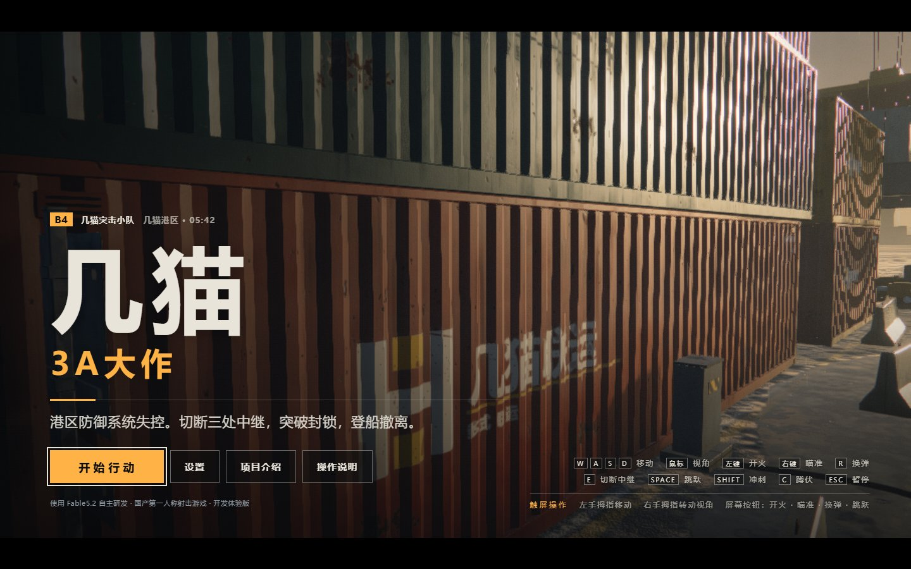

# 几猫国产3A大作 V1 · 港区突围

> **Codex + GPT-6.1 Sol**

本次完成原作解析、本机运行与可编辑工程准备、验证和案例发布。上述署名与耗时仅指本次工作，不代表原作生成信息。原作制作耗时未记录；页面内的“Fable5.2”是原作自述，未据此推定 Agent 或模型。

**原始 `几猫国产3A大作_V1.html` 保持不变；发布入口 `index.html` 与原文件逐字节一致。** 未优化玩法、数值、画质或源文件。SHA-256：`9e55b5200b088adaf8e1152da04efc0d3b25e236e6baf2dee96f81e23e084966`。

- 在线游戏：<https://wangxp7.github.io/GoodCase.xAI/codex/gunking/index.html>
- [详细技术解析](技术解析.html)
- [验证记录](validation.json)
- [本次工作记录与耗时](case-meta.json)

## 本机运行

双击 **`启动.cmd`**。已有 Node.js 即可，不需要 npm install，不需要联网。浏览器打开 `http://127.0.0.1:8765/`，关闭终端或按 Ctrl+C 停止服务。

也可手动运行：

```powershell
node tools/build.mjs
node tools/serve.mjs --open
```

低画质排查入口：`http://127.0.0.1:8765/?q=low`。基准巡览：`?q=low&bench=1`。画面需要支持 WebGL2 的浏览器和显卡驱动。原作自身是单文件无外链，但本次主要验收走 HTTP。

## 文件与后续修改入口

| 文件 | 用途 |
|---|---|
| `几猫国产3A大作_V1.html` | 本地原始文件，保留不改 |
| `index.html` | 原作逐字节副本，线上及本机默认入口 |
| `src/game.js` | 从内嵌 bundle 提取、仅展开格式的游戏代码副本，约 3.7 万行 |
| `src/ui.css`、`src/page.html` | 提取出的界面样式副本和页面模板 |
| `vendor/three-r180.js` | 原包内提取的 Three.js r180 运行时，保留压缩名称 |
| `vendor/THREE-LICENSE.txt` | 官方 r180 MIT 许可 |
| `tools/build.mjs` | 默认校验原文件哈希并复制发布入口；`--check` 只校验 |
| `tools/serve.mjs` | 无额外依赖、本机回环地址 HTTP 服务 |
| `技术解析.html` | 架构、代码定位、参数、运行机制与优化建议 |
| `shots/`、`validation.json` | 本次验收图与结果 |
| `case-meta.json` | 本次 Agent、模型、范围与耗时 |

**本轮停在可修改阶段，尚未进行优化。** 若以后授权修改，编辑 `src/` 副本后运行 `node tools/build.mjs --editable`，只生成独立的 `editable.html`，不会覆盖原作和默认发布入口。然后打开 `http://127.0.0.1:8765/editable.html`。

这些文件是从构建产物恢复的可读副本，**没有恢复原始变量名、源目录、TypeScript 或 source map**。游戏与运行时共享词法作用域，必须按构建脚本顺序拼接，不能把 `src/game.js` 作为独立 ES Module 加载。直接修改 `index.html` 不会反向同步到副本，并会被默认构建恢复为原始字节。

## 玩法与验证边界

WASD 移动，鼠标环视，左键开火、右键瞄准，R 换弹，按住 E 切断中继，Space 跳跃、Shift 冲刺、C/Ctrl 蹲伏、F 近战，Esc/P 暂停。鼠标捕获失败时可用方向键/IJKL 转向、Enter 开火。切断堆场、仓库、码头三处中继后前往撤离艇。

已通过的详细检查见 `validation.json`。真实键鼠验证了移动、备用开火、换弹、暂停和 E 交互；撤离、死亡、重试部分结合原作调试接口验证。桌面与移动模拟不等于实体手机验收，禁音测试不等于声音已实听验收，瞬时 FPS 不代表正式性能基准。


