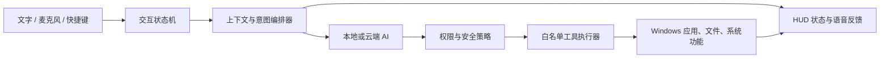
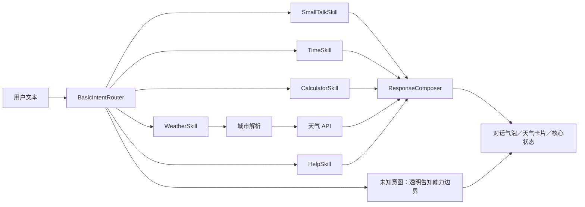

# JARVIS Windows 桌面 AI 项目主记录

> 当前文档版本：`v0.3.1+publication.20261015`  
> 当前可执行版本：`v0.3.0`  
> 当前项目阶段：阶段 2 已完成；阶段 2.5／轻量基础对话增强方案待用户批准  
> 建立日期：2026-07-31  
> 最后更新：2026-10-15  
> 文档性质：唯一主记录；后续每次迭代均同步更新版本号、变更日志、交付物与验收结论。

## 1. 版本管理规则

- `v0.1.0`：调研、范围、架构与实施计划获批。
- `v0.1.1`：四套首版完成；记录用户对 Demo A 的首次定向精修。
- `v0.2.0`：四套视觉 Demo 首版完成并通过结构检查。
- `v0.2.1`：用户批准推荐混合方案并授权进入动态视觉 EXE 原型阶段。
- `v0.2.2`：完成构建环境审计并确定工作区便携式 SDK 策略。
- `v0.2.x`：视觉方案定向修订，每次修订递增补丁版本。
- `v0.3.0`：动态视觉 EXE 原型完成。
- `v0.3.1`：轻量基础对话增强方案完成并进入审批点；不修改 `v0.3.0` EXE。
- `v0.3.2`：轻量基础对话预览版完成（批准后实施）。
- `v0.4.0`：文字 AI 助手核心完成。
- `v0.5.0`：语音和 Windows 安全工具完成。
- `v0.9.0`：发布候选版完成。
- `v1.0.0`：最终验收版。

版本号遵循语义化思路：阶段性成果提升次版本，单轮修订提升补丁版本；正式验收后进入 `v1.0.0`。

## 2. 当前批准记录

用户于 2026-07-31 批准：

1. 按推荐方案实施。
2. 第一阶段先制作四张图片 Demo。
3. 项目过程、方案、输出、路径、验收结果全部记录在 Markdown 中。
4. 每次迭代必须同步迭代本主记录，并用版本号跟进。

用户随后批准推荐混合方案：B 作为主框架，A 作为中心核心与待机页，C 作为桌面悬浮模式，D 作为系统诊断页，并明确授权进入阶段 2 动态视觉 EXE 原型。阶段 2 已于 2026-08-01 完成；阶段 3 的真实 AI、语音识别和 Windows 系统操作尚未启动，需在本轮视觉交互验收后另行批准。

用户于 2026-08-01 提出：在不过度复杂化的前提下，考虑加入天气等基础人工智能对话。本轮仅完成可行性分析、范围控制、技术方案与验收标准并写入 `v0.3.1` 主记录；为遵守“先计划、确认后动手”，尚未修改源码或重新发布 EXE。

## 3. JARVIS 调研结论

J.A.R.V.I.S. 全称为 “Just A Rather Very Intelligent System”。Marvel 官方设定中，它最初是 Tony Stark 创建的自然语言交互系统，随后参与盔甲设计、运行 Iron Man 装甲，并逐步发展成更完整的人工智能；其残存系统后来成为 Vision 的组成基础。

主要资料：

- [Marvel 官方 Vision 档案](https://www.marvel.com/characters/vision/on-screen)
- [MCU Wiki：J.A.R.V.I.S.（二级资料）](https://marvelcinematicuniverse.fandom.com/wiki/J.A.R.V.I.S.)

### 3.1 从影视设定到真实产品

| 影视特征 | Windows 产品对应实现 |
|---|---|
| 自然语言交互 | 中文／英文文字与语音对话 |
| 随时可用 | 全局快捷键、系统托盘、迷你悬浮窗 |
| 监测装甲和环境 | CPU、内存、网络、电池、磁盘等电脑状态 |
| 分析信息 | AI 推理、摘要、检索和文件问答 |
| 控制设备和系统 | 打开应用、调节音量、计时、通知等安全操作 |
| 主动提醒 | 日程、计时、系统异常和任务状态提醒 |
| 冷静、略带幽默 | 原创人格、简洁回答和明确状态反馈 |
| 全息交互感 | 动态核心、扫描环、粒子、波形和数据面板 |

### 3.2 产品定义

本项目不是电影界面复刻，也不是静态皮肤聊天框，而是一个具备以下特征的原创 Windows AI 助手：

- 界面状态与真实任务状态一致。
- 既能对话，也能在权限范围内完成电脑任务。
- 所有系统操作均经过安全策略和参数验证。
- 高风险操作必须显式确认。
- 离线时仍保留基础桌面助手能力。

## 4. V1 产品范围

### 4.1 必做功能

- 全屏“指挥中心”主界面。
- 可折叠桌面悬浮核心。
- 中文优先、兼容英文的文字对话。
- 按键说话；唤醒词后置为可选能力。
- 待机、聆听、识别、思考、确认、执行、完成、警告八种视觉状态。
- 时间、日期、CPU、内存、磁盘、网络和电池状态。
- 打开已授权的应用、文件夹和网站。
- 音量控制、媒体控制、计时器、提醒和便签。
- 本地对话历史和偏好设置，可关闭并一键清除。
- 全局快捷键、系统托盘和开机启动开关。
- 可替换的本地 AI／云端 AI 接口。
- 权限中心和操作审计记录。
- 无网络或 AI 服务不可用时仍能正常启动和使用基础工具。

### 4.2 V1 暂不包含

- 任意 PowerShell、CMD 或脚本执行。
- 无确认删除文件、安装软件、关机或修改系统设置。
- 自动发送邮件、消息、付款或发布内容。
- 摄像头人脸识别和持续屏幕监控。
- 默认持续监听麦克风。
- 智能家居和手机远程控制。
- Paul Bettany 声音克隆。
- Marvel、Avengers、Iron Man 标志、电影截图、装甲模型或电影音效。

## 5. 阶段 1：四套视觉 Demo

### 5.1 Demo A：Orbital Core／轨道核心

- 全屏深色界面。
- 中央多层旋转“认知核心”。
- 环绕语音波形、系统状态和任务轨道。
- 强调第一眼视觉冲击和待机仪式感。

最终文件：`design/demo-pack-v0.2.0/JARVIS_DEMO_A_ORBITAL_CORE.png`

#### Demo A 用户定向精修记录（v0.1.1）

用户针对图像 1 指定：

1. 中央核心以圆形为基础，但不要保持光滑正圆；表面增加起伏波浪纹，强化维度和纵深。
2. 左上声纹加大，使其成为更明显的聆听状态反馈。

本轮实际处理：

- 中央核心改为大体球形、轮廓具有不规则波峰和凹谷的多层波动体。
- 表面加入发光波面、拓扑等高线、脊线和谷线，强化前后层次。
- 左上声纹扩大、加粗、提亮，并增加振幅变化。
- 同时保留之前完成的去品牌底栏和原创六节点导航图标。
- 最终文件：`design/demo-pack-v0.2.0/JARVIS_DEMO_A_ORBITAL_CORE.png`。
- 原始稿与去品牌中间稿均非破坏性保存在 `design/archive/v0.1.0-drafts/`。

### 5.2 Demo B：Glass Command Deck／玻璃指挥台

- 三栏式生产力界面。
- 中间为对话与任务流，左右为电脑状态、上下文和工具。
- Mica 感半透明卡片与蓝青色光带。
- 强调炫酷程度和日常实用性的平衡。

最终文件：`design/demo-pack-v0.2.0/JARVIS_DEMO_B_GLASS_COMMAND_DECK.png`

### 5.3 Demo C：Ghost Overlay／幽灵悬浮层

- 桌面常驻迷你模式。
- 无边框悬浮核心、实时声波和少量状态信息。
- 通过快捷键或点击展开完整控制台。
- 强调长期使用、低干扰和 Windows 桌面融合。

最终文件：`design/demo-pack-v0.2.0/JARVIS_DEMO_C_GHOST_OVERLAY.png`

### 5.4 Demo D：Tactical Focus／战术聚焦模式

- 高密度扫描线、目标节点、数据拓扑和警报状态。
- 用于复杂任务、系统扫描或演示场景。
- 视觉冲击最强，但需保持信息层级和可读性。

最终文件：`design/demo-pack-v0.2.0/JARVIS_DEMO_D_TACTICAL_FOCUS.png`

### 5.5 图片约束与验收

- 四张独立横屏 PNG。
- 另制作一张四方案对比总览图。
- 所有方案为高完成度产品 UI Mockup，不做低保真线框图。
- 原创界面，不复制电影镜头、专有 HUD、人物、装甲或品牌标志。
- 不出现 Avengers、Iron Man、Stark Industries、Marvel 等标识。
- 可使用项目工作名 `JARVIS`，但不使用影视专属字标。
- 最终 EXE 使用矢量和实时渲染代码重建，概念图不直接铺作静态界面。
- 逐张检查主题、布局、文字错误、视觉层级、版权约束、尺寸和文件完整性。

## 6. 技术路线

### 6.1 推荐技术栈

- C# 14。
- .NET 10 LTS。
- WinUI 3／Windows App SDK。
- Win2D 与 Windows Composition 作为后续高阶动态渲染候选。
- SQLite 本地配置与历史。
- Windows Credential Manager／DPAPI 保存密钥。
- 模块化 AI、语音和工具接口。

资料依据：

- [.NET 官方支持信息](https://dotnet.microsoft.com/en-us/download/dotnet)
- [Windows 应用开发文档](https://learn.microsoft.com/en-us/windows/apps/)
- [Win2D 概览](https://learn.microsoft.com/en-us/windows/apps/develop/win2d/in-a-core-app)
- [WebView2 for WinUI 3](https://learn.microsoft.com/da-dk/microsoft-edge/webview2/platforms/winui3-windows-app-sdk)

WinUI 3 作为原生窗口和交互框架；后续可由 Win2D／Windows Composition 承担更复杂的核心、粒子和动态图表。`v0.3.0` 为降低依赖并优先保证 Windows 10 可运行性，实际采用 WinUI XAML Shapes、`DispatcherQueueTimer` 和代码生成路径完成核心、波形、扫描及拓扑动画，没有引入 Win2D。WebView2 仅作为未来可选网页内容容器，不作为透明 HUD 的主渲染核心。

`v0.3.0` 实际构建版本：.NET SDK `10.0.302`、.NET Runtime `10.0.10`、`Microsoft.WindowsAppSDK 1.8.260317003`（解析到 WinUI 子包 `1.8.260224000`）、`Microsoft.Windows.SDK.BuildTools 10.0.26100.7705`，目标为 `net10.0-windows10.0.19041.0 / win-x64`。

### 6.2 AI 架构



- 云端模式：质量和复杂任务能力优先，由用户自行配置密钥。
- 本地模式：隐私和离线优先，可接入 Foundry Local。
- 混合模式：本地处理常规任务，复杂推理由云端完成。

资料：[Foundry Local 官方文档](https://learn.microsoft.com/en-us/windows/ai/foundry-local/get-started)

### 6.3 语音与发布

第一版默认采用按键说话。Windows 内置 `SpeechRecognizer` 要求应用具有包身份，因此计划交付：

- `JARVIS.exe`：可直接双击运行的自包含版本。
- `JARVIS-Setup.exe`：推荐正式版，注册应用身份和所需组件，支持更完整的麦克风权限、通知、开机启动和 Windows AI 能力。

资料：

- [Windows Speech Recognition](https://learn.microsoft.com/en-us/windows/apps/develop/input/speech-recognition)
- [外部位置应用身份说明](https://learn.microsoft.com/en-us/windows/apps/desktop/modernize/grant-identity-to-nonpackaged-apps)

## 7. 分阶段实施计划

| 阶段 | 工作内容 | 主要交付物 | 审批点 |
|---|---|---|---|
| 0 | 调研、范围和技术路线 | 本主记录 `v0.1.0` | 已批准 |
| 1 | 四套视觉探索 | 4 张 Demo、总览图、视觉说明 | 已选择推荐混合方案 |
| 2 | 动态视觉原型 | `releases/v0.3.0/Jarvis.VisualPrototype.exe` | 已完成，等待用户运行验收 |
| 3 | 助手核心 | 文字对话 Alpha EXE | 用户确定 AI 模式 |
| 4 | 语音与电脑工具 | 功能完整 Beta EXE | 用户批准操作权限 |
| 5 | 安全与稳定性 | Release Candidate | 用户试用反馈 |
| 6 | 发布 | EXE、安装器、源码和验收报告 | 最终验收 |

## 8. 安全与隐私

### 8.1 操作等级

| 等级 | 示例 | 规则 |
|---|---|---|
| 安全 | 打开计算器、查看时间、调整界面 | 可直接执行 |
| 需确认 | 打开指定文件、截图、修改音量、启动外部程序 | 首次或敏感情境确认 |
| 禁止／高风险 | 删除、安装、关机、注册表、管理员命令 | V1 默认禁止 |

### 8.2 强制要求

- 日常运行不申请管理员权限。
- AI 不得构造或执行任意 Shell 命令。
- 每项工具使用固定参数模型和路径校验。
- 执行前能查看动作描述。
- 密钥不写入源码、普通配置文件或日志。
- 麦克风工作时必须有明显视觉指示。
- 本地记录可关闭、导出和彻底清除。
- 屏幕或文件读取必须明确授权具体范围。

## 9. 原创与版权边界

本项目当前按私人原型设计。Marvel 明确说明其数字内容受著作权、商标及其他知识产权保护。

资料：[Marvel 使用条款](https://www.marvel.com/corporate/license_tou)

- 借鉴智能管家、环形 HUD、冷静 AI 等抽象体验。
- 不复制电影画面、标志、装甲、角色肖像或原版音效。
- 不克隆 Paul Bettany 的声音。
- 使用原创图标、原创核心结构和原创提示音。
- 声音可表现为沉稳、克制、礼貌的科技管家，但不得冒充具体演员。
- 如公开或商业发布，需更换或复核正式名称并单独进行知识产权审查。

## 10. 质量验收标准

- `v0.3.0` 最低目标为 Windows 10 build 19041 x64，已在 Windows 10 build 19045、125% DPI 完成运行验证；正式版仍需补齐 Windows 11 与完整 DPI／硬件矩阵。
- 100%、125%、150%、200% DPI 下布局正常。
- 支持 1366×768 至 4K 分辨率。
- 支持窗口、全屏和迷你悬浮模式。
- 动画目标 60 FPS；低功耗模式自动降至 30 FPS。
- UI 空闲 CPU 平均目标不高于 3%，不包括本地大模型进程。
- 无 AI、无网络或拒绝麦克风权限时仍能正常启动。
- 危险操作不得绕过确认策略。
- 测试首次启动、升级、卸载、断网、服务超时、睡眠唤醒和多显示器。
- 发布物执行依赖审计、许可证检查和 SHA-256 校验。
- 无代码签名证书时，明确说明 EXE 可能触发 SmartScreen，不虚称已签名。

## 11. 项目目录规划

```text
D:\68.AIGC\JARVIS\
├─ JARVIS_PROJECT.md                    唯一主记录
├─ design\demo-pack-v0.2.0\           四张最终图片 Demo
├─ design\contact-sheets\             对比总览图
├─ src\Jarvis.VisualPrototype\         阶段 2 WinUI 3 源码
├─ qa\runtime-captures\v0.3.0\        开发构建运行截图
├─ qa\published-smoke\v0.3.0\         最终发布包冒烟记录与截图
├─ build\                              可复现构建、图标和发布脚本
├─ releases\v0.3.0\                   可直接运行的完整目录版
├─ releases\archive\                  非破坏性保留的失败／被替换发布尝试
└─ releases\JARVIS.VisualPrototype-v0.3.0-win-x64.zip
```

## 12. 当前任务清单

- [x] 第一轮 JARVIS 设定与技术路线调研。
- [x] 完整实施计划获批。
- [x] 建立版本化主记录 `v0.1.0`。
- [x] 生成 Demo A：Orbital Core。
- [x] 按用户反馈精修 Demo A 的波浪核心和声纹。
- [x] 生成 Demo B：Glass Command Deck。
- [x] 移除 Demo B 中自动生成的第三方品牌图标。
- [x] 生成 Demo C：Ghost Overlay。
- [x] 生成 Demo D：Tactical Focus。
- [x] 逐张视觉检查并按需定向修订。
- [x] 制作四方案对比总览图。
- [x] 将四张最终图统一规范化为 2560×1440 PNG。
- [x] 核验尺寸、格式、哈希和记录完整性。
- [x] 将本主记录升级为 `v0.2.0`。
- [x] 用户批准推荐混合方案：B 主框架 + A 核心 + C 悬浮模式 + D 诊断页。
- [x] 审计 Windows 与 .NET 构建环境。
- [x] 创建动态视觉原型工程。
- [x] 实现四种视觉模式与状态动画。
- [x] 发布可直接运行的自包含 EXE。
- [x] 完成发布包运行、五视图截图、交互冒烟、结构和文件哈希验证。
- [x] 将本主记录升级为 `v0.3.0`。

阶段 2 不以真实性能基准为交付门槛；CPU、内存、FPS、不同 DPI／多显示器和 Windows 11 的量化基准保留到阶段 5 安全与稳定性测试，不能把当前“运行流畅且窗口响应正常”的观察等同于性能达标。

阶段 2.5／轻量基础对话增强：

- [x] 明确天气、时间、日期、计算、帮助和轻量闲聊的最小范围。
- [x] 完成无大模型依赖的自然语言路由与天气服务方案。
- [x] 完成 UI、隐私、异常处理和验收标准设计。
- [ ] 用户批准 `v0.3.2` 轻量基础对话预览版实施。
- [ ] 批准后开发、测试并发布 `v0.3.2` EXE／ZIP。

## 13. 阶段 1 交付与验收

### 13.1 最终文件清单

| 方案 | 最终文件 | 尺寸 | 格式 | 字节数 | SHA-256 |
|---|---|---:|---|---:|---|
| A／Orbital Core | `design/demo-pack-v0.2.0/JARVIS_DEMO_A_ORBITAL_CORE.png` | 2560×1440 | PNG／24-bit RGB | 4,918,541 | `F2D65D9AE2CA2213460D844201B40DAFDC5BC3CC71CDF83BFCB7C49BD393F787` |
| B／Glass Command Deck | `design/demo-pack-v0.2.0/JARVIS_DEMO_B_GLASS_COMMAND_DECK.png` | 2560×1440 | PNG／24-bit RGB | 4,051,373 | `69D0AACECEDF12C75DE355C70BEF3B0845CF350893F54B54BEB2ACC6E2FE7EB8` |
| C／Ghost Overlay | `design/demo-pack-v0.2.0/JARVIS_DEMO_C_GHOST_OVERLAY.png` | 2560×1440 | PNG／24-bit RGB | 3,563,317 | `FF1D930FF4F5855DA8407F22744160E5AFD6C48B7DD78A6B32BCE46E29234E27` |
| D／Tactical Focus | `design/demo-pack-v0.2.0/JARVIS_DEMO_D_TACTICAL_FOCUS.png` | 2560×1440 | PNG／24-bit RGB | 3,814,234 | `F07055EB933CB28967EBC75D0E6CF80DD35C4900AC98B6C5AAB4DFFB911DB951` |
| 四图总览 | `design/contact-sheets/JARVIS_DEMO_CONTACT_SHEET_v0.2.0.png` | 2560×1640 | PNG／32-bit ARGB | 4,938,833 | `C7F7505184AEDEAAD5CAC0532AA725E07270B68A6D4970E1751103B19392500A` |

### 13.2 可复现处理工具

- `build/Normalize-DemoImages.ps1`：把内置 imagegen 原生输出统一规范化为 2560×1440 PNG。
- `build/Create-ContactSheet.ps1`：从四张最终图生成带方案名称的 2×2 总览图。
- 原生尺寸输出保存在 `design/archive/v0.1.1-native-output/`。
- 被替换的 A、B 稿件保存在 `design/archive/v0.1.0-drafts/`。

### 13.3 视觉验收结论

| 方案 | 最强项 | 适合落地位置 | 当前结论 |
|---|---|---|---|
| A | 仪式感、AI 核心、聆听反馈 | 启动画面、待机主页、语音状态 | 已按用户反馈增强波浪维度与声纹；通过 |
| B | 信息层级、实用性、可扩展性 | 日常主界面 | 已移除第三方品牌图标；通过 |
| C | 低干扰、桌面融合、常驻感 | 迷你悬浮模式 | 结构清晰；通过 |
| D | 系统诊断、数据密度、权限提示 | 深度诊断／任务分析页 | 高密度但仍可读；通过 |

推荐组合不是四选一，而是：**B 作为主框架，A 作为中心核心与待机页，C 作为桌面悬浮模式，D 作为系统诊断页面。** 用户仍可指定单一方案或其他混合比例。

### 13.4 已知说明

- 图片是 UI 概念稿，不是运行截图；日期、文件名、负载值和系统服务名均为演示数据。
- 正式 EXE 中所有数值和状态必须来自真实数据源，并由代码渲染。
- 概念稿中的细小文字不会直接进入产品；正式实现按 DPI 和无障碍标准重新排版。
- 本条为阶段 1 历史状态：截至 `v0.2.0` 尚未生成或运行 EXE；阶段 2 已在 `v0.3.0` 完成可运行原型。当前原型中的负载和事件仍为明确标注的本地模拟数据，不代表已经接入真实系统遥测或 AI。

### 13.5 imagegen 生产提示词记录

生成模式：内置 `imagegen`；没有使用 CLI 回退，没有使用用户 API 密钥。

#### A／Orbital Core 基础提示词

```text
Use case: ui-mockup. High-fidelity 16:9 Windows desktop AI assistant interface named Orbital Core. Create a polished full-screen command center with an original abstract cognitive core, asymmetrical orbital rings, voice waveform, task status, clock, CPU, memory, network and battery widgets. Use realistic shippable product UI, crisp vector-like HUD graphics, subtle 3D glass depth, obsidian/cyan/cobalt palette and restrained bloom. Show JARVIS, SYSTEM ONLINE, LISTENING, CPU 24%, MEMORY 41%, NETWORK SECURE and 19:04. No humans, armor, helmet, weapons, arc reactor, superhero imagery, Marvel/Avengers/Iron Man/Stark branding, copied film HUD or watermark.
```

#### A／去品牌修订提示词

```text
Remove the recognizable Windows taskbar and branded application icons. Extend the JARVIS application to the bottom edge and replace the taskbar with an original in-app command dock using generic line icons. Replace the Windows-like navigation symbol with an original six-node grid. Change the clock panel date to Thursday, July 31, 2026. Preserve the central core, panels, orbital rings, colors, typography and all other layout details.
```

#### A／用户反馈精修提示词

```text
At x=50.7%, y=41.3%, keep the central intelligence core roughly spherical but not a smooth perfect circle. Add irregular wave-shaped bulges and indentations, layered luminous wave sheets, topographic ripples, ridges, valleys and stronger depth separation. At x=16.6%, y=21.1%, enlarge the cyan voice waveform to about 1.8 times its visual height and 1.35 times its width; make it brighter, thicker and more varied while keeping LISTENING readable. Change only these two areas and preserve the full interface.
```

#### B／Glass Command Deck 基础提示词

```text
Use case: ui-mockup. High-fidelity 16:9 Windows AI assistant dashboard named Glass Command Deck. Use a three-column layout: central conversation and task plan, left agenda/recent work/tools, right system health/context/automations/privacy. Apply native Windows design sensibility, Mica-like glass, crisp vector icons, graphite/midnight/cyan/cobalt palette and practical daily-use spacing. Show JARVIS, COMMAND DECK, Good evening, How can I assist?, TODAY, SYSTEM HEALTH, PRIVACY ON and Ask anything. No humans, armor, weapons, arc reactor, superhero imagery, franchise branding, copied film HUD or watermark.
```

#### B／无品牌精修提示词

```text
Replace Outlook, Teams, OneDrive, Notion, Photoshop, VS Code and Spotify with original generic icons labeled MAIL, MEETINGS, CLOUD, NOTES, IMAGE, CODE and MUSIC. Replace OneDrive and SharePoint sources with Cloud Files and Team Files. Replace branded document icons with neutral file icons. Replace the branded taskbar with a minimal unbranded system dock. Preserve the three-column layout, colors, waveform, central glyph, text hierarchy and glass treatment.
```

#### C／Ghost Overlay 提示词

```text
Use case: ui-mockup. High-fidelity 16:9 Windows desktop screenshot demonstrating a compact always-on-top AI overlay. Place a small translucent layered cognitive lens in the upper-right with incomplete orbit arcs, live cyan waveform, one concise response card, microphone/privacy indicators, system strip and Ctrl + Space hint. Keep most of the desktop unobstructed with generic unbranded productivity windows. Show JARVIS, LISTENING, Ready when you are., MIC ON, PRIVACY LOCAL and Ctrl + Space. No brand logos, humans, armor, weapons, arc reactor, franchise imagery, copied film HUD or watermark.
```

#### D／Tactical Focus 提示词

```text
Use case: ui-mockup. High-fidelity 16:9 defensive system-diagnostics workspace named Tactical Focus. Show an original computer-service topology map, data flows, anomaly markers, dependency paths, resource graphs, AI reasoning timeline and permission-gated proposed action. Use crisp technical vector graphics, dark navy/cyan palette and selective amber warnings. Show JARVIS, TACTICAL FOCUS, SYSTEM DIAGNOSTICS, ANOMALY DETECTED, SAFE MODE READY, REVIEW ACTION and NO CHANGES APPLIED. No warfare, targeting people, world map, weapons, superhero imagery, franchise branding, copied film HUD or watermark.
```

## 14. 阶段 2：动态视觉 EXE 原型交付与验收

### 14.1 批准范围与交付结论

- 用户已批准推荐混合方案并授权进入动态视觉 EXE 原型阶段。
- 落地映射：B／Glass Command Deck 为常驻主框架，A／Orbital Core 为中心核心与待机主页，C／Ghost Overlay 为桌面悬浮模式，D／Tactical Focus 为系统诊断页。
- 阶段 2 已完成：源码、可直接运行的 Windows x64 自包含目录版、ZIP、五视图运行截图、自动冒烟记录、哈希和可复现脚本均已落盘。
- 本阶段只实现动态视觉、窗口、导航和本地模拟交互；未越权实现真实 AI、语音识别或 Windows 系统操作。

### 14.2 已实现的动态体验

- 原生 WinUI 3 三栏玻璃指挥台，包含左侧模式导航、中心动态工作区和右侧遥测／事件栏。
- Orbital Core 使用非光滑波浪轮廓、多层路径、轨道和脉冲动画，保留用户指定的“圆为基础但表面起伏、维度更强”的核心形象。
- 左上／主工作区声纹加粗、加大并持续动画，聆听状态更明显。
- 四种主模式可切换：`ORBITAL CORE`、`COMMAND DECK`、`GHOST OVERLAY`、`TACTICAL FOCUS`。
- 状态机演示可循环：`STANDBY → LISTENING → THINKING → EXECUTING → COMPLETE → ALERT`。
- 命令输入框可提交本地模拟命令并产生状态／事件反馈；界面明确标注 `SIMULATED`、未连接外部 AI、未执行系统操作。
- Ghost Overlay 除主窗口预览外，还可启动真实的独立置顶窗口；Windows 10 使用标准标题栏兼容回退，Windows 11 预留无边框路径。
- Tactical Focus 包含动画拓扑、输入／输出节点、脉冲路径、诊断信息和“审核后操作”的权限表达。

### 14.3 源码与实际技术基线

| 项目 | 实际值 |
|---|---|
| 源码工程 | `src/Jarvis.VisualPrototype/Jarvis.VisualPrototype.csproj` |
| 语言／运行时 | C# 14／.NET 10.0.10 |
| 构建 SDK | .NET SDK 10.0.302 |
| UI 框架 | WinUI 3／Windows App SDK `1.8.260317003` |
| 实际 WinUI 子包 | `Microsoft.WindowsAppSDK.WinUI 1.8.260224000` |
| Windows 构建工具 | `Microsoft.Windows.SDK.BuildTools 10.0.26100.7705` |
| 目标 | `net10.0-windows10.0.19041.0`、`win-x64` |
| 发布方式 | unpackaged、自包含、目录式 EXE |
| 动态渲染 | WinUI XAML Shapes、代码生成路径、`DispatcherQueueTimer`；未引入 Win2D |

关键源码：`App.xaml(.cs)`、`MainWindow.xaml(.cs)`、`MainPage.xaml(.cs)`、`OverlayWindow.xaml(.cs)`；应用图标为 `src/Jarvis.VisualPrototype/Assets/AppIcon.ico`。

### 14.4 最终发布物

| 交付物 | 路径 | 字节数 | SHA-256 |
|---|---|---:|---|
| 主程序 | `releases/v0.3.0/Jarvis.VisualPrototype.exe` | 330,752 | `5C7C989ECA5AD442201D7E886473F2650A9AF90304DF342C34E7DC397EC4059E` |
| Windows x64 ZIP | `releases/JARVIS.VisualPrototype-v0.3.0-win-x64.zip` | 87,270,799 | `3F56269CA27E39DF6428D2ADB32C970385F03BD0BE72F287F2FACEE87D7243A9` |
| 发布清单 | `releases/v0.3.0/release-manifest.json` | 1,180 | `F64E0AFFE13DA0701ACD0463934DCB45E0C25869312E693763D5DC879C7F8602` |
| 校验文件 | `releases/SHA256SUMS-v0.3.0.txt` | 210 | 记录 EXE 与最终 ZIP 哈希 |

发布目录中的运行负载为 521 个文件、224,075,070 字节；该计数按清单字段定义，不包含 `release-manifest.json` 本身。完整目录含清单共 522 个文件、224,076,250 字节。目录已确认包含 `Jarvis.VisualPrototype.pri`、`App.xbf`、`MainWindow.xbf`、`MainPage.xbf`、`OverlayWindow.xbf` 和 `Assets/AppIcon.ico`。

### 14.5 最终运行与交互验证

验证环境：Windows 10 build `19045`、125% DPI、x64、.NET Runtime `10.0.10`。

| 验证项 | 结果 |
|---|---|
| Release x64 构建 | 通过，0 warnings／0 errors |
| 最终发布目录正常启动 | 通过；窗口启动后持续存活并响应，观察 4 秒后仅终止本次测试进程 |
| `--qa-capture` 自动冒烟 | ExitCode 0 |
| 四页导航 | `passed` |
| 状态循环 | `passed` |
| 命令输入 | `passed` |
| 独立 Overlay 创建 | `passed` |
| 五张运行截图 | 已生成并逐张目检通过 |
| 发布包启动日志错误扫描 | 0 个错误匹配 |
| 数据边界 | `SIMULATED`；`external_ai_connected=false`；`system_actions_applied=false` |

自动验收记录：`qa/published-smoke/v0.3.0/qa-capture-complete.txt`；启动日志：`qa/published-smoke/v0.3.0/release-startup.log`。

### 14.6 发布包运行截图

| 截图 | 尺寸 | 字节数 | SHA-256 |
|---|---:|---:|---|
| `qa/published-smoke/v0.3.0/01_ORBITAL_CORE.png` | 1582×913 | 301,863 | `64EBAD123F18423828C89D5BDAF6DF6E44D58E626F9F89E9B793E993FBFA1417` |
| `qa/published-smoke/v0.3.0/02_COMMAND_DECK.png` | 1582×913 | 148,633 | `D71FF763F1886AEC709BD8FDFC6894199878D313A8EB4456C9524852A8125F87` |
| `qa/published-smoke/v0.3.0/03_GHOST_OVERLAY.png` | 1582×913 | 149,775 | `391197CC13060153DEB09A6FCD06C301151342D46525949A0A40253F6126C8A3` |
| `qa/published-smoke/v0.3.0/04_TACTICAL_FOCUS.png` | 1582×913 | 165,265 | `69813666B1B59B93EA40ECF6967A50D4584142378B20177004341BE108577738` |
| `qa/published-smoke/v0.3.0/05_LIVE_OVERLAY_WINDOW.png` | 522×263 | 30,683 | `3D8876794ED7677D99280C516F8DA6A81BB9D4101E6E075247523E9A17A203FF` |

目检重点包括：核心波浪轮廓和声纹可见性、导航层级、诊断页 INPUT／OUTPUT 完整显示、Overlay 垂直尺寸、输入框占位文字和 Windows 10 标题栏兼容性；最终截图均通过。

### 14.7 构建／运行问题与修复记录

- 首次运行曾因同一个 WinRT `PointCollection` 同时赋给两条 `Polyline` 而触发 `ArgumentException`；改为各自独立集合后修复。
- `dotnet publish` 的单文件尝试遗漏应用 XBF／PRI 资源并导致 XAML 初始化失败，已非破坏性归档到 `releases/archive/v0.3.0-singlefile-failed/`。
- 关闭单文件后，标准 `dotnet publish` 仍遗漏应用自身 XBF／PRI，已归档到 `releases/archive/v0.3.0-dotnet-publish-missing-xbf-failed/`。最终版由已验证的自包含 Release 输出组装，完整保留依赖和 XAML 资源。
- 125% DPI 下诊断拓扑和 Overlay 曾出现裁切；通过扩大逻辑画布、调整节点坐标并把 Overlay 调整为 540×310 逻辑像素修复。
- 输入框占位文字对比度、日期区域性格式、启动事件时间文案和应用图标均已修订。
- Windows GUI 辅助检查工具能枚举窗口，但对本机 WinUI 3 窗口截图返回 `SetIsBorderRequired failed: 不支持此接口 (0x80004002)`。这属于辅助工具与 Windows 10／WinUI 窗口的兼容限制，不是应用启动失败；因此最终使用应用内 `RenderTargetBitmap` QA 模式生成真实运行截图，并辅以进程响应与日志验证。
- 发布清单现已明确使用 `payload_*` 字段表示“不含清单自身”的负载计数，随后重新生成最终 ZIP 和校验文件，避免自引用统计歧义。

### 14.8 已知限制与后续边界

- 当前是动态视觉 EXE 原型，不是完整 AI 助手；遥测、事件和命令结果均为本地模拟。
- 尚未接入语言模型、语音识别、真实系统状态、系统托盘、全局快捷键、开机启动或 Windows 操作执行器。
- 尚未制作安装器或申请代码签名；Windows SmartScreen 可能显示未知发布者警告。
- 当前为目录式自包含应用：EXE 可直接双击，但必须与同目录依赖一起保留；跨电脑交付应使用完整 ZIP，不要只复制单个 EXE。
- 当前仅在 Windows 10 build 19045、125% DPI 完成发布包验证；Windows 11、100%／150%／200% DPI、多显示器和更多 GPU／硬件仍待后续矩阵测试。
- 尚未量化 CPU、内存或 FPS；“窗口正常响应”不是对 60 FPS／低 CPU 目标的正式证明。

### 14.9 运行方法与复现入口

1. 解压 `releases/JARVIS.VisualPrototype-v0.3.0-win-x64.zip`，保持目录结构完整。
2. 双击 `Jarvis.VisualPrototype.exe`。
3. 使用左侧四个模式入口切换页面；点击状态按钮循环演示状态；在底部输入框提交本地模拟命令；在 Ghost Overlay 页面启动独立置顶悬浮窗。

可复现入口：

- `build/Assemble-VerifiedRelease.ps1`：从已验证的自包含 Release 输出组装版本化目录，检查必需 XBF／PRI／图标，可选生成 ZIP 与哈希。
- `build/Create-JarvisIcon.ps1`：生成应用图标和预览。
- `.tools/dotnet/dotnet.exe build src/Jarvis.VisualPrototype/Jarvis.VisualPrototype.csproj -c Release -p:Platform=x64 --no-restore`：复现 x64 Release 构建。
- `Jarvis.VisualPrototype.exe --qa-capture <输出目录>`：运行四页导航、状态、输入和真实 Overlay 的自动截图冒烟流程。

### 14.10 未完成任务复核（2026-08-01）

- 在 `v0.3.0` 最终复核时，阶段 2 清单未勾选项为 0；`v0.3.1` 新增的两个未勾选项仅对应“等待用户批准”和“批准后实施”的阶段 2.5 新需求。
- 排除编译生成目录 `bin/`、`obj/` 后，人工维护的 `src/` 与 `build/` 中 `TODO`、`FIXME`、`NotImplementedException`、`NotSupportedException` 未完成标记：0。
- 最终复构建再次通过：0 warnings／0 errors。
- 复构建后的 EXE、DLL、PRI 与四个 XBF 均与 `releases/v0.3.0/` 对应文件逐项 SHA-256 一致，确认发布目录没有落后于当前源码构建。
- 发布清单负载计数、目录实际计数、EXE 哈希、ZIP 哈希、ZIP 522 个条目和必需 XBF／PRI／图标均复核一致；发布目录不存在遗留启动日志。
- 阶段 2 范围内无已知未完成任务。阶段 2.5 正停在新增审批点；阶段 3 及以后项目属于尚未获本轮授权的新阶段，不作为本次未完成项自动启动。

## 15. 阶段 2.5：轻量基础对话增强方案（待批准）

### 15.1 可行性结论与推荐方案

可以加入，而且无需立即引入大型语言模型。推荐 `v0.3.2` 先采用“本地自然语言意图路由 + 可验证技能 + 实时天气接口”的轻量混合方式：用户仍以自然语言提问，JARVIS 识别天气、时间、计算、帮助等意图，再调用对应技能生成结构化回答。

这一方案比直接把所有问题交给生成式模型更适合当前原型：包体变化小、无模型下载、无需默认配置 AI 密钥、回答可测试、天气数据可注明来源，而且不会误触系统操作。它属于基础智能助手能力，但不是开放领域生成式 AI；真正的大模型自由对话仍保留到 `v0.4.0`。

### 15.2 `v0.3.2` 建议支持的对话能力

| 能力 | 示例输入 | 预期输出 |
|---|---|---|
| 问候／轻量闲聊 | “你好”“你是谁”“谢谢” | 原创、简短的科技管家式回答 |
| 当前时间 | “现在几点”“北京时间” | 本机时间、时区和日期 |
| 日期／星期 | “今天星期几”“明天几号” | 精确日期与星期 |
| 当前天气 | “上海现在天气怎么样” | 天气、温度、体感温度、湿度、风速、更新时间 |
| 今日／明日天气 | “北京明天会下雨吗” | 高低温、降水概率、天气概况和简短提示 |
| 三日预报 | “深圳未来三天天气” | 三天结构化天气卡片 |
| 短上下文追问 | “杭州天气怎么样”→“明天呢” | 复用本轮城市与意图上下文 |
| 简单计算 | “125×24 等于多少” | 本地安全计算结果，不执行脚本 |
| 功能帮助 | “你现在能做什么” | 只列真实可用能力，不虚构系统控制 |
| 未支持问题 | “帮我写一篇论文” | 明确说明当前能力边界，不伪造答案 |

第一版默认中文，兼容常见英文表达，例如 `weather in Shanghai`、`what time is it`。

### 15.3 天气数据方案

候选天气服务为 Open-Meteo：

- 城市解析使用 `https://geocoding-api.open-meteo.com/v1/search`，支持城市名或邮编并返回经纬度、时区和行政区。
- 天气查询使用 `https://api.open-meteo.com/v1/forecast`，读取当前温度、体感温度、湿度、天气代码、风速、降水概率，以及每日最高／最低温。
- 官方文档：[Geocoding API](https://open-meteo.com/en/docs/geocoding-api)、[Weather Forecast API](https://open-meteo.com/en/docs)。
- 原型按非商业公共接口设计；如果未来商业发布，必须重新核对授权／额度或切换为用户指定的合规天气服务。

默认不请求 Windows 精确定位权限。用户可以在问题中指定城市，也可以在本地设置一个默认城市；城市重名时显示候选城市供选择。天气回答必须显示数据来源和更新时间，不把预测描述为确定事实。

### 15.4 处理架构



建议新增接口：

- `IConversationSkill`：所有基础技能的统一入口。
- `IWeatherService`：隔离外部天气供应商，便于模拟测试和未来替换。
- `ConversationContext`：只保留当前会话的城市、日期范围和上一个意图，支持“明天呢”一类短追问。
- `ResponseComposer`：把结构化结果转换为文字气泡、天气卡片和状态动画。
- `IAiChatProvider`：仅预留接口，`v0.3.2` 默认不连接生成式模型；后续 `v0.4.0` 再接入本地／云端 AI。

### 15.5 UI 与状态联动

- Command Deck 中央区域从单条模拟反馈升级为滚动对话时间线。
- 天气结果使用紧凑卡片，显示城市、天气图标、温度、体感、湿度、风速、降水概率和更新时间。
- 输入后核心依次进入 `THINKING`，成功时进入 `COMPLETE`，断网／城市不明确时进入非危险的 `ALERT`。
- 右侧事件栏记录 `LOCAL INTENT`、`WEATHER REQUEST`、`CACHE HIT`、`OFFLINE FALLBACK` 等真实处理状态。
- Ghost Overlay 可以显示最近一条简短回答，但第一版不在悬浮窗内展开完整聊天记录。

### 15.6 隐私、安全与异常处理

- 默认仅向天气服务发送用户明确输入的城市或解析后的经纬度，不上传完整聊天历史。
- 默认城市和轻量设置保存在本地；提供清除入口。
- 天气请求设置超时、取消和短时缓存；建议同城市数据缓存 10 分钟，减少重复请求。
- 断网、超时、服务错误时返回明确的离线提示，界面不得卡死或退出。
- 计算功能仅解析受限数字和运算符，不调用 PowerShell、CMD、脚本引擎或动态代码执行。
- 基础对话不得触发应用启动、文件修改、系统设置或其他 Windows 操作。
- 不确定答案必须说明“不支持／数据不可用”，不得用模板伪造实时天气。

### 15.7 明确不纳入 `v0.3.2`

- 开放领域知识问答和长文生成。
- 真实大语言模型推理、联网搜索或网页总结。
- 语音识别、语音合成和唤醒词。
- 文件、应用、音量、媒体或系统控制。
- 长期记忆、用户画像和跨会话上下文。
- 自动定位、持续后台天气推送或主动通知。

这些能力继续按原计划分别进入 `v0.4.0`、`v0.5.0` 及后续版本。

### 15.8 验收标准

- “你好”“现在几点”“今天星期几”“125×24”“你能做什么”五类本地请求在无网络环境仍可工作。
- “上海现在天气”“北京明天会下雨吗”“深圳未来三天”“杭州天气→明天呢”四类天气／上下文请求返回结构化结果。
- 城市不存在、城市重名、断网、HTTP 超时、API 错误和无返回数据均有可读提示，不崩溃。
- 天气回答显示城市、来源和更新时间；不得把缓存数据冒充实时数据。
- 自动测试使用可注入的模拟天气服务，保证不因外部网络波动产生假失败；另执行一次真实服务冒烟测试。
- 原有四种视觉模式、六态循环、独立 Overlay 和 Windows 10 兼容路径不得回归。
- Release x64 构建必须保持 0 warnings／0 errors，并重新完成运行截图、日志、结构与 SHA-256 验证。
- 新版本继续交付完整目录、ZIP、源码、QA 记录和更新后的本主记录。

### 15.9 版本与审批点

- 当前仅完成方案文档 `v0.3.1`；现有可执行文件仍是已验证的 `v0.3.0`。
- 推荐批准范围：本地轻量对话 + 实时天气，不接入生成式大模型，不增加系统操作权限。
- 用户明确批准后，开始开发并发布 `v0.3.2`。
- 如果用户要求真正的自由生成式对话，则改为启动 `v0.4.0`，并另行确认使用本地模型还是云端模型、密钥保存方式及费用边界。

## 16. GoodCase.xAI 案例集发布（2026-10-15）

- 用户授权将当前 JARVIS 成果上传到 `WangXP7/GoodCase.xAI`，并接入已启用的 `main / root` GitHub Pages。
- 上传方式为 GitHub API 增量写入；不 clone、不 fetch、不 pull，不把原仓库内容保存到本地。只在内存中读取站点首页及 README，用于保留既有格式。
- 保留原站深色卡片、工具命名空间和布局；只新增 Codex 下的 JARVIS 卡片，更新案例数量及对应说明。
- 案例入口：`https://wangxp7.github.io/GoodCase.xAI/codex/jarvis/`。
- 页面展示五张真实 EXE 运行截图，支持切换；公开源码、原始概念图、项目记录、QA 与哈希校验。
- 87,270,799 字节的 Windows ZIP 使用 GitHub Releases 分发，避免把 522 个运行依赖文件加入站点源码仓库。
- 当前可执行版本仍为 `v0.3.0`；天气等基础对话方案仍待批准，页面不宣称已实现。
- 中文案例入口为“贾维斯 JARVIS · Windows 动态视觉原型”；工具／模型字段只出现一次：`Codex + GPT-5.6 Sol / GPT-6.1 Sol`。
- 模型依据为本地原始会话日志 `turn_context.model` 字段；已核实 `gpt-5.6-sol` 与 `gpt-6.1-sol`，不根据工具默认配置推测模型。
- 本地保留 `showcase/index.html` 作为项目展示页源码、`build/Publish-GoodCase.py` 作为 API 发布入口；发布记录位于 `docs/GITHUB_PUBLICATION.json`。
- 发布验证结果在本节更新；所有本次临时 QA 文件与测试服务将在验证结束后清理，不创建临时 Git 仓库。

## 17. 变更日志

### v0.3.1+publication.20261015 — 2026-10-15

- 根据用户授权准备上传当前完整案例到 GoodCase.xAI 的 Codex 命名空间。
- 新增匹配原站视觉的静态展示页，提供五张运行截图、源码、文档与 Windows 下载入口。
- 使用 GitHub Git Data API 增量提交，Windows 二进制单独通过 Releases 发布，不下载原仓库到本地。
- 可执行功能与版本不变；本轮仅发布现有成果。

### v0.3.1 — 2026-08-01

- 根据用户提出的“天气等基础人工智能对话”需求，完成轻量对话增强可行性分析。
- 推荐本地意图路由 + 可验证技能 + 实时天气服务，不在本轮引入大型语言模型。
- 明确天气、时间、日期、简单计算、功能帮助、轻量闲聊和短上下文追问范围。
- 记录 Open-Meteo 城市解析／天气接口候选、UI 联动、隐私安全、异常处理和验收标准。
- 明确本轮仅更新方案与主记录；源码、EXE 和 `v0.3.0` 发布包均未改动，等待用户批准 `v0.3.2` 实施。

### v0.3.0 — 2026-08-01

- 完成获批的 B 主框架 + A 核心 + C 悬浮模式 + D 诊断页混合动态原型。
- 使用工作区便携式 .NET 10 SDK 构建 WinUI 3／Windows App SDK 自包含 x64 应用，Release 构建为 0 warnings／0 errors。
- 完成非光滑波浪核心、加大声纹、四页导航、六态循环、模拟命令反馈和真实独立置顶 Overlay。
- 修复 WinRT 路径集合复用崩溃、Windows 10 标题栏兼容、125% DPI 裁切、Overlay 高度、占位文字和日期格式。
- 记录两种 `dotnet publish` 资源缺失失败并保留归档；最终从验证通过的 Release 输出组装目录式自包含发布包。
- 完成最终发布目录启动、自动交互冒烟、五张运行截图、视觉目检、日志扫描、资源结构和 SHA-256 验证。
- 生成 `releases/v0.3.0/`、最终 ZIP、发布清单、校验文件及可复现发布脚本。
- 明确当前仍是模拟数据视觉原型，没有连接外部 AI，也没有执行系统操作。

### v0.2.2 — 2026-07-31

- 只读审计确认：系统已安装 .NET 6／8 运行时，但没有任何 .NET SDK。
- 未发现 Visual Studio、MSBuild、WinUI 项目模板或本地 Windows App SDK／Win2D NuGet 缓存。
- 当前沙箱身份无权通过 CIM 读取完整硬件资料；该项不影响建立视觉原型。
- 为避免管理员权限和系统级安装，决定把 .NET 10 SDK 安装到项目内 `.tools/dotnet/`，仅供本项目构建。
- 当时优先评估 WinUI 3 + Win2D 路线，并保留 WPF 代码原生渲染作为构建失败时的回退；最终 WinUI 3 构建成功，没有切换 WPF。
- `v0.2.2` 调研时记录的候选包版本已被实际模板解析结果取代；`v0.3.0` 最终固定为 Windows App SDK `1.8.260317003`（WinUI 子包 `1.8.260224000`），并以 WinUI 原生 Shapes／Timer 实现动态效果，未引入 Win2D `1.4.0`。

### v0.2.1 — 2026-07-31

- 用户正式批准推荐混合方案：B 作为主框架，A 作为中心核心与待机页，C 作为桌面悬浮模式，D 作为系统诊断页。
- 用户授权进入阶段 2：动态视觉 EXE 原型。
- 本阶段仅实现视觉、窗口模式、导航和本机演示数据；AI、语音识别与系统操作仍留在后续阶段。
- 开始前先执行只读环境审计，再根据实际可用工具链构建并验证 EXE。

### v0.2.0 — 2026-07-31

- 阶段 1 正式完成，主记录升级至 `v0.2.0`。
- 四张最终 Demo 统一规范化为 2560×1440 PNG，并提升至 `design/demo-pack-v0.2.0/`。
- 生成 2560×1640 的四方案对比总览图。
- 完成逐张视觉检查、尺寸检查、像素格式检查和 SHA-256 校验。
- 增加可复现的规范化与总览图 PowerShell 脚本。
- 将生成提示词、定向修订、用户反馈、文件路径、哈希和验收结论写入本主记录。
- 当前停在视觉选择审批点，未开始 EXE 编码。

### v0.1.1 — 2026-07-31

- 四套视觉 Demo 首版全部完成并保存到工作区。
- Demo B 已定向替换第三方应用图标、名称和品牌化任务栏，最终稿使用原创通用图标。
- 根据用户坐标反馈精修 Demo A：中央球体改为带波峰、凹谷和多层波面的非光滑核心，左上声纹显著放大。
- Demo A、Demo B 的被替换稿均移入 `design/archive/v0.1.0-drafts/` 留档，没有删除历史输出。
- 图片由内置 imagegen 模式生成和精修；尚未开始 EXE 编码。

### v0.1.0 — 2026-07-31

- 固化已批准的产品定位、V1 范围、技术路线和阶段计划。
- 增加四套图片 Demo 的明确设计目标、文件名和验收要求。
- 建立安全、隐私、原创和版权边界。
- 建立唯一主记录与后续版本递增规则。
- 当前尚未启动 EXE 编码。
