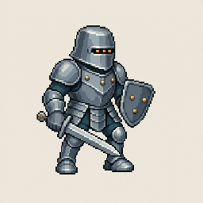
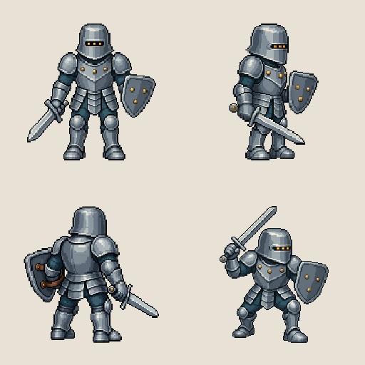

# 铁甲小兵「三灯铆卫」原创角色定妆与即梦提示词 V1.1

> 文档日期：2026-08-04  
> 角色编号：`TAS-01-RIVET-GUARD`  
> 当前状态：**定妆已通过 / 75% 身体填充锁定 / 动作脚本待二次审批**  
> 原创边界：采用“中世纪板甲步兵 + 像素风战斗单位”的通用题材，只吸收历史器物的功能结构，不复刻任何现成游戏角色、现成精灵图或商业 IP 的可识别造型。

## 0. 修订记录与本轮交付边界

### 0.1 V1.1 修订记录

- 2026-08-04：用户通过首张 Demo；
- 正式动画的直立身体填充度由 66% 提升为 **75%**；
- 角色根节点由 `(128,216)` 调整为 `(128,224)`，使 192 px 高的直立身体在画布中上下各保留约 32 px；
- 将“连贯、无跳帧、无卡顿、无错位”提升为全项目最高验收原则；
- V1.0 原文件保留，本文件作为后续生产唯一有效定妆主记录。

### 0.2 本轮交付边界

本轮已完成：

1. “像素风铁甲小兵”题材与生产方式调研；
2. 原创角色「三灯铆卫」的定妆锁定；
3. 可直接复制到即梦的定妆 Prompt、角色锁定块和负面约束；
4. 1 张持剑、持盾的 256×256 审批 Demo。

形象审批通过后，本阶段执行：

1. 其余约 4 张一致性参考图；
2. 约 5 个动作脚本与对应即梦 Prompt；
3. 提交动作脚本二次审批。

本阶段仍不执行每个动作的 4–12 帧动画序列；动作脚本获批后才进入逐帧生产。

## 1. 调研结论

### 1.1 题材与原创边界

公开检索中，“铁甲小兵”更像一个通用描述，并未找到一个名称、来源和标准形象都唯一明确的官方角色。检索到的同类像素骑士普遍集中在银灰板甲、封闭头盔、剑盾、披风、角盔等高频符号上。为了降低同质化和 IP 误认风险，本项目采用以下策略：

- 不使用角盔、长披风、王冠、铲形武器、昆虫面具、超大剑等高识别度组合；
- 不照搬任何搜索结果的轮廓、配色、姿势或逐帧结构；
- 只从公共领域历史甲胄中提炼“圆弧盔顶、窄视缝、护颈、胸甲折线、叠片手甲”等功能特征；
- 建立独立识别锚点：**三格琥珀视窗灯 + 三枚胸甲铆钉 + 三枚盾面铆钉 + 截角小盾**。

### 1.2 历史甲胄的可用形态语言

| 调研对象 | 可提炼结构 | 本角色中的像素化转译 |
|---|---|---|
| 约 1500–1510 年德式 Sallet 头盔 | 圆滑盔顶、狭窄视缝、后部护颈 | 低矮“橡果式”盔顶、单条黑色视窗、短后檐 |
| 约 1450 年 Kastenbrust 胸甲 | 胸腹体块明确、折线有结构感 | 胸甲中央仅保留一条倒 V 折脊，避免碎细节 |
| 15 世纪末叠片式连指手甲 | 大块叠片、手部轮廓坚固 | 三段式连指铁手套，动作时仍能读出握剑手 |
| 中世纪直刃剑 | 直护手、尖刃、清晰中轴 | 短阔双刃剑、直护手、六边形尾首，保证劈砍轨迹可读 |

历史参考只用于理解结构，不进行文物外观复刻。相关资料见文末“研究来源”。

### 1.3 像素角色与动画生产结论

- 256×256 是最终交付画布；内部采用 **64×64 逻辑像素网格，再以 4 倍最近邻放大**，这样既能保留大颗粒像素感，又给剑、盾和关节动作留下足够空间。
- 动画不能按每帧自动裁切；所有帧必须保留相同 256×256 画布、相同脚底基准点和相同角色缩放。
- 每个动作允许不同帧时长。准备、命中、停顿、回收不应被迫等时；Aseprite 本身支持逐帧时长、动画标签以及 PNG 序列/精灵表导出。
- 后续用于游戏引擎时，应使用 Point/Nearest 采样并关闭有损压缩，避免像素边缘被平滑。
- “连贯”不等于一味增加帧数；优先保证准备姿势、动作极值、接触帧、回收帧之间的重心与武器圆弧连续，再按复杂度在 4–12 帧内补间。
- 本项目将连续性置于画面华丽度和生成速度之上：宁可减少剑光、粒子和装饰，也不能省略承上启下的姿势。

## 2. 角色一句话定义

**三灯铆卫**：一名沉默、认真、略显笨重但绝不退缩的无名铁甲步兵；用短阔剑负责劈砍，以截角小盾完成格挡，三格琥珀色视窗灯是其最醒目的识别标记。

## 3. 定妆锁定

### 3.1 视角与用途

- 主视角：正交、右向、轻微 3/4 侧视；
- 适用类型：横版动作、横版 RPG、战斗演示；
- 默认状态：双膝微屈、重心居中、盾略前置、剑尖斜向右下；
- 面部：永不露出，不画嘴、鼻、皮肤或真实眼睛；
- 三格琥珀光：是视窗识别灯，不扩展为三只眼睛。

### 3.2 比例硬锁

| 项目 | 固定规范 |
|---|---|
| 身体比例 | 3.25 头身，结实短小，但不是婴儿式 Q 版 |
| 头盔占比 | 约为直立身体高度的 31% |
| 肩宽 | 约 1.55 个头盔宽，左右肩甲体积相同 |
| 手脚 | 铁手套、铁靴略放大，保证 64×64 逻辑网格下可读 |
| 武器 | 一把短阔双刃剑；剑身长度约为直立身体高度的 62% |
| 盾牌 | 一面小型截角梯形盾；高度约为直立身体高度的 36% |
| 左右手 | 画面右侧朝向时：角色右手握剑、角色左手持盾；全系列不得互换 |

### 3.3 头盔硬锁

- 低矮、圆滑、略压平的“橡果式 Sallet”轮廓；
- 后脑仅有短护颈后檐，不形成披风轮廓；
- 一条窄黑视窗，内部固定 **3 格**等距琥珀橙光；
- 无角、无羽饰、无冠、无十字开孔、无动物耳；
- 盔顶只有一处短平面高光，不画镜面反射。

### 3.4 甲胄硬锁

- 钢甲主色为低饱和蓝灰；
- 肩甲：左右各一块宽圆甲片；
- 胸甲：中央一条倒 V 折脊，胸口固定 **3 枚**黄铜铆钉；
- 腰甲：三组短叠片，不做长裙甲；
- 关节缝：只露出深青灰软甲；
- 手部：连指铁手套；
- 腿部：圆形护膝、短胫甲、厚底铁靴；
- 不增加披风、毛领、锁链、骷髅、宝石或繁复纹章。

### 3.5 武器与盾牌硬锁

**短阔剑**

- 直刃、双刃、尖头；
- 直护手；
- 六边形尾首；
- 剑身只保留一条浅色中脊；
- 不发光、不燃烧、不带符文；
- 所有帧中长度、宽度、护手和尾首形状一致。

**截角小盾**

- 上宽下窄、四角截平；
- 盾面固定 **3 枚**黄铜铆钉，呈三角布局；
- 无徽章、文字、十字或动物图案；
- 所有帧中轮廓、尺寸、铆钉数量一致。

## 4. 色板锁定

角色使用以下 12 色；背景色不计入角色色板。

| 用途 | 色值 |
|---|---|
| 最深外轮廓 | `#161A20` |
| 深阴影 | `#26313B` |
| 钢甲暗部 | `#3E4C59` |
| 钢甲中间色 | `#657681` |
| 钢甲亮部 | `#A9BBC2` |
| 极少量金属高光 | `#D8E2DF` |
| 关节软甲 | `#243E46` |
| 深皮革 | `#5B3B2A` |
| 中皮革 | `#8C5A36` |
| 黄铜暗部 | `#C59642` |
| 黄铜亮部 | `#F0CC72` |
| 视窗琥珀灯 | `#F29A2E` |

色彩规则：

- 每种材质最多 2 级明暗，再加极少量高光；
- 禁止平滑渐变、半透明金属光、照片式反射；
- 外轮廓始终比内部线更深；
- 视窗灯是唯一高饱和色，不增加第二种霓虹色。

## 5. 256×256 画布、填充度与锚点

### 5.1 推荐值

正式规范将**直立身体高度（头盔顶到脚底，不含剑与盾）固定为画布高度的 75%**：

- 256×256 最终画布；
- 64×64 逻辑像素；
- 4×最近邻放大；
- 直立身体参考高度：48 逻辑像素 = 192 输出像素 = 75%；
- 完整动作连同剑、盾的最外侧实像素不得超出 `x=2–62, y=2–62` 逻辑安全区，即输出坐标 `8–248`；
- 剑弧残影属于辅助效果层，必须独立输出，不得以缩小角色的方式给剑弧腾位置。

75% 是用户最终批准值。为避免过顶劈砍被裁切，动作设计采用“举剑时同步屈膝压低重心”，而不是临时缩小角色。

### 5.2 固定坐标

| 项目 | 逻辑坐标 | 256×256 坐标 |
|---|---:|---:|
| 角色根节点/脚底中点 | `(32, 56)` | `(128, 224)` |
| 常态躯干中心线 | `x = 32` | `x = 128` |
| 躯干允许偏移 | `x = 30–34` | `x = 120–136` |
| 极端踏步允许偏移 | 最多 ±3 | 最多 ±12 px |
| 完整动作安全区 | `x=2–62, y=2–62` | `x=8–248, y=8–248` |

一致性判定以“同一角色缩放 + 同一根节点”为准。蹲下、压低重心或举剑会自然改变外接框高度，但不得把某一帧单独放大、缩小或自动居中。

### 5.3 连续性最高原则

以下规则优先级高于姿势夸张、特效数量和交付速度：

1. **同一根节点**：每帧画布、脚底根节点、角色缩放保持不变，禁止逐帧裁边后重新居中。
2. **接触脚不滑动**：脚掌处于承重阶段时，其接地点相邻帧位移必须为 0 逻辑像素；只有明确写入脚本的踏步帧才可移动。
3. **重心连续**：常规相邻帧躯干中心移动不超过 2 逻辑像素，即 8 输出像素；突刺和冲步必须拆出启动、跨步、制动帧，不能瞬移。
4. **关节连续**：肩、肘、腕、髋、膝的运动方向不能在无缓冲帧时突然反转；剑尖必须沿同一条可追踪圆弧或直线移动。
5. **动作阶段完整**：每个非循环战斗动作都必须包含“准备 → 发力 → 接触/极值 → 缓冲 → 回收”；禁止从准备姿势直接跳到命中姿势。
6. **首尾可接续**：每个动作第 1 帧和最后 1 帧都回到同一战斗待机基准；动作之间可以无缝串接。
7. **帧数服从连续性**：复杂动作优先使用 10–12 帧；不得为了压缩帧数删掉决定方向、重心或武器轨迹的过渡帧。
8. **帧时长无卡顿**：建议 12 fps 基准；普通帧约 83 ms，快速帧 67–83 ms，极值帧 83–100 ms。除明确的命中停顿外，单帧不得长于 125 ms。
9. **生成链不得断开**：每一帧同时参考“已批准角色锚点 + 上一帧”，中间帧在前后关键姿势之间生成；禁止把所有帧作为互不相关的单图独立生成。
10. **先裸动作、后特效**：先验收无剑光、无粒子的身体与武器运动，再把剑弧作为独立层添加，避免特效掩盖错位。

## 6. 像素绘制硬约束

- 只允许整像素方块；
- 外轮廓为 1 个逻辑像素；
- 禁止抗锯齿、模糊、羽化、矢量平滑、景深、柔光；
- 禁止每帧改变像素颗粒大小；
- 禁止在角色脚下添加地面线、投影或反射；
- 禁止自动裁边后再缩放回 256×256；
- 单帧只出现一个角色、一把剑、一面盾；
- 剑必须与身体轮廓明显分离，盾牌不能遮住全部胸甲识别点；
- 每帧都复核：3 格视窗灯、3 枚胸甲铆钉、3 枚盾面铆钉。

## 7. 即梦可直接粘贴 Prompt

### 7.1 定妆单图 Prompt

```text
生成一张原创 2D 游戏角色定妆图：像素风铁甲小兵「三灯铆卫」，单人、全身、正交视角、面向画面右侧的轻微 3/4 侧视，战斗待机姿势。角色 3.25 头身，结实短小但不是婴儿式 Q 版；双膝微屈、重心居中。右手握一把短阔双刃剑，直护手、尖刃、六边形尾首，剑尖斜向右下；左手持一面小型截角梯形盾，盾面只有 3 枚黄铜铆钉，呈三角布局，无徽章。

角色外观必须锁定：低矮圆滑、顶部略压平的橡果式钢盔，短护颈后檐，一条窄黑视窗，视窗内恰好 3 格等距琥珀橙色识别灯，不露面部；无角、无羽饰、无王冠、无动物耳。低饱和蓝灰板甲，宽圆肩甲，胸甲中央只有一条倒 V 折脊，胸口恰好 3 枚黄铜铆钉；三组短腰甲叠片；连指铁手套；圆形护膝、短胫甲、厚底铁靴；关节缝只露深青灰软甲。无披风、无毛领、无锁链、无骷髅、无宝石、无复杂纹章。

画布 1:1，最终用途为 256×256 动画单帧；按照 64×64 逻辑像素绘制并以 4 倍最近邻呈现。角色脚底中点固定在画布坐标 (128,224)，直立身体高度固定为 192 像素，占画布高度 75%；角色完整居中，剑盾不出输出坐标 8–248 的完整动作安全区。纯手工像素块质感，清晰方形像素，1 个逻辑像素深色外轮廓，紧凑色块，每种材质最多两级明暗和少量高光。禁止抗锯齿、禁止模糊、禁止渐变、禁止 3D 渲染、禁止写实金属反射、禁止平滑曲线。

角色固定 12 色：#161A20、#26313B、#3E4C59、#657681、#A9BBC2、#D8E2DF、#243E46、#5B3B2A、#8C5A36、#C59642、#F0CC72、#F29A2E。背景为单一浅暖灰 #E7E1D6，无地面、无投影、无反射、无纹理、无渐变。只出现一个角色、一把剑、一面盾；无文字、无标注、无界面、无精灵表网格、无 Logo、无签名、无水印。必须为完全原创造型，不得接近或复刻任何已知游戏角色。
```

### 7.2 后续所有动作 Prompt 的“角色锁定前缀”

将下面整段放在每一个动作 Prompt 的最前面，不要只写“同一角色”。

```text
【角色一致性硬锁】沿用参考图中的同一名原创像素角色「三灯铆卫」，不得重新设计。始终是面向画面右侧的轻微 3/4 侧视、3.25 头身、相同身体尺寸、相同头盔和甲片比例。头盔固定为低矮圆滑、顶部略压平、带短护颈后檐的橡果式钢盔；窄黑视窗内始终恰好 3 格琥珀橙识别灯，不露面部；胸甲中央始终是一条倒 V 折脊并恰好保留 3 枚黄铜铆钉；盾牌始终是同尺寸的截角梯形小盾并恰好保留 3 枚三角布局黄铜铆钉；右手始终握同一把短阔双刃剑，左手始终持同一面盾，不得换手、不得增减武器、不得改变剑盾长度与轮廓。蓝灰板甲、深青灰关节软甲、黄铜铆钉、12 色角色色板、1 逻辑像素深色外轮廓全部保持不变。无角、无羽饰、无披风、无徽章、无额外装饰。

【画布一致性硬锁】每帧固定 256×256，内部 64×64 逻辑像素并按 4 倍最近邻呈现；角色根节点固定在 (128,224)，常态躯干中心线 x=128，角色缩放恒定 100%，直立参考身体高度 192 像素，占画布高度 75%。动作导致的自然蹲伏和伸展可以改变外接框，但禁止逐帧自动缩放、自动裁边或漂移居中。背景纯透明；无地面、无投影、无文字、无水印。

【连续性最高原则】本帧必须同时沿用已批准角色参考图和上一帧；接触脚在承重阶段不得移动，常规相邻帧躯干中心位移不超过 8 输出像素，肩肘腕髋膝的运动方向不得无缓冲反转，剑尖沿连续圆弧或直线移动。动作必须完整包含准备、发力、接触或极值、缓冲、回收；不得跳过中间姿势，不得瞬移，不得用逐帧缩放或自动居中掩盖错位。复杂动作宁可增加到 10–12 帧，也不得删掉决定重心和武器轨迹的过渡帧。
```

### 7.3 负面约束

```text
不要写实，不要 3D，不要平滑插画，不要矢量风，不要抗锯齿，不要模糊，不要渐变，不要柔光，不要真实金属反射，不要复杂纹理，不要噪点，不要改变像素颗粒大小；不要角盔、羽饰、王冠、动物耳、披风、毛领、骷髅、锁链、宝石、符文、十字徽章；不要超大剑、弯刀、长矛、双持、额外武器；不要露出脸、皮肤、嘴或真实眼睛；不要多角色、重复肢体、多手指、手脚错位、剑盾换手、剑穿过身体、盾牌变形；不要改变 3 格视窗灯、3 枚胸甲铆钉、3 枚盾面铆钉；不要改变配色、头身比、角色朝向、画布尺寸、根节点、角色缩放；不要背景场景、地面线、阴影、反射、边框、网格、文字、Logo、签名、水印；不要模仿任何知名游戏角色或现成精灵图。
```

### 7.4 使用建议

1. 首次生成可直接使用“定妆单图 Prompt”。
2. 形象获批后，将本次 Demo 作为角色参考图；后续每个动作均粘贴完整“角色锁定前缀”。
3. 每次只改变“动作段”，不要改写角色锁定段。
4. 动画阶段先生成关键姿势，再补中间帧；不要一次要求模型自由生成整张复杂精灵表。
5. 输出后仍需做逐帧对齐、色板归一、透明背景、最近邻缩放和连续性 QA，不能把未经校正的 AI 图直接当作最终帧。

## 8. 本次审批 Demo



文件：`../01_Demo/铁甲小兵_三灯铆卫_Demo_审批版_V1.0_256x256.png`

说明：

- 本图用于审批角色轮廓、头盔、三格视窗灯、胸甲、剑盾、配色和整体气质；
- 已输出 256×256 审批版；
- 当前是浅暖灰底的观察图，不是最终透明动画帧；
- 动画正式生产时执行固定 75% 身体缩放、根节点 `(128,224)`、透明背景和 64×64 逻辑网格校准。

### 8.1 Demo 文件校验

| 文件 | 尺寸 | PNG 像素格式 | SHA-256 |
|---|---:|---|---|
| `铁甲小兵_三灯铆卫_Demo_审批版_V1.0_256x256.png` | 256×256 | 32bpp ARGB | `9232AEEF7852FEB958D7D08C1864D246521B45678B76C45011681999C5031217` |
| `铁甲小兵_三灯铆卫_Demo_审批版_V1.0_source.png` | 1254×1254 | 24bpp RGB | `A922E28A38ED260AA615D74DFDC15ED1A490F07A3B763C48F89EBA4316D5436A` |

## 9. 第一审批结论

2026-08-04，用户确认首张 Demo **通过**，并给出以下最终决定：

1. 保留已通过 Demo 的头盔、体型、配色、短阔剑、截角小盾和右向轻微 3/4 侧视；
2. 身体填充度提升到 75%；
3. 动作连贯性为最高原则；
4. 禁止跳帧、卡顿和错位。

本轮补齐约 4 张一致性参考图，并提交约 5 个具有明显劈、砍、挡、刺/反击动作的逐帧脚本与即梦 Prompt。动作脚本仍需二次审批，批准后再进入 4–12 帧序列生产。

## 10. 第二阶段交付

### 10.1 四张一致性参考图



正式参考文件：

1. `../02_一致性参考图_V1.1/01_正面定妆_V1.1_75pct_256x256.png`
2. `../02_一致性参考图_V1.1/02_右侧定妆_V1.1_75pct_256x256.png`
3. `../02_一致性参考图_V1.1/03_背面定妆_V1.1_75pct_256x256.png`
4. `../02_一致性参考图_V1.1/04_高位防御姿势_V1.1_75pct_256x256.png`

生成 Prompt、源文件、75% 归一结果与 SHA-256 校验记录：`../02_一致性参考图_V1.1/README.md`。

### 10.2 五个动作脚本

动作脚本及可直接用于即梦的完整 Prompt：`../03_动作脚本/铁甲小兵_三灯铆卫_5个动作脚本与即梦Prompt_V1.0.md`。

动作包括：

1. 10 帧右上至右下斜劈；
2. 12 帧过顶重劈；
3. 10 帧直线突刺；
4. 8 帧盾牌高位格挡；
5. 12 帧盾挡拨开接横斩。

## 11. 研究来源

1. The Metropolitan Museum of Art，Sallet（约 1500–1510，公共领域图像）：<https://www.metmuseum.org/art/collection/search/23088>
2. The Metropolitan Museum of Art，Breastplate (Kastenbrust)（约 1450，公共领域图像）：<https://www.metmuseum.org/art/collection/search/23145>
3. The Metropolitan Museum of Art，Mitten Gauntlet（15 世纪末，公共领域图像）：<https://www.metmuseum.org/art/collection/search/23263>
4. The Metropolitan Museum of Art，Two-Handed Sword（约 1400–1450）：<https://www.metmuseum.org/art/collection/search/35388>
5. Aseprite 官方文档，Sprite 结构与动画帧：<https://www.aseprite.org/docs/sprite/>
6. Aseprite 官方文档，逐帧时长：<https://www.aseprite.org/docs/frame-duration/>
7. Aseprite 官方文档，PNG 序列、标签与 Sprite Sheet 导出：<https://www.aseprite.org/docs/cli/>
8. Unity Learn，像素图导入建议使用 Point 过滤并关闭压缩：<https://learn.unity.com/pathway/game-development/unit/animation/tutorial/add-animation-to-your-game>
9. Godot 官方文档，Sprite Sheet 切分与逐帧动画：<https://docs.godotengine.org/en/4.1/tutorials/2d/2d_sprite_animation.html>
