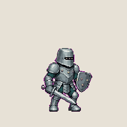
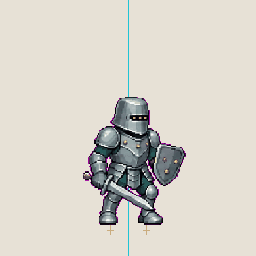
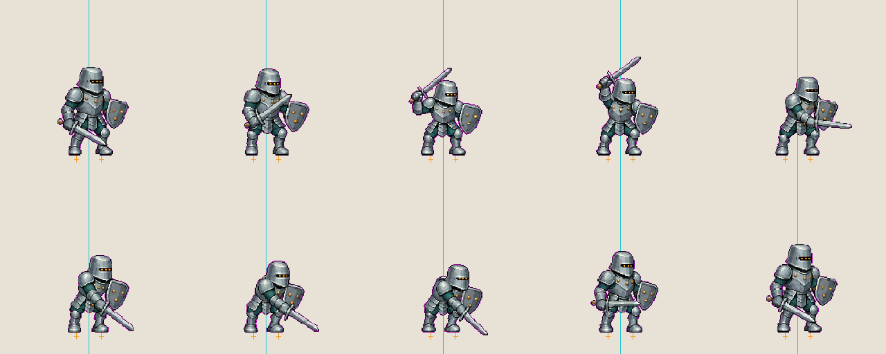

# ACT01「斜劈」50% 双脚固定审核说明 V1.2

> 日期：2026-08-04  
> 状态：仅完成 ACT01 V1.2，等待用户审核  
> 审批门：本版通过前，不生成其余 4 个动作

## 1. 本版修正目标

在 V1.1“人物中心线固定”的基础上，进一步锁定左右脚各自的位置：

- 第 01 帧左脚中心：`x=109.82`；
- 第 01 帧右脚中心：`x=146.20`；
- 两脚中心中点：`x=128.01`；
- 两脚基线：`y=224`；
- 第 02—10 帧左右脚分别跟随各自脚点，不再通过扩大步幅制造劈砍力量；
- 力量主要由膝、髋、躯干、肩、肘、腕和剑路表现。

## 2. 正常审核 GIF



## 3. 双脚固定验证 GIF

青色竖线为人物中心线；两处橙色十字分别是第 01 帧左右脚的固定脚点。标记只用于审核，不进入透明正式帧。



逐帧验证总览：



## 4. 结构校验

| 项目 | V1.2 结果 |
|---|---|
| 单帧画布 | 256×256 px |
| 帧数 | 10 |
| 动画总时长 | 810 ms，无限循环 |
| 身体填充 | 50%，直立帧约 128 px |
| 左脚最大位移 | 1.75 px |
| 右脚最大位移 | 1.54 px |
| 任一脚最大位移 | 1.75 px，满足不超过 2 px |
| 人物中心线 | 约 `x=128` |
| 两脚基线 | 10/10 帧均为 `y=224` |
| 画布溢出 | 0/10 帧 |
| 相邻重复帧 | 无 |
| 循环闭合 | 第 10 帧与第 01 帧完全一致 |

V1.1 后半段单脚最大位移约 12 px；V1.2 已压缩到 1.75 px。

机器结构记录：`selected_fixedfeet/ACT01_V1.2_双脚固定结构检查.json`。

## 5. 动作连贯性

- 保留“待机 → 预备 → 抬剑 → 最高蓄力 → 胸前过渡 → 斜向接触 → 随动 → 缓冲 → 回收 → G0”的 10 帧结构；
- 第 04 帧到第 05 帧保留胸前中间位，避免从最高点直接跳到低位；
- 第 06—08 帧不再使用大跨步，双脚保持原地，膝髋负责吸收力量；
- 相邻帧全部为不同动作帧；
- 第 10 帧精确回到第 01 帧，避免循环末端错位。

## 6. 可直接用于即梦的 V1.2 Prompt

```text
以已批准的「三灯铆卫」定妆图为唯一角色锚点，生成 ACT01「右上至右下斜劈」连续像素帧动画。严格 10 帧，顺序为：待机、预备、抬剑、最高蓄力、剑经过胸前、斜向接触、低位随动、低位缓冲、回收、精确回到第 01 帧待机。

第 01 帧先固定两个独立脚点：左脚中心约 x=110，右脚中心约 x=146，两脚基线均为 y=224，两脚中点约为 x=128。第 02—10 帧中，左脚始终围绕左脚点、右脚始终围绕右脚点，每只脚的最大位移不得超过 2 像素。两脚不得向外扩大步幅，不得跨步、滑步、平移或交换前后位置；鞋底接地点始终贴住同一位置。允许膝盖弯曲、髋部旋转和躯干前倾，但脚踝以下尽量保持与第 01 帧一致。

动作力量必须通过膝、髋、躯干、肩、肘、腕和剑尖的连续圆弧表现，禁止通过人物整体平移或大跨步制造动势。剑尖沿连续顺时针圆弧移动，最高蓄力后必须经过胸前中间位，再进入右前下方接触和缓冲；每一帧同时参考角色锚点和上一帧，严禁跳帧、停帧和武器瞬移。

全部帧统一 256×256，角色统一 50% 填充，直立身体约 128 像素高，统一缩放后锁死。禁止逐帧重新缩放、裁切、自动居中或改变镜头；身体和剑盾必须完整留在画布内。

角色外观完全固定：低矮圆滑钢盔，窄黑视窗内恰好 3 格琥珀灯，胸甲恰好 3 枚黄铜铆钉，右手同一把短阔双刃剑，左手同一面三铆钉截角盾，同一蓝灰板甲和深青灰软甲。不得换手、不得改变剑盾长度、不得增减装饰。

纯洋红抠像背景 #FF00FF，无地面、无阴影。纯方形像素、硬边、无抗锯齿、无运动模糊、无剑光、无速度线、无粒子、无重复肢体、无多余武器、无人物平移、无滑步、无跳帧、无卡顿、无错位。
```

## 7. 生成方式与处理记录

- 使用内置 ImageGen 对 V1.1 动作母版进行定向编辑；
- 第一轮把脚步移动明显收窄；
- 第二轮只修改下半身，要求第 02—10 帧复用第 01 帧的站位和落脚点；
- 随后按第 01 帧左右脚中心进行确定性微调，把任一脚最大误差控制在 2 px 内；
- 正式透明 PNG 位于 `selected_fixedfeet/frames_transparent/`。

## 8. 文件校验

| 文件 | SHA-256 |
|---|---|
| `ACT01_斜劈_10帧_50pct双脚固定_审核版V1.2.gif` | `F84BCAE90160A3EFA96CC9A6AB68CB3B8B8F5260503991A6622C1825720A0CCE` |
| `ACT01_斜劈_10帧_双脚固定验证V1.2.gif` | `4001784F225CF59DD4209E99924C320EB6D4EBFE541E68BC525AEDF7E794EAC6` |
| `ACT01_斜劈_10帧总览_双脚固定V1.2.png` | `D306E99E771E8028D428BE7F36C9D740135C537AC4820306C373BA28307734A2` |
| `ACT01_V1.2_双脚固定_ImageGen_source.png` | `90629CE38EB554EBFCFBB895B8DE6338444D2E8F3F9FF1BDC42391445A44F598` |

## 9. 当前审批范围

本次只审核 ACT01 V1.2。其余 4 个动作没有生成。
