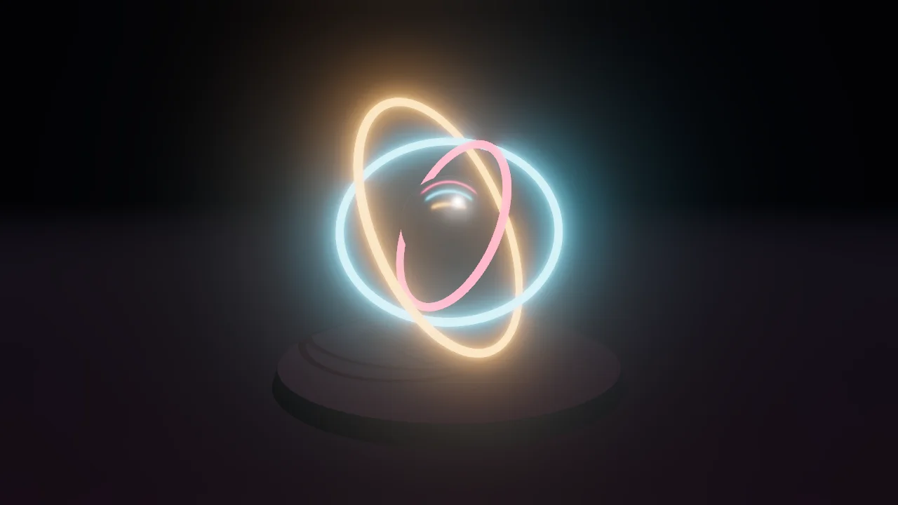

# Bloom

The classic mip-chain bloom of the Unreal Bloom, in 8 passes instead of 12, with its wide mips at a quarter of the usual pixels.

<a href="https://marcofugaro.github.io/three-advanced-techniques/rendering/bloom/"></a>

#### Live link: https://marcofugaro.github.io/three-advanced-techniques/rendering/bloom/

## Usage

```js
import * as THREE from 'three/webgpu'
import { pass } from 'three/tsl'
import { bloom } from 'three-advanced-techniques'

const scenePass = pass(scene, camera)
const sceneColor = scenePass.getTextureNode() // the input must be a texture node, such as a pass output

const bloomNode = bloom(sceneColor, { strength: 1, radius: 0.5, threshold: 0.8 })

const renderPipeline = new THREE.RenderPipeline(renderer)
renderPipeline.outputNode = sceneColor.add(bloomNode)
```

## Why it's fast

Bloom's cost is memory traffic: every pass writes a texture and the next one reads it back. Fewer passes and smaller textures make it faster.

- **The threshold rides on the first blur**, saving a whole pass and its texture.
- **One pass per mip.** Only the first mip keeps the usual horizontal-then-vertical blur; each wider mip is a single small blur of the one before.
- **Smaller wide mips.** The wide mips are so smooth they're stored at a quarter of the usual pixels.
- **Fewer texture reads.** Where it can, two neighbouring blur weights share one filtered read.

## What it improves

It looks the same as the classic bloom, the tight glow around bright spots and the wide, soft haze around it, only faster. Tint the glow with `bloomTintColors`, or choose what glows with `highPassFn`.
