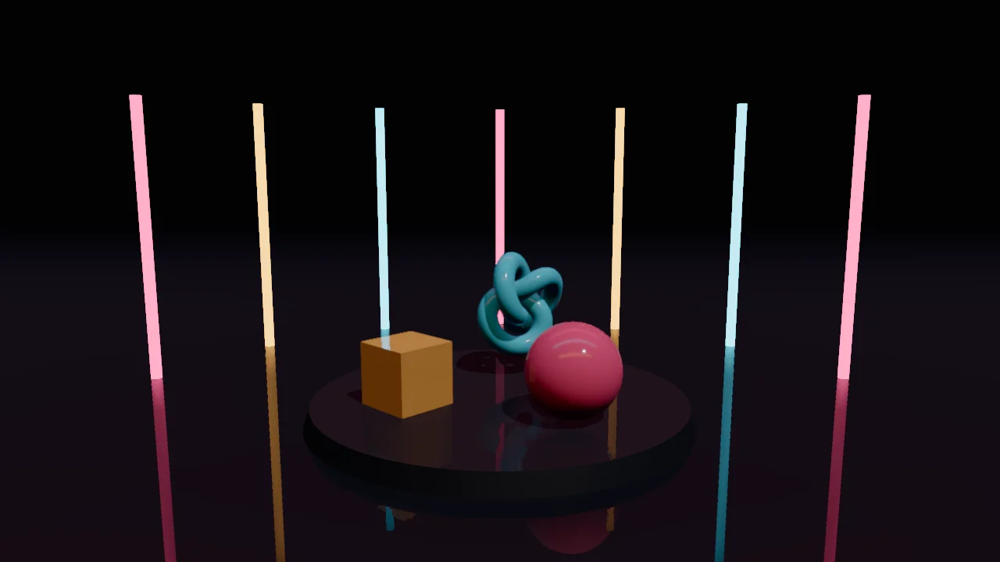

# Screen-space reflections

Cheap Screen-space Reflections found by Newton's method on the depth buffer instead of a ray march, after Mayer, Assarsson and Sintorn, [_Ultrafast Screen-Space Refractions and Caustics via Newton's Method_](https://jcgt.org/published/0015/01/03/paper.pdf) (2026).

<a href="https://marcofugaro.github.io/three-advanced-techniques/rendering/screen-space-reflections/"></a>

#### Live link: https://marcofugaro.github.io/three-advanced-techniques/rendering/screen-space-reflections/

## Usage

```js
import * as THREE from 'three/webgpu'
import { mrt, output, pass, rtt, velocity } from 'three/tsl'
import { traa } from 'three/addons/tsl/display/TRAANode.js'
import { ssr, ssrComposite, ssrGBuffer } from 'three-advanced-techniques'

const scenePass = pass(scene, camera, { samples: 0 })
scenePass.setMRT(mrt({ output, velocity, ...ssrGBuffer() }))
const velocityTexture = scenePass.getTexture('velocity')
velocityTexture.type = THREE.HalfFloatType // RG16F
velocityTexture.format = THREE.RGFormat

const color = scenePass.getTextureNode()
const reflections = ssr(color, scenePass, { roughnessCutoff: 0.6, thickness: 0.2 })
const composite = ssrComposite(color, reflections, scene.environment, {
  environmentIntensity: () => scene.environmentIntensity,
  environmentRotation: scene.environmentRotation,
})

const renderPipeline = new THREE.RenderPipeline(renderer)
renderPipeline.outputNode = traa(
  rtt(composite, null, null, { type: THREE.HalfFloatType }),
  scenePass.getTextureNode('depth'),
  scenePass.getTextureNode('velocity'),
  camera,
)
```

## Why it's fast

The usual ray march steps along each reflected ray, reading the depth buffer every pixel or two until it hits something: hundreds of reads for a long reflection. This one needs a few.

- **A few jumps instead of many steps.** Newton's method jumps straight to where the ray meets the surface below it: one jump on a flat floor, a few on a curved one, however long the reflection.
- **Last frame's answer first.** Each pixel starts from where its reflection landed last frame, so a reflection that hasn't changed is only checked, not searched for.
- **It skips what you won't see.** Pixels too rough or too faint to reflect take the environment map instead.
- **Optional half resolution.** `resolutionScale: 0.5` traces a quarter of the pixels.

## What it improves

- **Sharp on smooth surfaces, blurry on rough ones.** A polished floor shows a crisp mirror image, a rougher one a soft, spread-out reflection.
- **Strongest at grazing angles.** Surfaces reflect more as you look across them and less as you look straight down, like real materials, and replace the environment's reflection instead of adding to it, so they don't get too bright.
- **No ghost reflections.** Each hit is checked against the surface it lands on, so nothing shows up in a reflection where it isn't.
- **No hard edges.** Reflections of what's off screen fade smoothly into the environment instead of cutting off.
