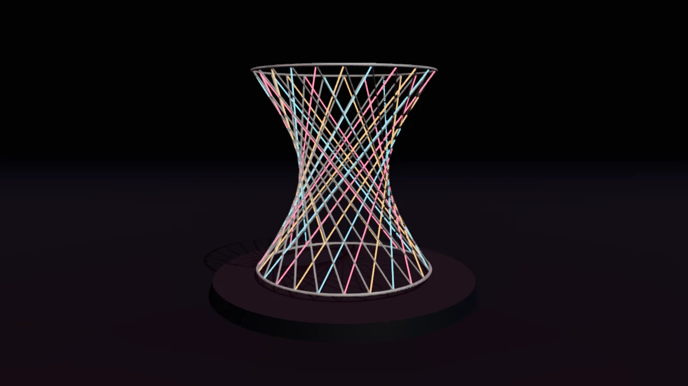

# TAAU

Temporal anti-aliasing upscaling: the scene renders jittered, at or below the output's resolution, and each frame joins the history into one stable, anti-aliased image at the output's. Thin features stay locked, edges stay smooth. After Karis, [_High Quality Temporal Supersampling_](https://advances.realtimerendering.com/s2014/) (2014), and AMD's [FidelityFX Super Resolution 2](https://github.com/GPUOpen-Effects/FidelityFX-FSR2) (2022).

<a href="https://marcofugaro.github.io/three-advanced-techniques/rendering/taau/"></a>

#### Live link: https://marcofugaro.github.io/three-advanced-techniques/rendering/taau/

## Use

```sh
npm install three three-advanced-techniques
```

```js
import * as THREE from 'three/webgpu'
import { mrt, output, pass, renderOutput, velocity } from 'three/tsl'
import { taau } from 'three-advanced-techniques'

const scenePass = pass(scene, camera, { samples: 0 }) // no MSAA
scenePass.setMRT(mrt({ output, velocity }))
scenePass.setResolutionScale(0.5) // input / output: 1 anti-aliases at full resolution
const depth = scenePass.getTextureNode('depth')
const taauNode = taau(scenePass.getTextureNode('output'), depth, scenePass.getTextureNode('velocity'), camera, {
  maxAccumulation: 24, // samples a pixel accumulates, 16 by default
})

const renderPipeline = new THREE.RenderPipeline(renderer)
renderPipeline.outputColorTransform = false
renderPipeline.outputNode = renderOutput(taauNode.getTextureNode())
```

The camera is jittered only while the pipeline renders, so picking and the shadow maps see it still. Read the output through `getTextureNode()`: it ping-pongs. If TAAU can leave the output graph, call `syncUnjitteredProjection(camera)` once a frame before rendering: the scene's velocity keeps reading the projection TAAU handed it.

## Why it's fast

Upscaling is limited by memory traffic: every pass reads its inputs and the previous frame, and writes full-size textures. This one keeps that traffic down.

- **Shared work.** What the output needs from each low-resolution pixel is worked out once and shared by the output pixels over it, four at a 2× upscale.
- **Fewer reads.** The reconstruction takes 4 filtered reads instead of 9.
- **No copies.** The output alternates between two history textures, so nothing is copied into a third.
- **Small textures.** Its per-pixel bookkeeping is packed into compact formats.

## What it improves

It reduces ghosting and blur:

- **Sharp, not soft.** Past frames are resampled with a sharp filter, so detail doesn't soften frame after frame.
- **No ghost trails.** Past frames only keep colours the current frame has nearby, and are dropped where depth jumps, so moving objects don't leave trails behind.
- **Thin details hold still.** Wires, railings and other lines under two pixels wide stay steady instead of flickering or breaking up.
- **Smooth edges in motion.** An object's outline stays anti-aliased as it moves, instead of turning jagged over the background it uncovers.
