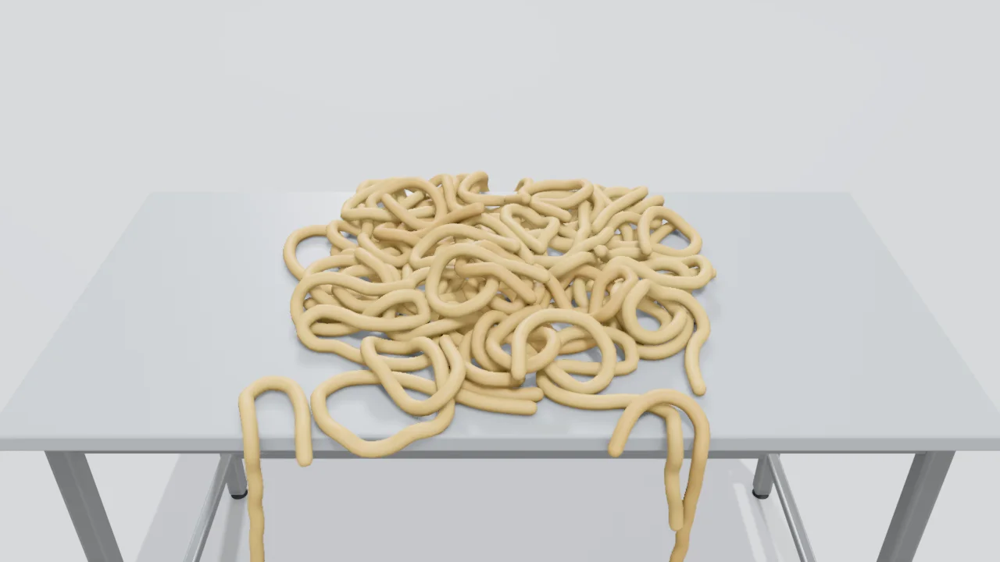
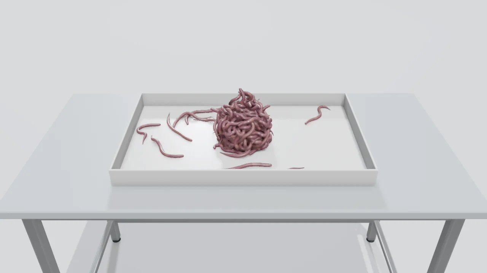

# Noodles

Compute shader strand simulation in TSL. `NoodleSimulation` simulates noodles, ropes and cables that bend, buckle, pile up and never pass through each other. `WormSimulation` builds soft, crawling worms on it.

## NoodleSimulation

Each noodle is a chain of particles joined by capsules, simulated in small fixed time steps so it moves the same at any frame rate. After Macklin et al., [_XPBD: Position-Based Simulation of Compliant Constrained Dynamics_](https://matthias-research.github.io/pages/publications/XPBD.pdf) (2016), Han and Harada, [_Tridiagonal Matrix Formulation for Inextensible Hair Strand Simulation_](https://doi.org/10.2312/PE.vriphys.vriphys13.011-016) (2013), Bergou et al., [_Discrete Elastic Rods_](https://www.cs.columbia.edu/cg/rods/) (2008), Ericson, [_Real-Time Collision Detection_](https://realtimecollisiondetection.net/books/rtcd/) (2005), Tonge et al., [_Mass Splitting for Jitter-Free Parallel Rigid Body Simulation_](https://doi.org/10.1145/2185520.2185601) (2012), Wu et al., [_A Safe and Fast Repulsion Method for GPU-based Cloth Self Collisions_](https://wanghmin.github.io/publication/wu-2020-sfr) (2020), and Chen et al., [_Offset Geometric Contact_](https://graphics.cs.utah.edu/research/projects/ogc/) (2025).

<a href="https://marcofugaro.github.io/three-advanced-techniques/simulations/noodles/"></a>

#### Live link: https://marcofugaro.github.io/three-advanced-techniques/simulations/noodles/

### Usage

```js
import * as THREE from 'three/webgpu'
import { NoodleSimulation } from 'three-advanced-techniques'

// one curve per noodle: its rest shape and starting pose
const curves = points.map((p) => new THREE.LineCurve3(p, p.clone().add(new THREE.Vector3(0, -3, 0))))
const noodles = new NoodleSimulation(curves, material, { radius: 0.05, particlesPerNoodle: 32 })
noodles.bendingCompliance = 0.5 // stiffer
noodles.bendingPlasticity = 0 // ropes and cables spring back
noodles.colliders.push(new THREE.Sphere(center, 0.5))
scene.add(noodles)

const timer = new THREE.Timer()
renderer.setAnimationLoop((time) => {
  timer.update(time)
  noodles.update(renderer, timer.getDelta())
  renderer.render(scene, camera)
})
```

### How it works

- **Bending:** each noodle bends like a soft rod, solved on the GPU one noodle per workgroup. `bendingCompliance` sets how floppy it is, whatever its particle count: 2 is cooked spaghetti, 0.08 a stiff rod. `bendingPlasticity` lets a noodle keep the shape it settles in; at 0 it springs back.
- **Length:** each noodle's length is solved exactly in one step, so it never stretches. It squashes a little more easily, so a noodle landing on its end buckles.
- **Contacts:** segments are sorted into a grid, so each one only tests its neighbours, and overlapping noodles are pushed apart with friction.
- **No passing through:** with `strictCollisions`, a particle never moves more than about half its distance to the nearest other segment in one step, so noodles can't pass through each other.
- **Colliders:** a ground plane plus planes, spheres, boxes and capsules you can move every frame. Add another NoodleSimulation to `colliders` and the two collide.
- **Drawing:** every noodle is drawn as a tube in one draw call, with any material.
- **Extending it:** `extraPasses` runs your own compute shaders on its data, and `pickAsync`, `startGrab`, `moveGrab` and `endGrab` let you drag a noodle.

## WormSimulation

Worms are noodles that move themselves: they only add pushes and muscle bends, so the noodle physics, length, bending and collisions, always wins. Everything runs on the GPU, and nothing is read back to the CPU.

<a href="https://marcofugaro.github.io/three-advanced-techniques/simulations/noodles/worms.html"></a>

#### Live link: https://marcofugaro.github.io/three-advanced-techniques/simulations/noodles/worms.html

### Usage

```js
import * as THREE from 'three/webgpu'
import { WormSimulation } from 'three-advanced-techniques'
import { BodyField } from './BodyField.js' // copied from the repo's examples/utils, not in the package

const field = BodyField.fromSkinnedMesh(body) // the body the worms climb: round cones on its bones
const worms = new WormSimulation(curves, material, { field, radius: 0.024, particlesPerNoodle: 18 })
worms.colliders.push(...field.colliders)
scene.add(worms)

const timer = new THREE.Timer()
renderer.setAnimationLoop((time) => {
  timer.update(time)
  const dt = timer.getDelta()
  field.update(dt)
  worms.update(renderer, dt)
  renderer.render(scene, camera)
})

worms.poke(raycaster) // knock worms off along a ray
```

### How it works

- **Crawling:** muscles bend each worm in a travelling wave, like a snake. Worms also steer and squirm, and can squeeze along their length (`peristalsis`).
- **States:** each worm is loose, crawling, climbing or held, and can switch once a frame.
- **Body:** the worms climb a shape given as a distance field: how far each point is from its surface, which way is out, and how fast it moves. Inside it, worms are nearly weightless and fill it from the bottom up; those that don't fit drip off and crawl back.
- **Floor grip:** worms stick to the floor and slide more easily forward than sideways, so the wave moves them forward.
- **Tools:** `poke`, `blast`, `strike` and `collapse` knock worms off; `pick`, `grabPicked` and `moveGrabAlongRay` drag one; `reset({ clock: true })` replays a run.
