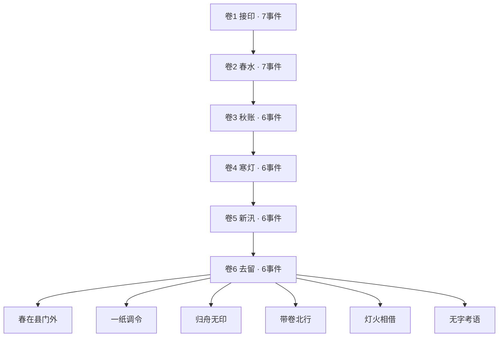

# 剧情图与回收表

## 六卷日历

## 八条持续链

| 链 | 埋下 | 推进 | 必回收 / 明确交接 |
| --- | --- | --- | --- |
| 原始证据 | M01 V01 | R01 M05 | R05 M11；缺证则不开放E04；E06公开保留遮掩的后果 |
| 旧工钱 | V02 | M03 R02 | 分期在M03付余款；不偿者M11明确待清偿；R07记录经验流失 |
| 两岸水利 | M03 A04 | R02 M06 | M09按水利分正文，R07决定维护/验工移交 |
| 魏氏承诺 | V03 | M06 V06 | 借粮在M06归还，V06确认销账；R04 M10回收合作方式 |
| 白契与学字 | A01 V04 A05 | R03 A09 | R06保留已定/待定的处分区别，结局承认权利范围 |
| 船工姓名 | A02 R01 | V05 A07 | R08保留失踪/无主款及新旧姓名，不提前宣布全部死亡 |
| 医案与照护 | A03 A08 | M08 V07 | R06与clinic凭据保存可核经验及校正机制 |
| 差费与离任 | A06 M07 | A07 V08 | 余饷在A07结清；A10辞役者由交接记录替代到场；结局保留旧处分 |

未决外乡身份、羁押会审及部分产权边界不编造即时裁决，通过M12完整交接与相应结局说明继续处理。E04的复核进程是阶段结局，不声称已经终审获胜。

## 结局条件

| 结局 | 实际条件 |
| --- | --- |
| E01 | 民生≥50且秩序≥50，最终选择留任 |
| E02 | 考成≥60，最终选择调署 |
| E03 | 始终开放，最终选择归乡 |
| E04 | ledger、boats、receipt三证齐备，最终选择上呈 |
| E05 | M10立相济约获得pact，最终选择辞官留县 |
| E06 | 遮掩旧账的累积决定至少2次，最终接受改写考语 |

多个条件可以同时满足，由玩家最终选择；结局不会随机覆盖决定。验收目录中的六份见证JSON含完整合法选择序列。
