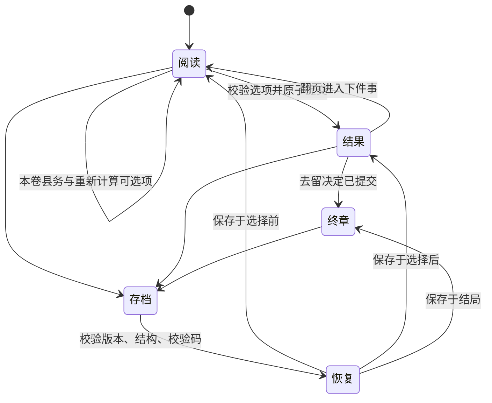

# 系统与存档规范

## 一个世界状态

TypeScript 的 World 是权威状态，保存八项资源/评价、38项选择标记、人物关系、已认识人物、凭据、已选事件、县务额度、历史、随机状态和内容版本。Ink 在场景进入时获得世界值，负责条件正文、可见选项和选择结果。

每个场景独立编译成 Ink JSON。choice_id 由 Ink 的选择流写出；程序核对后，复制并结算世界状态，原对象不改变。数字变化、物品、关系、标记、历史和 Ink 阅读位置在同一次提交中完成。界面进入结果阶段后不再接受第二次批复。

存档将世界与 Ink state.ToJson 一起封装，校验后用 LoadJson 恢复。校验码是损坏检测，不是防修改或密码保护。版本不符明确拒绝。本版不制作跨版本迁移承诺。

## 日历与触发

V0.1采用固定故事日历，38件事依顺序各发生一次；无需通过重复日常等候随机事件。角色与地点为同一县域，前置回响通过 after 校验。月份从崇祯二年正月到三年腊月，六卷长短不完全一致。

事件数据同时保留类别、地点、职位、priority、once 等编目字段。当前调度按确定顺序推进，priority 不用于开放式事件池竞争。不宣称已有全国自由行动、多出身或无限随机人生模拟。

八名主要人物均无死亡分支。程守义的辞役由 V08 选择标记维护：若已回家，A10改用交接记录和新差役处理，人物页明确显示已辞役。角色卡的「相关旧事」包含其被提及的事务，不把所有提及算作当面相遇。

## 数值

| 数值 | 初始 | 范围 | 用途 |
| --- | ---: | --- | --- |
| 公银 | 90 | 0—200 | 修缮、用人、补偿、约内偿息 |
| 仓粮 | 90 | 0—200 | 开粥、安置、借粮和偿还 |
| 民生 | 50 | 0—100 | 留任条件之一 |
| 秩序 | 50 | 0—100 | 留任条件之一 |
| 水利 | 35 | 0—100 | 汛情正文与移交验工权限 |
| 民望 | 45 | 0—100 | 民间反馈与结局变体 |
| 考成 | 45 | 0—100 | 调署府事条件 |
| 清议 | 55 | 0—100 | 对本任做法的评价与结局变体 |

数值上限截断，结算显示实际变化。县务每卷一次，换卷补入公银18、仓粮16。费用不足的选择显示原因且无法点击；当前最大支出策略也有合法路径可继续，资源难度服务叙事而非逼迫反复重开。

## 明确到期的承诺

| 前因 | 到期事件 | 结算 |
| --- | --- | --- |
| V02选择分期 | M03 春堤 | 另付公银7，结清剩余工钱 |
| V03借魏氏粮 | M06 秋闸 | 归还仓粮16、约内折息公银2 |
| M07先发半饷 | A07 次月 | 另付公银5，结清余饷 |
| M07先核空名 | A07 次月 | 另付公银7，付足核明的余饷 |
| V02旧欠一直另查 | M11及人物结局 | 明列未清偿交接项，不伪装已经付清 |

到期义务通过 catalog.obligations 定义。构建器为 Ink 生成同样的可支付条件；运行时合并进当次选择，并统一结算，读档与重复点击不能重复偿还。

## 状态机

所有玩家资源、编译剧情、CSS、SVG及运行时内联于HTML。字体来自系统，运行时没有HTTP请求、CDN、API、广告或统计上报。
