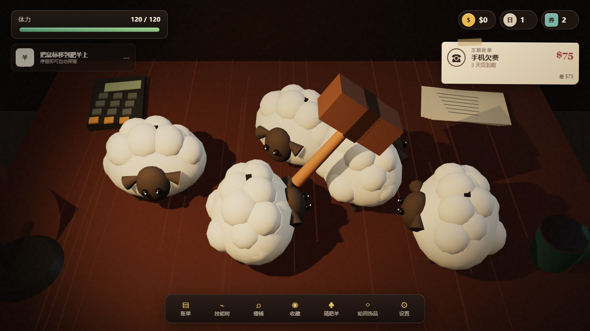

# 羊债必须清（Woolly Debts）

一款原创肥羊主题的主动增量桌面游戏：把鼠标停在肥羊储蓄罐上自动挥锤，收集随机钱币，在期限内支付不断上涨的账单，并通过三选一增益、技能树、锤具、猜羊小游戏和破产轮回构筑长期成长。



## 直接运行

[在项目站点在线游玩](https://wangxp7.github.io/GoodCase.xAI/codex/woolly-debts/)。推荐使用桌面浏览器与鼠标，分辨率 1280×720 或更高。

本仓库只收录网页成品与源码，不提供 EXE 或 Windows 安装包。源码可以通过下方开发与构建步骤生成本地桌面版。

## 操作与循环

1. 把鼠标停在任意肥羊上，锤子会按当前攻击速度自动挥动。
2. 每次命中都有机会把硬币打落到桌面，击碎时会爆出主奖励；只有把鼠标移近硬币、让它吸到锤边，钱才会进入现金。
3. 每次挥锤消耗体力；游客羊击碎时恢复 15 体力。体力耗尽后显示本局挥锤、击碎、拾取、遗漏和现金结算，再补满体力进入下一天。
4. 技能树直接花现金购买；支付账单获得三选一增益，每付 3 张账单获得 1 张猜羊券。
5. 磁铁、额外肥羊、恢复重击、电弧连锁和落石雨会改变实战行为；锤铺继续改变伤害、攻速、暴击、体耗和范围。
6. 破产进入新轮回，临时资源归零，但轮回点、饰品、成就和终生统计保留。

底部导航包含：账单、技能树、锤铺、收藏、猜肥羊、轮回饰品、设置。

## 已实现内容

- 6 种程序化原创肥羊：云朵羊、游客羊、木绒羊、彩糖羊、狂奔羊、鎏金羊。
- 6 把数据差异明确的锤具与范围溅射。
- 17 张主线账单，从 $75、$750、$250,000、$16,000,000 拟合到 $270,000,000，并保留逾期、宽限期、利息和破产逻辑。
- 17 种账单增益、24 个现金技能节点、8 件永久饰品；首个“更多存钱罐”节点按玩家实机设为 $30、每局 +2 只羊。
- 桌面持久钱币、鼠标拾取、磁铁吸附、未拾取损失和独立单局统计。
- 修正后的头部血条使用世界空间头部锚点、始终朝向相机，不再随羊模型旋转或缩放错位。
- 4 档钱币收藏、肥羊图鉴、猜羊小游戏、7 项本地成就。
- 程序化 Three.js 低多边形场景、阴影、钱币雨、碎片、暴击、屏幕震动与 WebAudio 音效。
- 本地自动存档、声音/动态效果/全屏设置。

## 开发与构建

要求：Windows、Node.js 20+、pnpm。

```powershell
pnpm install
pnpm run dev
pnpm run test
pnpm run test:e2e
pnpm run build:exe
pnpm run test:exe
```

`build:exe` 会依次完成类型检查、Vite 构建、Windows 目录封装、单文件便携版、ZIP 和 SHA-256 清单。打包脚本使用“已安装 Electron 运行时 → 预封装目录 → portable”流程，避免部分 Windows 环境中 Electron Builder 对临时目录执行原子重命名时出现 `EPERM`。

## 项目结构

```text
src/
  balance.ts       全部可调数值、羊种、锤具、账单、增益、技能与饰品
  state.ts         存档、派生属性、掉落、支付、商店、轮回与小游戏规则
  scene.ts         Three.js 原创程序化桌面、肥羊、锤子和粒子
  ui.ts            HUD、面板、弹窗、图鉴与设置
  game.ts          实时循环、悬停攻击、生成、跨日和测试接口
electron/          安全隔离的桌面壳
tests/             数值、浏览器端到端与成品 EXE 冒烟测试
scripts/           Windows 打包与原创图标生成脚本
release/           最终 Windows 交付物
```

## 调研、拟合与独立性

本次 B 站玩家实机复核、玩法重构、数值锚点和验证记录见 [PLAYER_VIDEO_REBALANCE_V1.1.0.md](PLAYER_VIDEO_REBALANCE_V1.1.0.md)。初版市场数据、GitHub 搜索结果与旧拟合记录保留在 [RESEARCH_AND_NUMERICAL_BASELINE.md](RESEARCH_AND_NUMERICAL_BASELINE.md)。

本项目是独立原创原型：只复现主动增量游戏的抽象循环与公开可观察数值关系；没有复制、提取或分发《Bills Must Be Paid》的模型、贴图、音频、文案、代码、商标或界面素材。标题、肥羊造型、桌面道具、图标和音效均为本项目原创或程序化生成。

## 当前边界

- 不含 Steamworks、云存档、排行榜或商业支付。
- 数值是基于官方公开截图、试玩体验和进度漏斗的拟合，不宣称与闭源正式版逐字段相同。
- 未使用商业代码签名证书；发布前应签名、补齐隐私说明、年龄分级和商店素材。
