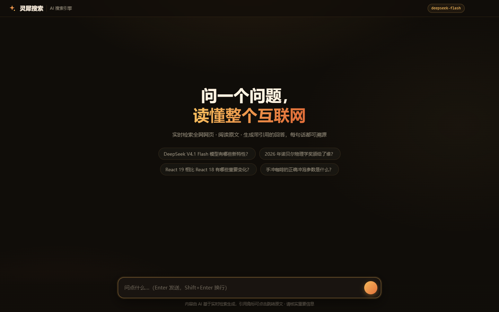
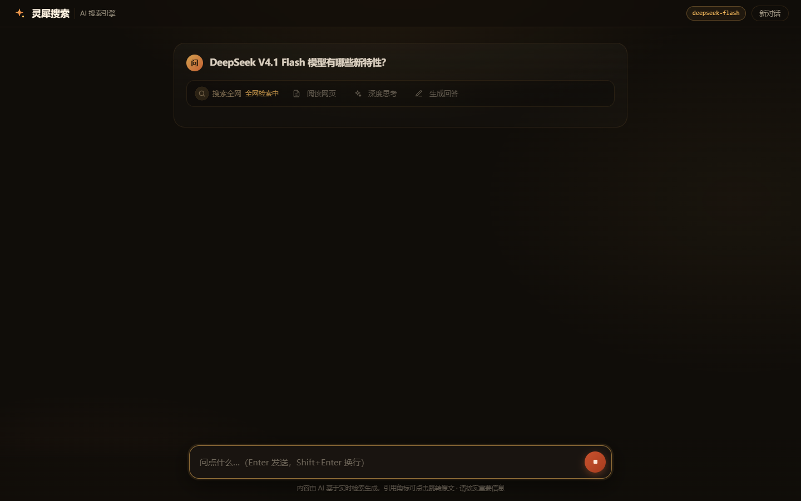
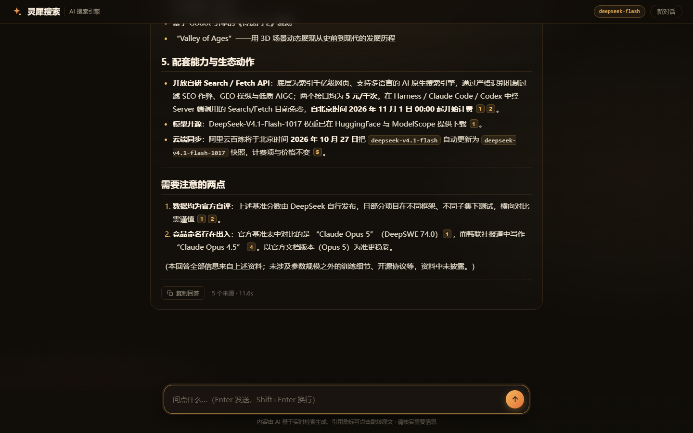
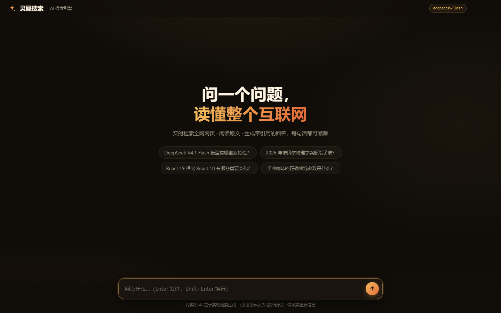
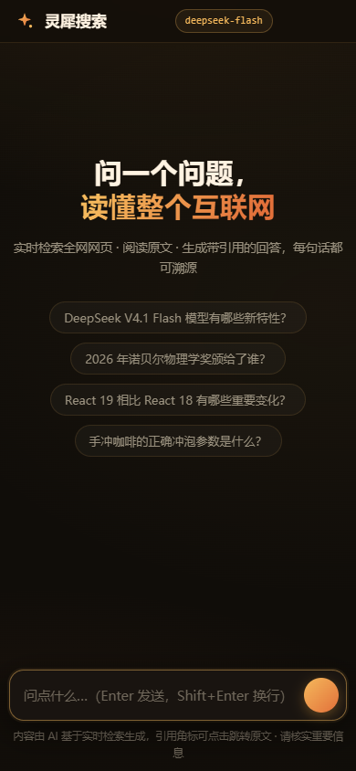

# 灵犀搜索 · deepseek-ai-search

> **WorkBuddy + Step-5-Preview**

一个类秘塔 / Perplexity 的 **AI 搜索引擎全栈应用**：用户输入问题 → 后端调用 DeepSeek 新开放的 **Search 接口**全网检索 → **Fetch 接口**抓取最相关的网页正文 → 交给 **deepseek-flash** 模型整理成带引用角标的回答，流式输出，点击角标跳转原文，支持多轮追问。

零 npm 依赖（Node ≥ 18.17 原生 fetch），前后端一体，开箱即用。

**总耗时约 40 分钟。**

> 本案例需要 Node 服务端与 DeepSeek API Key 才能完整体验，画廊站点（GitHub Pages）中以
> 文档形式呈现；按下方「快速开始」在本地启动后即可完整使用。

## 界面截图

| 首页 | 检索中 |
| --- | --- |
|  |  |

| 带引用的回答 | 新对话 | 移动端 |
| --- | --- | --- |
|  |  |  |

## 快速开始

```bash
# 1. 配置 API Key（.env.example 已给出模板；.env 含密钥不入库）
cp .env.example .env   # 然后填入 https://platform.deepseek.com/api_keys 申请的 Key

# 2. 启动
npm start              # → http://localhost:3210
```

浏览器打开后输入问题即可。Enter 发送，Shift+Enter 换行，生成中可点停止。

## 功能

- **实时检索增强**：Search 找页 → Fetch 读正文 → 模型作答，回答中的 `[1] [2]` 角标与来源一一对应，点击即跳原文
- **流式输出**：SSE 逐字渲染，带光标；页面实时展示「搜索全网 → 阅读网页 → 深度思考 → 生成回答」四步动线
- **思维链可见**：模型的推理过程（reasoning_content）实时流入可折叠的「思考过程」面板
- **多轮对话**：基于上一个回答继续追问，自动携带上下文
- **来源卡片**：favicon、站点名、发布日期、权威度，横向滚动（移动端）/ 自动换行（桌面端）
- **响应式**：桌面 / 平板 / 手机（390px 起）自适应，无横向溢出
- **健壮性**：单篇抓取失败自动跳过并重新编号、429/408/5xx 自动退避重试、客户端断连立即中止上游调用（不浪费额度）、XSS 全量转义、目录穿越拦截、API Key 只在服务端

## 测试

```bash
npm test           # 单元测试（17 项，无网络）+ 端到端测试（9 项，真实 API）
npm run test:ui    # Playwright 浏览器全流程冒烟（11 项，含截图）
```

三套测试覆盖：Markdown 渲染器（含 XSS 防护）、提示词组装、流水线编排（mock）、静态资源、错误处理、目录穿越、完整问答链路（事件顺序 / 来源 / 引用编号合法性 / 流式增量 / 多轮）、断连恢复、浏览器交互（提问 / 来源 / 角标跳转 / 新对话 / 移动端视口 / 控制台零错误）。

截图输出在 `test/shots/`。

## 架构

```
deepseek-ai-search/
├── server.js            # HTTP 服务：静态文件 + POST /api/chat（SSE）+ /api/health
├── src/
│   ├── config.js        # .env / 环境变量加载与参数集中管理
│   ├── deepseek.js      # API 客户端：search / fetch / chatStream（含重试与退避）
│   ├── prompts.js       # 系统提示词 + 带编号来源的用户消息组装
│   └── pipeline.js      # 检索增强流水线（依赖可注入，便于离线单测）
├── public/
│   ├── index.html       # 页面骨架
│   ├── style.css        # 暖色暗色主题（琥珀金 × 暖橙）
│   ├── md.js            # 安全 Markdown 渲染器（DOM-free，Node 可单测）
│   └── app.js           # 前端主逻辑：SSE 解析 / 流式渲染 / 引用 / 多轮
└── test/                # unit / e2e / ui-smoke 三套测试
```

一次问答的数据流：

```
浏览器                server.js              pipeline.js            DeepSeek API
  │ POST /api/chat       │                        │                      │
  │─────────────────────>│  runSearchPipeline     │                      │
  │                      │───────────────────────>│  search(query)       │
  │                      │                        │─────────────────────>│  ranked results
  │                      │                        │  fetch(top5 urls)    │
  │                      │                        │─────────────────────>│  markdown pages
  │                      │                        │  chatStream(messages)│
  │<── SSE: status/sources/thinking/answer/done ──│─────────────────────>│  tokens
```

### SSE 事件协议（POST /api/chat）

请求体：`{ "question": "问题", "history": [{ "role": "user"|"assistant", "content": "..." }] }`

| 事件 | 载荷 | 含义 |
| --- | --- | --- |
| `status` | `{step, text, ...}` | 步骤进度：search → read → read_done → generate → done |
| `sources` | `{sources: [{n,title,url,site_name,site_icon,date,authority,rerank_score,snippet}]}` | 编号来源列表（与角标对应） |
| `thinking` | `{delta}` | 思维链增量 |
| `answer` | `{delta}` | 回答正文增量 |
| `done` | `{answer, reasoning, sources, fetchedCount, elapsedMs}` | 完成 |
| `error` | `{message, status}` | 失败（含上游错误信息） |

## 所用 DeepSeek 官方接口（2026-10 文档）

| 能力 | Endpoint | 要点 |
| --- | --- | --- |
| 网页搜索 | `POST https://api.deepseek.com/v1/tools/search` | `query` ≤128 字符、支持 `site:`/`lang:`/`after:` 等运算符；`count` 1-50；QPS 100；按次计费 $0.75/千次 |
| 网页抓取 | `POST https://api.deepseek.com/v1/tools/fetch` | 入参 `url`，返回 Markdown 正文；QPS 25（另有单域限速）；404 表示抓不到可用内容 |
| 对话生成 | `POST https://api.deepseek.com/chat/completions` | `model: deepseek-flash`（现由 V4.1-Flash-1017 服务）；`stream: true`；`thinking.enabled` 开启思维链，增量在 `delta.reasoning_content` |

错误处理遵循官方约定：408/429/5xx 等待后重试；402 需充值；其余 4xx 不重试。Search/Fetch 按成功请求计费，失败与空结果不计费。

## 配置项（.env）

| 变量 | 默认 | 说明 |
| --- | --- | --- |
| `DEEPSEEK_API_KEY` | （必填） | API Key |
| `PORT` | `3210` | 服务端口 |
| `SEARCH_COUNT` | `10` | 搜索返回条数 |
| `MAX_FETCH_SOURCES` | `5` | 实际抓取正文的篇数（按相关度取前 N） |
| `CHAT_THINKING` | `on` | 设为 `off` 关闭思维链 |
| `CHAT_REASONING_EFFORT` | `medium` | 思维链强度 low/medium/high |

## 设计说明

暖色暗色主题：深炭背景 + 琥珀金（#f5b95c）× 暖橙（#e2703a）渐变强调色，卡片式对话流，来源条/思考面板/角标统一琥珀语言；尊重 `prefers-reduced-motion`。
