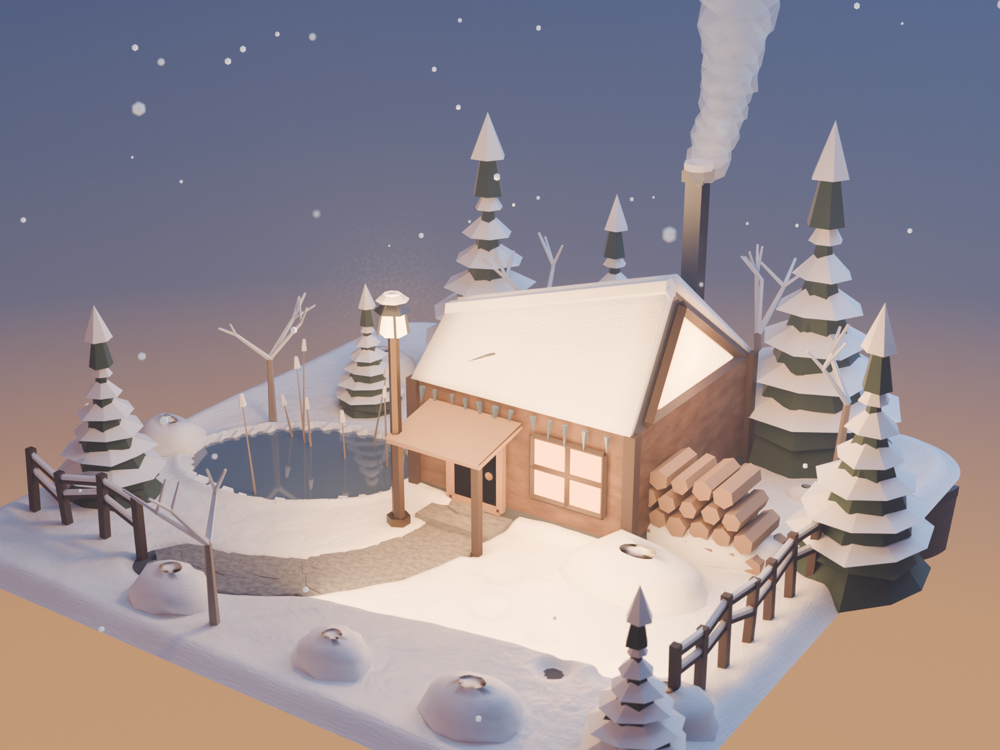

# 冬日微缩展示台 · Frost-Fold Cabin

> **WorkBuddy + DeepSeek-V4.1-Flash**

一块圆角方形石台上，坐落着一间折纸感冬季小屋与它的小院。**从地形、建筑、植被到材质与灯光全部由 `bpy` 程序化生成**，
不导入任何外部模型 / 贴图 / HDRI，同一个脚本既能出 EEVEE 预览也能出 Cycles 高清图。

小屋刻意避开常见的对称双坡木屋 —— 屋脊左右不等高（右翼 0.505 m / 左翼 0.360 m），
屋顶因此长成不对称的楔形，右端整面三角玻璃山墙把暖光泼进雪地，和冰蓝的暮色正面相撞。



## 成品参数

| 项目 | 值 |
|---|---|
| 视角 | 三分之四俯视，方位角 34° / 仰角 22.5°，55mm，距主体 3.02 m，f/6.3 微景深 |
| 渲染 | Cycles CPU · 1920×1440 · 240 spp + 降噪 · **468 秒**（EEVEE 192 spp 约 60 秒） |
| 色彩 | AgX 色彩管理，曝光 −0.16 |
| 天空 | 程序化渐变：天顶深蓝 → 紫 → 地平线暖橙余晖（`NewGeometry.Incoming` 驱动） |
| 规模 | 446 个对象 · 47,142 面 · 47,509 顶点 · 24 个程序化材质 · **0 个外部资源** |
| 底座 | 1.6 × 1.6 × 0.15 m 圆角方形石台，倒角半径 0.17 |

## 小屋造型

- **不对称楔形屋顶**：屋脊线靠近前檐，前坡陡（34°）、后坡长缓（16°）；屋脊两端高度差 0.145 m，
  右侧高扬成一片锐角，正面看是个「一翼扬起」的剪影
- **三角玻璃山墙**：高翼那面做成整片发光玻璃（`GlazingWarm` 发光 3.1 / 内核 5.6），
  外圈压一圈深色木窗棂；对面低翼那面是冷色玻璃，负责在暗部补一点天空反光
- **前立面**：大暖光窗 + 木门 + 深色门廊雨棚（浅木色顶板 + 两根方柱）+ 门口石板台阶
- **烟囱**：深色金属方管穿出后坡，顶端带雪帽，烟囱口升起一柱用重叠变形球体堆出的蓬松烟羽
- **檐口冰柱**：沿前檐随机分布 10 余根锥形冰凌，长度 22–62 mm

## 院落

- **地形**：`snow_height()` 是唯一真源 —— 3 个八度 fbm 起伏 + 沿石台边缘的积雪加厚 + 房子迎风面的雪堤，
  再减去扫雪小径与脚印的凹陷；石板、冰面、所有植被与道具的落位都查询同一函数，所以不会互相穿帮
- **小径**：沿折线路径下凹 26 mm，两侧铺 46 块随机多边形石板
- **结冰池塘**：椭圆轮廓带 8.5% 的噪声扰动，冰面透射 0.6 + Coat 0.6，边缘一圈白霜，冰上戳出 9 丛冻芦苇
- **植被**：7 株低多边形雪压雪松（每层锥体上方叠一圈稍窄的雪锥）、5 株挂霜枯桦（递归分枝）、
  8 丛被雪埋成圆包的灌木
- **道具**：木栅栏两段、暖光路灯、柴堆、门口一串交替左右脚的脚印

## 文件

```
diorama-winter/
├── index.html                    ← 案例页（可直接打开）
├── README.md
├── build_diorama.py              ← 1854 行单文件脚本：地形 / 小屋 / 院落 / 材质 / 灯光 / 相机 / 合成器
├── render_cycles.py              ← 33 行，载入工程并以 Cycles 出高清图
├── diorama_winter.blend          ← Blender 5.2.2 工程文件
└── shots/
    ├── render-final.png          ← 定稿 1600×1200（Cycles）
    ├── render-final-eevee.png    ← 同机位 EEVEE 版
    └── iter-01..13-*.png         ← 十三轮迭代留档(420px)
```

## 迭代过程

每轮先回看上轮出图再改脚本，共出图 16 版 + 2 轮终稿。**前 8 轮几乎全在跟「天空渐变的方向映射」死磕。**

| 轮次 | 主要改动 |
|---|---|
| v1 | 初版。天空渐变整条跑偏 → 背景是一片暖橙；烟囱的烟是几颗分离的白球；构图偏松 |
| v2 | 改用 `Geometry.Incoming` 驱动渐变 → 蓝调出来，但地平线暖光看不见 |
| v3 | 把暖色余晖带上移到可见区间，黄昏感立住 |
| v4 | 加飘雪与体积雾；屋顶雪从平板换成细分位移雪壳，出现自然起伏 |
| v5 | 暖色带放得太宽，整幅画面被染橙，蓝调几乎被吃掉 |
| v6 | 渲彩虹标定图反推映射关系，据此收窄暖带 |
| v7 | 矫枉过正，暖带整条跑出可见范围，天空变成纯蓝 |
| v8 | 色带落回画面中下部，上冷下暖的层次终于对了 |
| v9 | 前景枯树挡住房门视线 → 移位；底座雪面内缩加大，露出石台边缘 |
| v11 | 雪堆网格加密，把读出「火山口」的圆环压回自然圆丘 |
| v13 | 试开合成器辉光（Glare），暖色反过来淹没全图 |
| v16 | 辉光压到最低仍改不掉整体偏暖 → 最终关闭，回到干净对比 |
| final | 同机位 EEVEE 定稿；玻璃山墙前的遮挡树全部清干净 |

## 实现要点（这轮真正决定成败的几条）

1. **俯视 diorama 时，物理正确的天空渐变在画面里根本看不见。** 相机俯角 22.5°、垂直 FOV 只有 27.6°，
   整幅画面都落在地平线以上，于是「上冷下暖」的渐变整条跑到画外。v1 的天空变成一片暖橙就是这个原因。
2. **修法是换掉坐标源，而且要先用彩虹图标定。** `TexCoord.Generated` 在 World 里返回常量（天空直接变单色），
   必须改用 `NewGeometry.Incoming` → `SeparateXYZ.Z` → `MapRange(-1..1 → 0..1)` → `ColorRamp`。
   但映射关系不直观：先渲一张 8 段 CONSTANT 彩虹 ramp 的 640×480 标定图，反推出「画面高度 ↔ ramp 位置」
   的对应（本机相机下可见区间约 **0.55–0.80**），再据此摆暖色余晖带。
3. **不能靠查 enum 判断引擎能力。** `RenderSettings.engine` 的 `enum_items` 在本机 5.2.2 的
   `--factory-startup` 下只返回 `['BLENDER_EEVEE']`，但 `render.engine = 'CYCLES'` 实际是成功的；
   `view_settings.view_transform` 同样只报 `NONE`，而 AgX / Filmic / Standard 都能设。**一律实测赋值。**
4. **合成器 API 在 5.x 变了。** `Scene.node_tree` 已移除，改用 `Scene.compositing_node_group`
   （需自建 `bpy.data.node_groups.new(name, "CompositorNodeTree")` 并用 `interface.new_socket` 定义 socket）；
   `CompositorNodeComposite` / `MixRGB` 已不存在；**Glare 节点的全部参数改成了 input socket**
   （`inputs["Type"/"Threshold"/"Strength"/"Size"/"Tint"]`），旧属性名一律 AttributeError。
5. **辉光在这个场景里救不回来，最后关掉了。** 雪面在强光下的 HDR 亮度与窗光发光体是同一量级，
   任何「能让窗户发光」的阈值都会连带把整片雪原点亮、把画面整体染暖。
   代码里保留了 `setup_compositor()` 并设 `USE_BLOOM = False`，需要时可以打开。
6. **EEVEE 阴影池有 2048 tile 硬上限。** `shadow_pool_size` 的枚举最大就是 2048，400+ 对象的场景必然报
   "Shadow buffer full"。实测 `visible_shadow = False` 与 `shadow_ray_count = 1` 都**不能**降低这个计数 ——
   只能合并对象，或者接受它（实际视觉影响极小）。
7. **屋顶积雪是细分位移雪壳，不是贴片。** `snow_slab_grid()` 把四边形细分成 9×9 网格，
   沿法线按「檐口薄、屋脊厚」的厚度函数抬高，再叠一层带边界衰减的噪声；边缘自动收口到 0，
   所以檐口不会翘边、屋脊自然堆高。
8. **Blender 4.1+ 没有 `mesh.use_auto_smooth`。** 平滑着色 + 保留硬边要用
   「`polygon.use_smooth = True` + 按面夹角标 `edge.use_edge_sharp`」这个组合，
   不要再调 `shade_smooth_by_angle` 算子（它在 background 模式下还要依赖 context）。

## 复现

```bash
# 建模 + EEVEE 出图（约 1 分钟）
blender -b --factory-startup --python build_diorama.py -- final eevee

# 换 Cycles 就换个参数（约 8 分钟）
blender -b --factory-startup --python build_diorama.py -- final cycles
```

脚本一次运行会同时写出 `diorama_winter.blend` 与 `render/diorama_winter_<标签>_<引擎>.png`；
`render_cycles.py` 则用于在已保存的工程上重新出图，不必重新建模。
