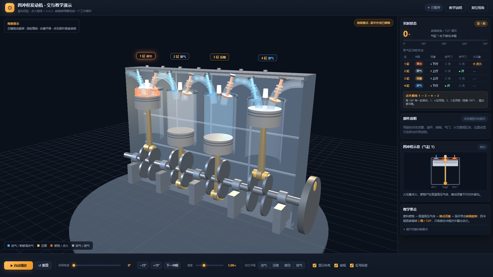
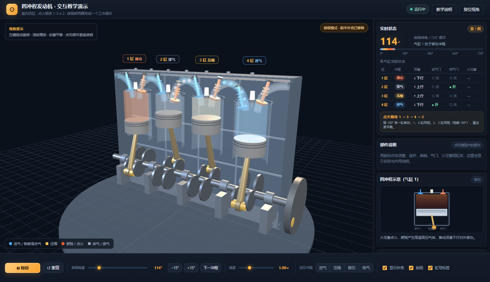
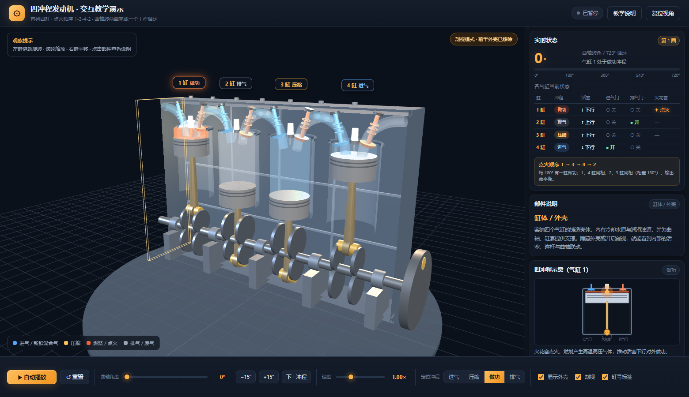
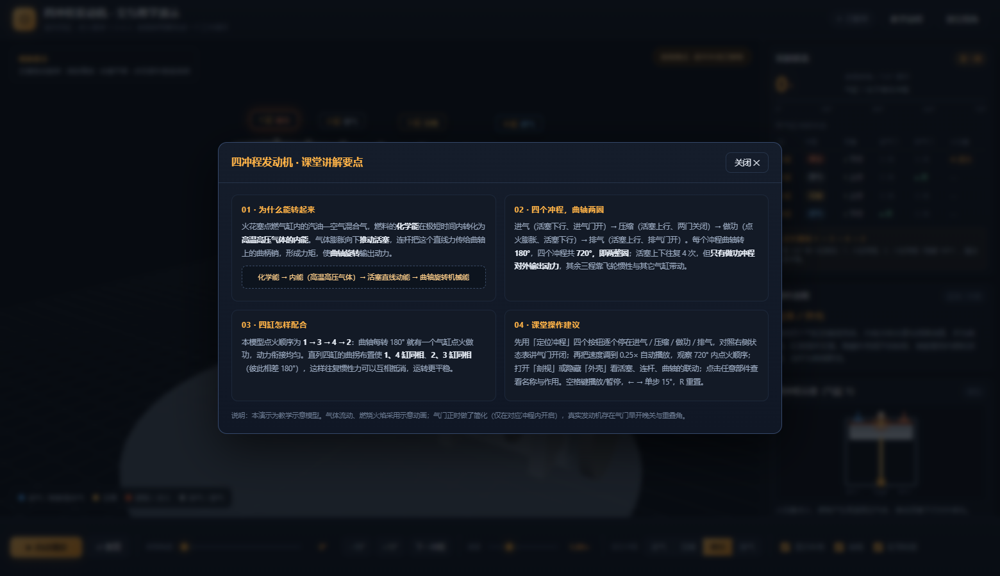

# 四冲程直列四缸发动机 · 3D 交互教学

> **WorkBuddy + Hy4**

面向课堂的四冲程内燃机交互演示：程序化搭建直列四缸发动机 3D 模型，实时联动活塞、连杆、曲轴、气门与火花塞，配合 720° 循环状态表、四冲程示意动画与可点击部件讲解，把「化学能 → 内能 → 活塞直线运动 → 曲轴旋转机械能」讲清楚。

**总耗时约 30 分钟。**

## 在线体验

在案例集中点击本案例即可直接在浏览器里运行；也可以单独打开 `index.html`。页面无需联网、无需构建，Three.js 与 OrbitControls 已本地化到 `vendor/`。

## 核心功能

- **3D 发动机模型**：缸体、缸套、四个活塞、连杆、曲轴曲拐、进排气门、火花塞与飞轮，全部程序化几何生成，零外部模型与贴图。
- **720° 循环动画**：曲轴转两圈完成一个工作循环，四缸相位按 `1、4 同相 / 2、3 同相` 布置，点火顺序 **1 → 3 → 4 → 2**，每 180° 有一缸做功。
- **定格式教学**：角度滑块可停在 0–720° 任意位置，`±15°` 单步、`下一冲程` 跳到 180° 边界、`定位冲程` 一键停在进气 / 压缩 / 做功 / 排气；火花与气体状态是曲轴角度的纯函数，暂停时也能看到确定状态。
- **剖视与透视**：局部裁剪平面只裁掉前半外壳，运动件不裁剪；关闭剖视后切换为半透明「透视外壳」，可隐藏外壳与缸号标签。
- **部件讲解**：点击任意部件显示名称与作用；右侧状态表实时列出四缸的冲程、活塞方向、气门开闭与火花塞状态。
- **课堂讲义**：内置教学说明弹层，涵盖能量转换、四冲程与曲轴两圈、四缸配合、课堂操作建议；空格播放/暂停，← → 单步，R 重置。

## 技术实现

| 项 | 做法 |
| --- | --- |
| 渲染 | Three.js r128 UMD + OrbitControls，普通 `<script src>` 引入，`file://` 下可直接双击运行 |
| 曲柄连杆 | 解析解 `pistonY = r·cosβ + √(L² − r²·sin²β)`，避免数值迭代导致的抖动 |
| 相位 | `α_i = (θ + DELTA[i]) mod 720`，`DELTA = [360, 540, 180, 0]` |
| 剖视 | `renderer.localClippingEnabled` + 局部 `Plane`，仅作用于外壳/缸套材质；拾取时手动过滤被裁掉的命中 |
| 依赖 | 全部本地化，离线可用，无任何 CDN 请求 |

> 说明：这是教学示意模型。气体流动与燃烧火焰为示意动画，气门正时做了简化（仅在对应冲程内开启）；真实发动机存在气门早开晚关与重叠角。

## 本地运行

直接双击 `index.html`；或在 Windows 下双击 `start.bat`（自动起 `python -m http.server 8000` 并打开浏览器）。也可用任意静态服务器指向本目录。

## 验收

`node tools/verify.cjs`（Playwright）覆盖渲染、四缸相位、点火顺序、播放/暂停、单步、速度、剖视、部件拾取、键盘快捷键、弹层、重置与控制台错误等 **44 项，`44/44` 全部通过**；`file://` 与 `http://` 两种方式均验证过。

## 截图

