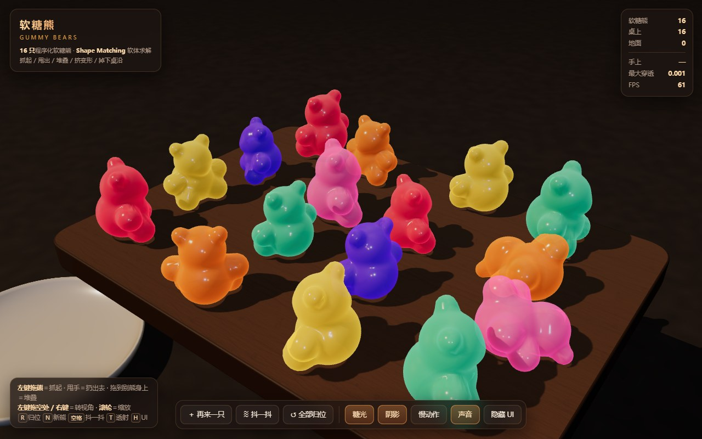
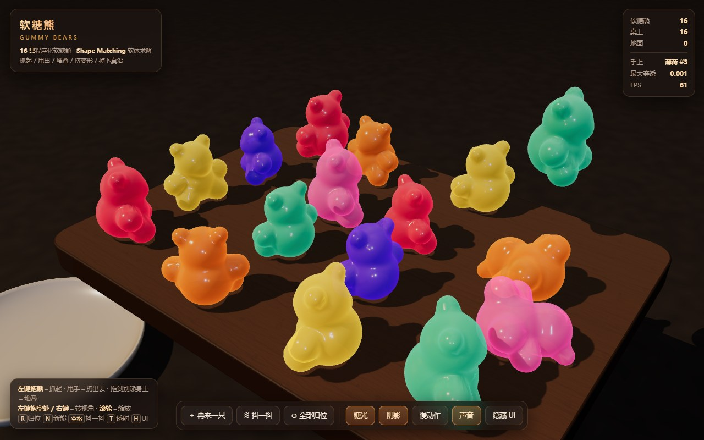
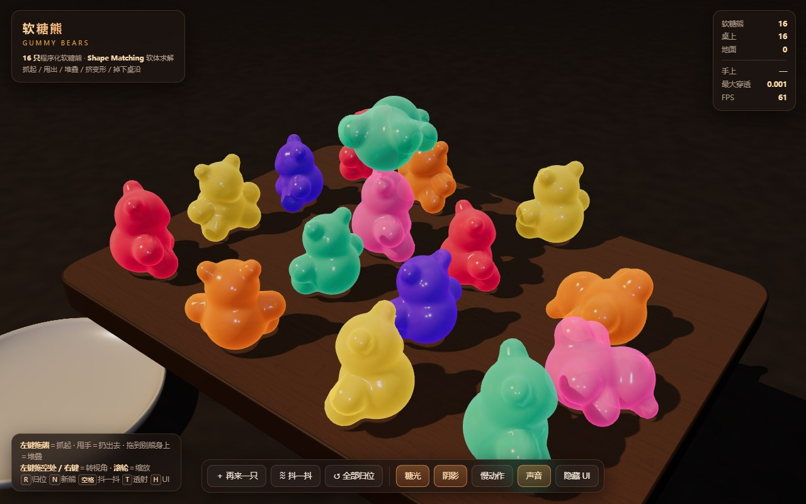
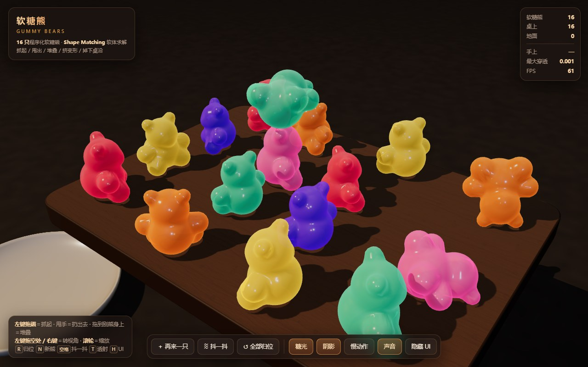
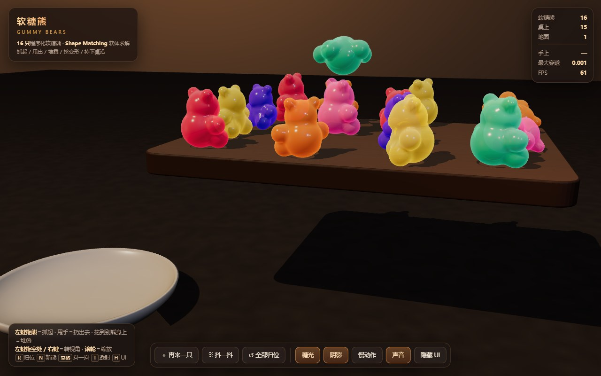
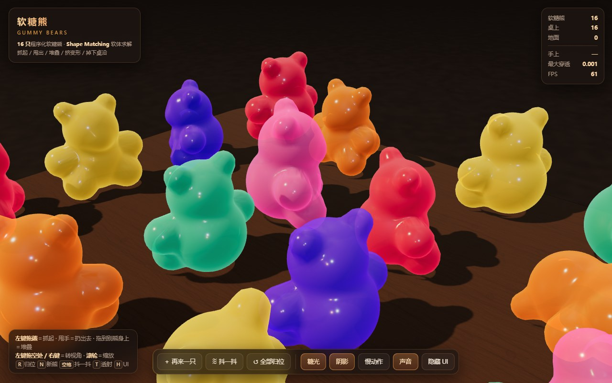

# 软糖熊 GUMMY BEARS — 可抓取软体糖果物理

> **WorkBuddy + Space Bunny**

木桌上摆着一堆软糖熊。**可以用鼠标抓起任意一只、举起来、甩出去、摞到别的熊身上**；
熊和熊之间会互相挤压变形，撞到桌沿会滑落到地面。全程 **Shape Matching 软体求解**，
网格、材质、环境贴图 **全部程序化生成，零外部资源**。单文件 `index.html`，Three.js r160。
总耗时 1 小时 25 分（含三轮物理与渲染调试）。








## 玩法

| 操作 | 效果 |
|---|---|
| **左键按住一只熊拖动** | 抓起它。熊会跟着手走，其余部分靠软体形变跟上 |
| **抓着的时候甩手** | 把它扔出去，速度由鼠标的移动速度决定（上限 9 u/s） |
| **抓着的时候滚滚轮** | 沿视线方向推远 / 拉近 |
| **左键拖空白处 / 右键拖** | 旋转视角 |
| **滚轮** | 缩放 |
| **双击一只熊** | 把它弹起来抖一抖（软糖 Q 弹） |
| `R` | 全部归位（同一套固定布局） |
| `N` | 再来一只（从空中掉下来） |
| `空格` | 抖一抖桌子 |
| `T` | 糖光开关（半透明边缘散射） |
| `H` | 隐藏 / 显示 UI |

底部按钮：再来一只 / 抖一抖 / 全部归位 / 糖光 / 阴影 / 慢动作 / 声音 / 隐藏 UI。

## 实现要点

### 网格：隐式曲面径向求解，零外部模型

熊的形状由 **9 个球的光滑并集**（多项式 `smin`）定义：头、两耳、吻、躯干、两臂、两脚。
把它当成一个标量场 `f(p)`，从质心沿 2562 个方向做二分求根得到表面点，再用 **SDF 梯度**当法线。
得到的网格 **2562 顶点 / 5120 三角形**，是二十面体 4 次细分后的球面拓扑，形变时不会出现裂缝。

顺带白送一个东西：`smin` 的混合过程天然给出每个表面点的 **解析混合权重**，
直接拿来当 **蒙皮权重**（不需要 K-D 树、不需要手工绑骨）。

### 物理：Shape Matching 软体 + PBD 松弛

每只熊 = **10 个质点**（9 肢 + 1 个不参与碰撞的核心粒子）。
每个子步：

1. 速度预测（`v += g·h`，位置 `p += v·h`）
2. **形状匹配**：把当前构型投影回"刚体化"的目标构型（最优旋转由 **矩阵极分解** 求出，
   Newton 迭代 `R ← ½(R + R⁻ᵀ)`，16 次收敛到 1e-16）
3. 两轮松弛：形状匹配回拉 + 抓取约束 + 碰撞投影
4. 速度回写 + 恢复系数 + 摩擦

**形状匹配必须在速度预测之后算目标构型**，而且目标构型要**带上这只熊自己的 scale**，
同时必须扣掉"目标构型相对当前构型的加权平均位移"——否则形状匹配会变成一个顶住重力的硬弹簧，
每步注入能量，整堆糖会被自己炸开（这几个坑都踩过，详见下方）。

### 蒙皮：把骨骼矩阵直接写进顶点着色器

每只熊 9 根骨骼，矩阵 `M_j = [R·s | p_j − R·(s·q_j)]`，
在 `onBeforeCompile` 里替换 `<beginnormal_vertex>` / `<begin_vertex>` 注入顶点着色器。
所有骨骼共用同一个旋转 `R`，所以混合后是"整体旋转 + 平移场"，**不会有糖纸效应式的体积塌陷**。
深度材质（阴影）用同一套注入，所以影子也跟着形变走。

### 碰撞

* **熊-熊**：空间哈希（0.44 网格）+ 球-球，50% 对称分离，带 6 mm 容差
* **熊-桌面**：轴对齐盒（球-盒最近点）
* **熊-地面**：平面
* **熊-陶瓷碟**：实心竖直圆柱（顶/底盖）

### 三个关键的"手感补丁"

| 现象 | 原因 | 处理 |
|---|---|---|
| 静止的熊会自己慢慢爬行 | 球面接触点的切向摩擦对**滚动**几乎无效（接触点瞬时速度≈0） | 单独加 **滚动阻力** `μ_roll·g`；接触面切向速度低于阈值时直接归零（静摩擦） |
| 叠在别人头顶的熊会自己转下来 | **球压球的几何上必然发散**（不是数值问题，是平衡点不稳定） | 糖浆粘性：悬空叠放的熊被**水平锚定**在刚搭上去的位置，且不许往下陷；接触断开会宽限 0.25 s 再放手 |
| 熊从半空掉下会把整堆炸飞 | PBD 把位置修正整份转成速度，初始 3 cm 穿插 = 9 u/s | 生成时保证不穿插（抬到最低点离桌 3 cm）；单质点速度上限 20 u/s；接触容差 6 mm |

### 固定步长

物理固定 `1/60 s` + 累加器，**渲染帧率再低物理步长也不变**。
直接拿渲染 dt 当步长时，低帧率下每步位移会超过球半径，求解器会把熊炸飞。

### 材质：自定义"糖光"而不是 three 的 transmission

`MeshPhysicalMaterial` 的 `transmission` 在这个场景里会把背景整块透过来，渲出一条白带，
糖熊看着像白模。改成：

* 彩色漫反射 + 清漆高光（`clearcoat 1.0 / roughness 0.05`）→ **表面高光**
* 顶点着色器之外，在片元里加一条**边缘散射项** `uGlow · (pow(1−N·V, 1.7)·1.85 + 0.16)` → **半透明糖感**
* 材质 `opacity 0.90` → 边缘能透出桌面

环境贴图是程序化 Canvas（摄影棚柔光箱）→ PMREM。**不能用 `FloatType` 的 `DataTexture`**：
它在部分 WebGL 实现（SwiftShader / 移动端）里会整块上传成白色，PMREM 之后环境变成一片白光，
清漆镜面反射直接过曝。LDR Canvas 贴图最稳。

### 音效

WebAudio 实时合成，零采样文件：抓起（短促正弦）、松手（下滑正弦 + 三角波＝Q 弹）、
桌面闷响（带通滤波噪声）、熊-熊碰撞（高频三角波）。首次点击才创建 `AudioContext`。

## 目录

```
gummy-bears/
├── index.html          ← 交付物：单文件完整交互（约 68 KB）
├── README.md
├── shots/              ← 验收截图（8 张 JPEG）
├── tests/
│   ├── probe.mjs       ← 静态探针：54 条（不开浏览器，直接验 index.html 里实际用的那份数学）
│   ├── e2e.mjs         ← 真实浏览器端到端：42 条
│   ├── shots.mjs       ← 重新生成 shots/
│   └── look.mjs        ← 快速视觉迭代（3 张小图 + 材质 A/B 对照）
└── vendor/             ← 固定 Three.js r160（与站点其它案例同一份文件）
    └── three.module.min.js
```

## 运行与验收

ES Module + importmap 在 `file://` 下会被 CORS 拦掉，需要经 HTTP 打开：

```bash
cd gummy-bears
python -m http.server 8000     # 浏览器访问 http://127.0.0.1:8000/
```

回归验证（需要 `playwright-core` 与本机 Edge / Chrome）：

```bash
cd gummy-bears
node tests/probe.mjs        # 54 条静态断言
node tests/e2e.mjs          # 42 条端到端断言
node tests/shots.mjs        # 重新生成 shots/
```

**静态探针**把 `index.html` 里实际使用的那几段数学（`fieldW` / `icosphere` / `polar3`）
按锚点切出来在 Node 里 `eval` —— 测的是产品代码本身，不是复制品。
覆盖：二十面体网格的顶点数/单位长度/索引合法性、SDF 的内外符号与"星形可解性"
（2562 个方向全部存在零面）、`smin` 权重和恒为 1、极分解的正交性与 det、页面结构与注入锚点。

**端到端**是真实无头浏览器 + 真实键鼠事件，物理在页面内以固定步长推进
（不依赖无头环境的 rAF 节流）。42 条断言覆盖：真实鼠标抓起 / 举起 / 松手 / 甩出 / 堆叠、
撞桌沿滑落、重叠分离、UI 四个按钮与两个快捷键、渲染非黑屏 / 有高光 / 糖光开关前后画面不同。

**关键断言都配了反向对照**（把被测能力关掉后断言必须失败）：

| 对照 | 期望 |
|---|---|
| 关掉熊-熊碰撞 | 重叠的两只熊不再分离（0.143） |
| 同一帧渲染两次 | 画面指纹完全一致（diff 0.0004） |
| 关掉糖光 | 画面指纹明显变化（diff 3.7） |

## 调试过程中修掉的几个隐蔽问题

1. **熊全渲染成了球。** 形状匹配的目标构型用了**模板单位**的静息偏移，漏了每只熊的 `scale`，
   求解器每帧都在把熊往质心方向压。所有熊缩成一坨，形状完全看不出来。
2. **熊浮在半空。** 形状匹配的目标构型相对当前构型有**系统性整体平移**（核心粒子的静息偏移
   没和加权质心对齐），每步把熊往下压一点、再被桌面弹回来 → 能量注入，熊会自己炸开。
   修法：核心偏移归零 + 求解后扣掉目标构型的加权平均位移。
3. **蒙皮矩阵整个是乱的。** `THREE.Matrix4.elements` 是**列主序**，平移量在 `[12..14]`；
   手写 elements 时按行主序填，还把矩阵转置了 —— 渲染出来的东西看不出是什么。
   现在统一用 `Matrix4.set()`（行主序入参）。
4. **低帧率下整堆糖会飞上天。** 物理直接吃渲染 dt，帧率低时单步位移超过球半径。
   改成固定步长 + 累加器。
5. **环境贴图变成一片白光。** `FloatType` 的 `DataTexture` 在这台机器的 WebGL 实现里
   整块上传成白色，PMREM 之后糖熊的清漆反射直接过曝成"白模"。换 LDR Canvas 贴图。
6. **低帧率下会自己爬行的熊。** 接触点切向摩擦对球面滚动无效，得单独给滚动阻力。
7. **一半熊在开场就滚到桌下去了。** 初始布局用了共享的有状态随机数，
   每次"归位"布局都不一样；改成独立且可重播的 RNG（`layoutRnd`），固定 `SEED = 20261020`。

## 已知限制

* 需要 HTTP 服务打开（`file://` 不支持 ES Module + importmap）。
* 软糖是"糖浆粘性"模型：叠上去的熊会被粘住，不会像真糖那样慢慢滑开——这是为了堆叠玩法可用。
* 没有多点抓取（一次只能抓一只）、没有把熊捏变形（手不能捏软糖）。
* 触屏只做了单指抓熊 / 双指缩放，没有做手势甩动的惯性曲线。
* 桌面材质是程序化木纹，缺真实木头的各向异性高光。
