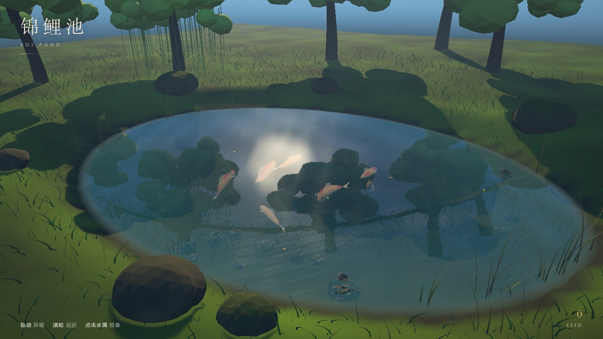
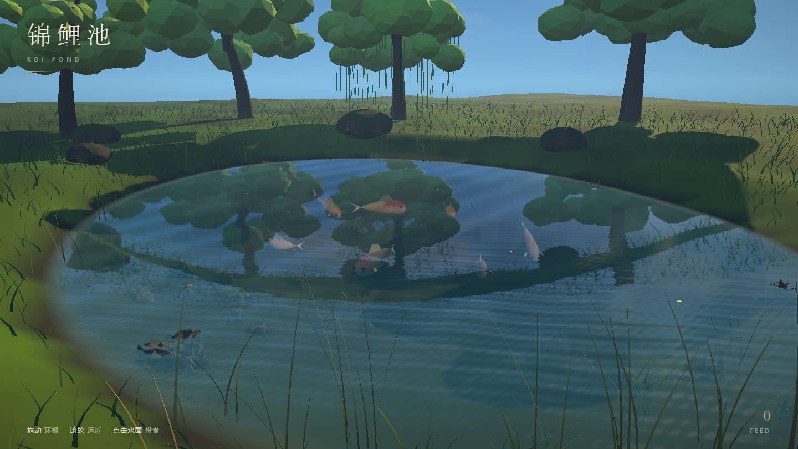
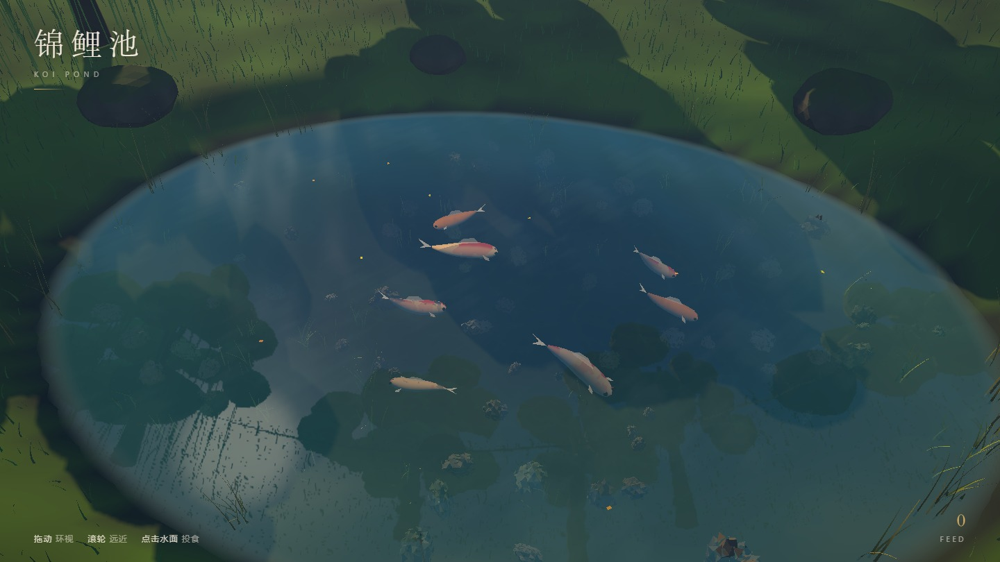
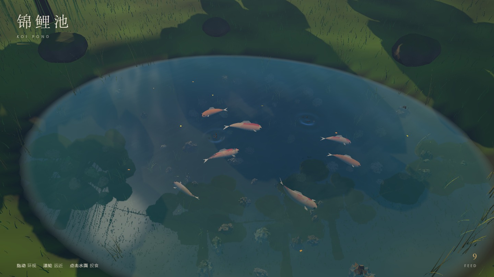

# 锦鲤池 · Koi Pond

> **WorkBuddy + DeepSeek-V4.1-Flash**

<sub>总耗时约 110 分钟 · 36 轮视觉迭代 + 13 项 E2E 断言 · 全程零外部素材</sub>

一个从零程序化生成的锦鲤池塘：水面有多层波纹、真实的平面倒影与太阳碎光；水下七尾锦鲤成群巡游、摆尾转向、见食则聚；池底有水草、鹅卵石与焦散光斑；岸边是草地、岩石、芦苇和一圈树。单文件 HTML，零外部素材，连音效都是 WebAudio 现合成。



## 运行

ES Module + importmap 在 `file://` 下会被 CORS 拦截，必须走 HTTP：

```bash
cd koi-pond
python -m http.server 8000
# 或 npx serve .
```

浏览器打开 `http://localhost:8000/`。

## 交互

| 操作 | 效果 |
| --- | --- |
| 拖动 | 环视池塘（限制俯角，不会钻到水下或天上） |
| 滚轮 | 拉近拉远（8.5–31 米） |
| 点击水面 | 撒一把鱼食，水面炸开涟漪，鱼群加速冲过来抢 |
| 鼠标划过水面 | 光标处泛起细小涟漪 |

投喂后鱼会从群游状态切到抢食状态：优先锁定最近的一颗食饵、上浮到接近水面、摆尾频率和游速一起拉高。食饵被吃掉时补一圈小涟漪和一声「啵」。

## 场景构成

- **水面**：`30×23` 的 148×114 细分网格，6 组不同方向/频率的正弦波叠加，逐帧在顶点着色器里位移；法线用**解析梯度**求（每波一次 `cos`，比差分省 3/4 的三角函数），高频波按距离淡出以避免像素级摩尔纹；边缘自动收敛波幅，不会漫上岸。
- **倒影**：镜像相机把世界渲染到半分辨率 RT，水面按屏幕坐标采样并按法线扰动 UV。天空带程序化云层——云和水草一样，是让波纹「看得出来」的关键：反射内容太平滑时，再大的波纹也只是均匀色块。
- **锦鲤**：体长 1.5–1.7 米，32 段脊线 × 18 边截面，每帧按「摆尾波 + 转弯曲率」重建顶点与法线。花纹在**静止姿态的参数空间**里用 3D fbm 生成（红白 / 昭和三色 / 黄金三种），所以鱼身怎么弯，斑块都跟着皮走、不会滑动。
- **水下**：水草是顶点着色的双面 ribbon，按高度做相位摆动；池底铺 96 颗半埋的鹅卵石；焦散光斑是一张贴合池底起伏的加色网格。
- **岸边**：9 棵树（含一棵垂柳，柳条单独一套摆动）、8 块苔藓岩石、7600 根实例化草叶、22 丛挺水植物。
- **后期**：场景先渲进线性 RT，再做饱和度、冷阴影/暖高光分离、S 曲线和暗角，最后手动 sRGB 编码。

## 实现里踩到的几个坑

1. **立方体贴图的色彩空间**。烘焙环境贴图时如果沿用主渲染的 ACES + sRGB 输出，反射会被二次编码、二次压暗，水面直接变成一块灰白塑料板。必须在烘焙期间切到 `NoToneMapping` + `LinearSRGBColorSpace`。
2. **镜像相机的 up**。给反射相机设 `up = (0,-1,0)` 后，它仰视的视线与 up 几乎反平行，`lookAt` 退化，整张反射图变成天空。用正常 up 即可。
3. **`fbm` 忘了归一化**。4 个八度相加不除权重时均值只有 0.47，红斑阈值 0.5 几乎永不触发——鱼全长一个色。归一化后才正常。
4. **`smoothstep` 的边沿顺序**。`smoothstep(0.55, 0.15, x)` 这类反向写法是 UB，SwiftShader 上直接给出恒定值，水面深浅和湿泥带全错。
5. **转弯弯曲别用角速度**。`acos(dot)/dt` 在 60fps 下被放大 60 倍，`clamp` 之后鱼永远处于最大弯曲，像一条弓着的香蕉。用「本帧转过的角度」乘时间常数才与帧率无关。
6. **高光会吃掉花纹**。0.85 强度的白色 Blinn-Phong 高光直接盖过 diffuse，红斑全被洗成白鱼。

## 验证

```bash
node tools/e2e-full.mjs    # 13 项功能断言
node tools/shots.mjs       # 四个机位出图
```

`e2e-full.mjs` 覆盖：7 尾鱼全部在游动/转向、脊线顶点逐帧变化（摆尾）、转弯弯曲、鱼群聚集半径、点击投食、食物落水、涟漪激活、鱼抢食吃掉食饵、拖动改变方位角、滚轮改变距离、食物数量上限。当前 **13/13 通过，0 console error**。

无头 Chromium 走 SwiftShader，帧率只有 1 fps 左右，所有断言都基于状态而非帧率。真实 GPU 上的帧率未在无头环境实测——水面 shader 的解析法线（每像素 6 次三角函数 + 8 个涟漪循环）是主要开销，1440×810 下场景约 17 万三角、两次 pass（反射 + 主渲染）+ 一次后期。




