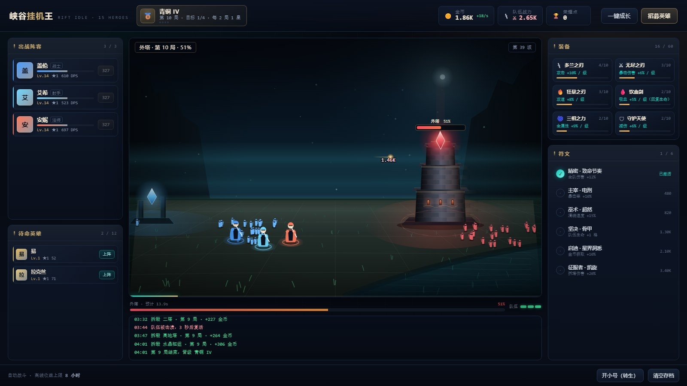
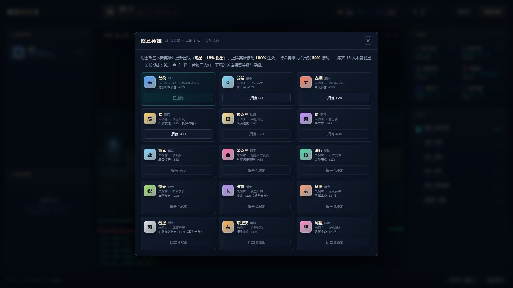
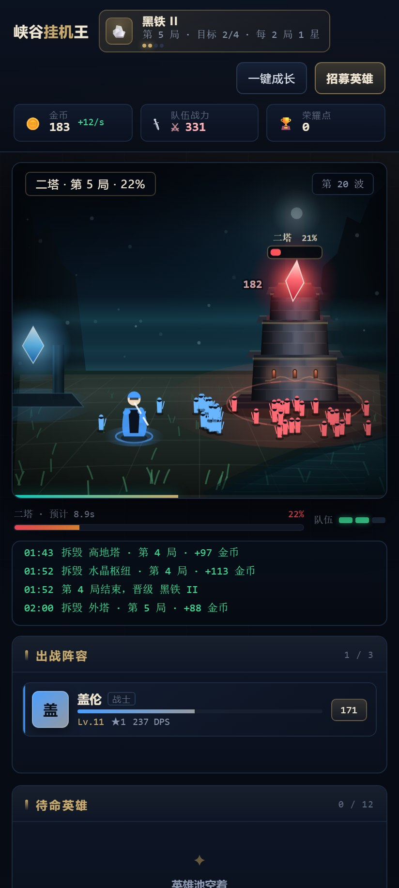

# 峡谷挂机王 · 15 英雄放置挂机

> **WorkBuddy + DeepSeek-V4.1-Flash**

以《英雄联盟》为题材的**放置挂机（Idle / Incremental）**：三人小队自动推中路，一波波兵线压上去、拆塔、破水晶，用金币养英雄、装备与符文，关掉页面也照样长钱。

单文件 HTML，**零依赖、零外部素材**——战场、英雄、防御塔、粒子、飘字全部 Canvas2D 程序化绘制，无图片、无字体文件、无音频。



---

## 运行

双击 `index.html` 即可（纯 DOM + Canvas2D，无 ES Module、无 importmap，`file://` 直接可跑）。
若想用本地服务：

```bash
cd lol-idle
python -m http.server 8000   # 打开 http://localhost:8000/
```

---

## 玩法

**核心循环**：兵线自动推进 → 拆掉当前目标（外塔 / 二塔 / 高地塔 / 水晶）→ 进入下一局 → 段位 +1 星。全自动战斗，玩家只做「买什么」的决策。

| 系统 | 规则 |
| --- | --- |
| 局与目标 | 每局 4 个目标，按 外塔 → 二塔 → 高地塔 → 水晶 依次推进 |
| 段位 | 黑铁 → 青铜 → 白银 → 黄金 → 铂金 → 翡翠 → 钻石 → 大师 → 宗师 → 王者，每段 4 星，**每 2 局 1 星** |
| 英雄 | 15 位可选，**上阵 3 位**；上阵被动 100% 生效，待命英雄仍贡献 **30%** 被动 |
| 升星 | 每位英雄可升星，**每星 +18% 伤害** |
| 装备 | 6 件 × 10 级：攻击 / 暴击伤害 / 攻速 / 吸血 / 全属性 / 减伤 |
| 符文 | 6 枚一次性铭刻：伤害、暴击、清线、生命、金币、拆塔 |
| 队伍生命 | 3 格起（符文与英雄被动可加），防御塔每 1.55 秒反击一次；归零则团灭，3 秒后满血复活 |
| 离线收益 | 关页面按 **60% 效率** 结算，上限 **8 小时** |
| 开小号（转生） | 黄金段位（4 星）后可重置，换取 **荣耀点**；每点 **+2% 全局金币与伤害**，永久生效 |

### 15 位英雄

| 英雄 | 定位 | 被动 | 英雄 | 定位 | 被动 |
| --- | --- | --- | --- | --- | --- |
| 盖伦 | 战士 | 对塔伤害 +35% | 锐雯 | 战士 | 全队伤害 +20% |
| 艾希 | 射手 | 暴击率 +15% | 卡莎 | 射手 | 攻速 +22% |
| 安妮 | 法师 | 全队伤害 +18% | 瑟提 | 坦克 | 队伍生命 +1 |
| 易 | 刺客 | 全队攻速 +30% | 薇恩 | 射手 | 对塔伤害 +30% |
| 拉克丝 | 法师 | 清线速度 +25% | 布里茨 | 辅助 | 清线速度 +30% |
| 劫 | 刺客 | 暴击率 +25% | 阿狸 | 法师 | 队伍生命 +2 |
| 亚索 | 战士 | 暴击伤害 +80% | 金克丝 | 射手 | 对塔伤害 +45% |
| 锤石 | 辅助 | 金币获取 +12% | | | |

> 「清线速度」直接提高兵线金币的产出频率——挂机收益的底盘；「对塔伤害」决定推进速度；「暴击」系是乘区叠加的中期核心。

---

## 操作

| 操作 | 效果 |
| --- | --- |
| 点英雄卡右侧金币按钮 | 升级该英雄（+18.5% 基础攻击 / 级） |
| 点装备格 | 购买一级装备 |
| 点符文行 | 铭刻符文（一次性，永久） |
| 顶部「一键成长」 | 从最便宜的成长项开始连续购买，直到金币不够 |
| 顶部「招募英雄」 | 15 人图鉴：招募 / 升星 / 上阵 |
| 待命英雄卡 | 点「上阵」替换当前阵容 |
| 底部「开小号」 | 转生，展示可获得的荣耀点 |
| 底部「清空存档」 | 抹掉本地存档（需二次确认） |

进度自动存 `localStorage`（每 5 秒 + 切后台 + 关页面），刷新即恢复。

---

## 数值曲线

刻意做成「前期快、后期稳」的放置节奏：

| 项 | 公式 |
| --- | --- |
| 目标血量 | `280 × 1.20^目标序 × 1.72^(局-1)` |
| 英雄伤害 | `基础攻击 × 1.185^(等级-1) × (1 + 0.18×(星级-1))` |
| 升级成本 | `16 × 1.24^(等级-1)`（成本增速 > 伤害增速，形成天然减速） |
| 兵线金币 | 每 6.5 秒一波，`3.0 × 1.08^目标 × 1.14^(局-1)` |
| 拆塔金币 | `40 × 1.16^目标 × 1.22^(局-1)` |

实测（无操作、纯自动购买 + 自动招募）：1 分钟到第 4 局、5 分钟第 11 局、20 分钟第 19 局并集齐 15 人，伤害量级从百级到十万级，不会在前十分钟出现数字爆炸。

---

## 界面

- **左栏**：出战 3 人（等级 / 星级 / 个人 DPS / 升级价）+ 待命英雄池（可滚动，点「上阵」换人）
- **中栏**：Canvas 侧视战场（己方水晶 / 三人小队 / 双向兵线 / 敌方防御塔）+ 血条 + 战报
- **右栏**：6 件装备（等级条 + 当前效果）+ 6 枚符文（激活态）
- **顶栏**：段位徽章与星数、金币与每秒收益、队伍战力、荣耀点




---

## 技术要点

| 项 | 做法 |
| --- | --- |
| 渲染 | Canvas2D 侧视：多层视差远景、渐变地面与透视石板路、三层收分塔身（错缝砖块 / 檐口 / 箭窗火光 / 塔冠水晶）、程序化英雄与兵线、粒子与飘字 |
| 模拟 | **固定步长 0.05 s** 推进战斗，渲染帧率无关；帧间 dt 上限 0.25 s，切后台回来不会瞬移 |
| 状态 | 单一 `S` 状态对象 + 脏标记驱动 DOM 重绘（面板 5 fps、顶栏 5 fps、战场 60 fps），避免每帧重建节点 |
| 存档 | `localStorage` 存 JSON（含 `gps` 快照用于离线结算），`loadGame()` 返回离线时长与收益 |
| 自适应 | `ResizeObserver` + DPR（上限 2）重设画布；≤960 px 单列堆叠，≤560 px 压缩字号与网格 |
| 无障碍 | 尊重 `prefers-reduced-motion`，关闭全部动画 |

---

## 验证

三层验证，全绿：

```bash
node tools/extract_check.mjs   # 1) 语法层 + 20 项纯函数静态探针（vm 内跑产品源码）
node tools/verify_e2e.mjs      # 2) Playwright 端到端，41 项断言
node tools/shots.mjs           # 3) 定机位出图（1600×900 / 手机竖屏）
```

端到端覆盖：初始状态、画布 DPR、自动战斗金币与塔血变化、升级/装备/符文购买与成本递增、招募与上阵、一键成长、拆塔推进与段位增长、存档与刷新恢复、离线 1 小时按 60% 结算、塔反击计数、阵亡复活、转生重置与荣耀点、招募面板 15 卡、三栏渲染、桌面与手机端横向溢出、零 JS 报错。

```
=== 41/41 PASS ===
```

---

## 文件

```
lol-idle/
├── index.html              # 全部内容：样式 + 界面 + 数据 + 模拟 + 渲染（单文件）
├── shots/                  # 交付截图（1600×900 与手机竖屏）
└── tools/
    ├── extract_check.mjs   # 语法层 + 纯函数静态探针
    ├── verify_e2e.mjs      # Playwright 端到端（41 项）
    └── shots.mjs           # 定机位出图
```

**范围说明**：这是「放置挂机」而非对局复刻——没有补刀、没有技能交互、没有对线压制，全部战斗自动结算；玩家决策集中在资源分配（升谁、先装备还是先符文、什么时候开小号）。
