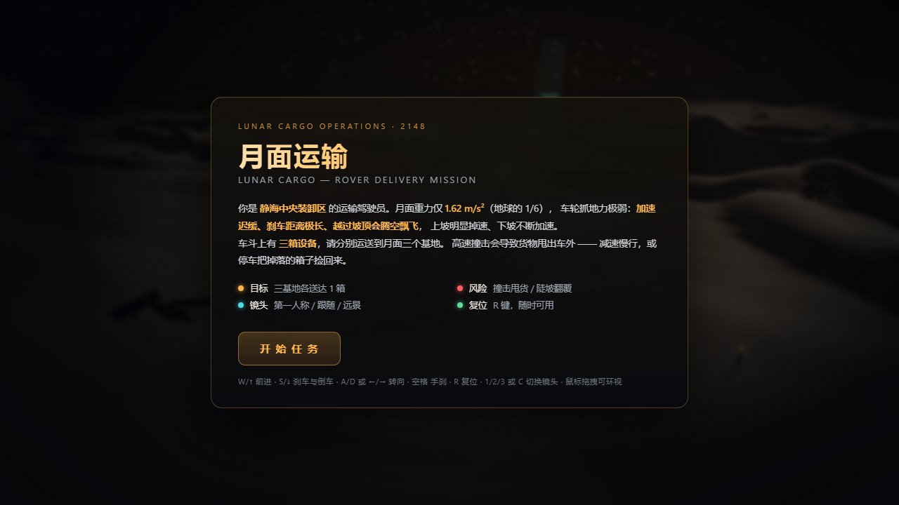
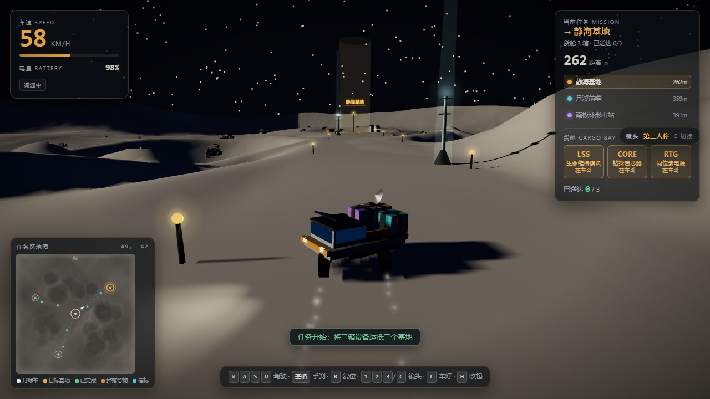
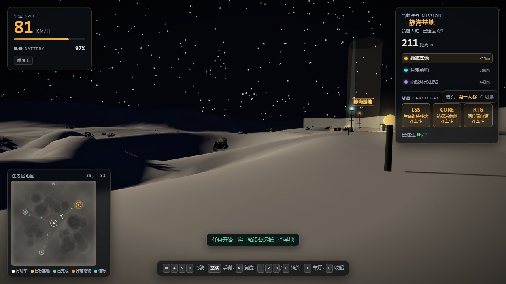
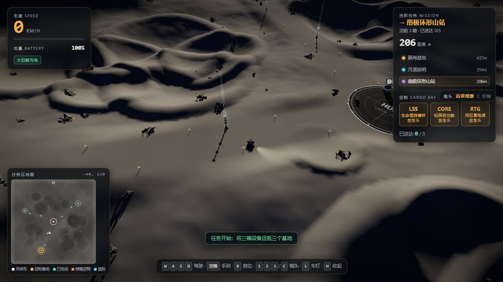
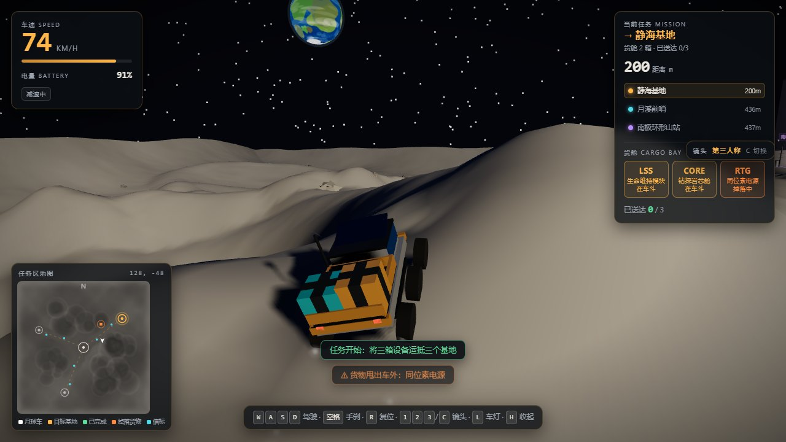

# 月面运输 LUNAR CARGO — 实时 3D 月球车运输任务

> **WorkBuddy + DeepSeek-V4.1-Flash**

一个**真正可以实时驾驶**的 3D 月球车货运任务（不是预渲染动画）：程序化生成的月面地形、可驾驶的六轮漫游车、
低重力车辆动力学、真实碰撞、货物甩落与三站配送。单文件 `index.html`，Three.js r160，
**全程序化几何、零外部贴图与模型**。








## 玩法

从**静海中央装卸区**（世界原点，停机坪半径 34 m）出发，把车斗上的三箱设备分别送到月面三个基地：

| 基地 | 代号 | 坐标 | 停机坪半径 |
|---|---|---|---|
| 静海基地 | ALPHA | (262, −196) | 27 m |
| 月溪前哨 | BETA | (−302, −118) | 24 m |
| 南极环形山站 | GAMMA | (−128, 306) | 26 m |

三箱货物：

| 货物 | 简称 | 说明 |
|---|---|---|
| 生命维持模块 | LSS | 琥珀色 |
| 钻探岩芯舱 | CORE | 青色 |
| 同位素电源 | RTG | 紫色 |

**三箱全都送达三个基地**（一基地一箱）即通关，弹出任务结算：用时、里程、最高车速、货物掉落次数。

## 操作

| 按键 | 功能 |
|---|---|
| `W` / `↑` | 前进 |
| `S` / `↓` | 刹车，停稳后继续按为倒车 |
| `A` `D` / `←` `→` | 转向 |
| `空格` | 手刹 |
| `R` | 复位（车辆翻覆、卡住时随时可用） |
| `1` / `2` / `3` 或 `C` | 切换镜头（第一人称 / 第三人称跟随 / 远景观察） |
| `L` | 车灯开关 |
| `H` | 收起 / 展开底部操作提示 |
| 鼠标拖拽 | 环视（远景镜头下可拖拽环绕、滚轮缩放） |
| `Enter` | 在标题画面直接开始任务 |

## 实现要点

**低重力车辆动力学.** 自行车转向模型：转向角随车速由 `0.60 rad` 收到 `0.19 rad`（低速灵活、高速不飘）。
驱动加速度 3.30 / 制动 4.00 / 倒车 1.90 m/s²，最高 24 m/s（≈86 km/h），倒车上限 7 m/s。
月面重力 `g = 1.62 m/s²`（地球的 1/6），轮胎—月壤摩擦系数 `μ = 2.05`，纵向与侧向抓地力按**摩擦圆**
（`μ·g·载重系数`）分配，超出上限就打滑。可爬坡度 `tanθ ≤ 0.72`（约 36°），更陡的坡会打滑下滑。
**上坡掉速、下坡加速由重力沿坡分量自然产生，没有为它写任何特判** —— 这是低重力手感与地球汽车最大的区别。

**地形跟随与悬挂.** 前后两个探测球贴地，底盘原点离地 1.18 m、轮半径 0.62 m、轴距 3.4 m。
冲上坎顶会腾空，按低重力抛物线落地；**落地冲击速度 ≥ 3.6 m/s 会把货箱颠出车外**，≥ 12 m/s 直接翻车。

**碰撞.** 世界共 **171 个碰撞体**（155 个圆柱：岩石与灯柱；16 个旋转矩形：基地建筑）。
宽相用 32 m 网格空间哈希，窄相是「车身前后两个半径 1.52 m 的球 × 圆柱 / 旋转盒」，
每帧 4 次松弛迭代推出，带高度区间判断（高于障碍顶面视为飞越）。车永远不会穿到障碍物另一侧。
正面撞击 ≥ 7.2 m/s 甩货，侧向撞击 ≥ 11.5 m/s 或侧倾 ≥ 62° 翻覆。

**货物状态机.** `装载 →（高速撞击）掉落 →（低速靠近 1.3 s）装回 →（停在基地圈内 1.8 s）交付`。
掉落物留在原地并亮起信标，**必须掉头回去捡**；刚掉落的 0.9 s 内有拾取冷却，
所以"甩出去再蹭回来"是行不通的。拾取要求车速 < 5 m/s 且在 5 m 内，交付要求停在停机坪上并停稳。

**电量.** 耗电 = `0.06 + 0.34·油门 + 0.14·刹车 + 0.004·车速` %/s（满油门约 0.50 %/s，≈200 s 续航）；
停车时车载太阳能板 +1.40 %/s 回充，停在基地停机坪 +5.00 %/s 快充；低于 15% 报警，耗尽后只能停车等充电。

**相机.** ① 第一人称驾驶舱（自动隐藏自身车体）② 第三人称平滑跟随 ③ 远景观察（缓慢环绕 + 拖拽 + 缩放）。

**HUD.** 速度表 + 电量条；任务面板（当前目标、到三个基地的实时距离、三个货位的状态、已送达 x/3）；
任务区小地图（地形晕渲 + 车标朝向 + 三基地 + 已交付 / 待交付 + 信标 + 掉落物）。

**世界.** 900 × 900 m 月面，固定随机种子 `SEED = 20260828` —— 每次打开地形、岩石、环形山位置**完全一致**。
含 30 个撞击坑（带隆起的坑缘与坑底）、130 块程序化岩石、6 座导航信标、3 条用发光路钉串起的运输通道。
地形由值噪声 + fbm 生成，颜色由顶点着色器按坡度与高度着色，不用任何贴图。

## 目录

```
lunar-rover/
├── index.html          ← 交付物：单文件完整游戏（约 95 KB）
├── README.md
├── shots/              ← 验收截图（7 张）
├── tests/
│   ├── playtest.mjs    ← 自动化试玩 / 回归：真实无头浏览器 + 69 条断言
│   └── shots.mjs       ← 重新生成 shots/ 验收截图
└── vendor/             ← 固定 Three.js r160（与站点其它案例同一份文件）
    ├── three.module.min.js
    └── addons/controls/OrbitControls.js
```

## 运行与验收

ES Module + importmap 在 `file://` 下会被 CORS 拦掉，需要经 HTTP 打开：

```bash
cd lunar-rover
python -m http.server 8000     # 浏览器访问 http://127.0.0.1:8000/
```

回归验证（需要 `playwright-core` 与本机 Edge / Chrome）：

```bash
cd lunar-rover
node tests/playtest.mjs        # 69 条断言，含一次完整通关
node tests/shots.mjs           # 重新生成 shots/
```

`tests/playtest.mjs` 是**真实浏览器端到端**：启动页面 → 真实点击「开始任务」→ 页面内以固定步长（1/60 s）推进物理。
共 **69 条断言**，覆盖低速货物回收、撞击甩货、翻覆复位、三种镜头、HUD 五项、小地图绘制、
以及一次**完整通关**（三箱全部送达、通关界面自动弹出、结算数据真实、重新开始后进度归零）。

驾驶是脚本自己开的：页面暴露 `window.__LR` 调试 API，测试往页面里注入自动驾驶。
长时间驾驶用固定步长推进，既快又不受无头浏览器帧率节流影响。
为了绕开岩石，自动驾驶用**网格 A\***（4 m 格、障碍半径外扩 2.4 m、8 邻接、禁切角、视线平滑）
规划路径后再低速精确靠拢，而不是"朝目标直冲、卡住就退"的启发式 —— 后者会卡在岩石上原地打转。

## 调试过程中修掉的几个隐蔽问题

1. **16 座建筑全部可以穿过去，而且不报任何错。** `addObstacle` 对旋转矩形没有 `r` 字段，而空间哈希用
   `o.x ± o.r` 计算覆盖网格，缺省时算出 `NaN` —— 这类障碍永远不出现在 `queryObs` 的结果里。
   现在按外接半径补默认值。
2. **第一人称视野被自身几何体糊住。** 镜头就在驾驶舱内部，车厢箱体、前挡、货箱、太阳能板全都贴着近裁剪面，
   车身一俯仰就整块挡满视野。改为第一人称隐藏车体（车轮在两侧 1.44 m、低于镜头 1.28 m，落在视锥之外，
   保留可见反而更有驾驶感）。
3. **尘雾变成了一串白色小方块。** `PointsMaterial` 不带 `map` 时每个粒子渲染成硬边方块，必须挂光晕贴图。
4. **重新开始后提示条自相矛盾。** `restartGame()` 没有清空提示条容器，上一局的提示会和新一局的
   「任务已重置」同屏显示。

## 验证方法上的两个坑

- **像素断言可能根本没有区分能力。** 最初用 `canvas.drawImage` 采样画面亮度来判断"第一人称是否被自身挡住"，
  结果在"已修复"和"故意改坏"两个版本里**都通过**。两个独立原因：渲染缓冲区不保留时 `drawImage` 会间歇性返回全黑；
  采样区恰好避开了真正被挡住的几何。最后改成**几何断言** —— 从相机沿视线打一条射线，
  最近命中属于漫游车自身且距离 < 2 m 即判失败；再用 `forceBodyVisible(true)` 强制显示车体做**反向对照**。
  实测"坏"版本命中自身 0.82 m，"好"版本 30–57 m，断言这才真正有效。
- **通关判定曾经死锁在测试脚本里。** `目标 ± 死区` 把速度钉在到达阈值之上，于是"永远不满足抵达条件"。
  日志里明明已经打印「已送达 3/3」，断言却判失败。修正为进入终点半径后主动刹停。

## 已知限制

- 需要 HTTP 服务打开（`file://` 不支持 ES Module + importmap）。
- 车辆动力学是**街机向**的：没有轮胎形变、没有多体悬挂，翻覆是阈值触发的姿态切换而不是真实刚体求解。
- 货物只有「装载 / 掉落 / 交付」三个状态，重量不影响动力学。
- 固定"月面白天"光照，没有昼夜循环（车灯可开关，但在白天视觉收益有限）。
- 只有键鼠输入，未做移动端触屏驾驶（HUD 布局本身是自适应的）。
