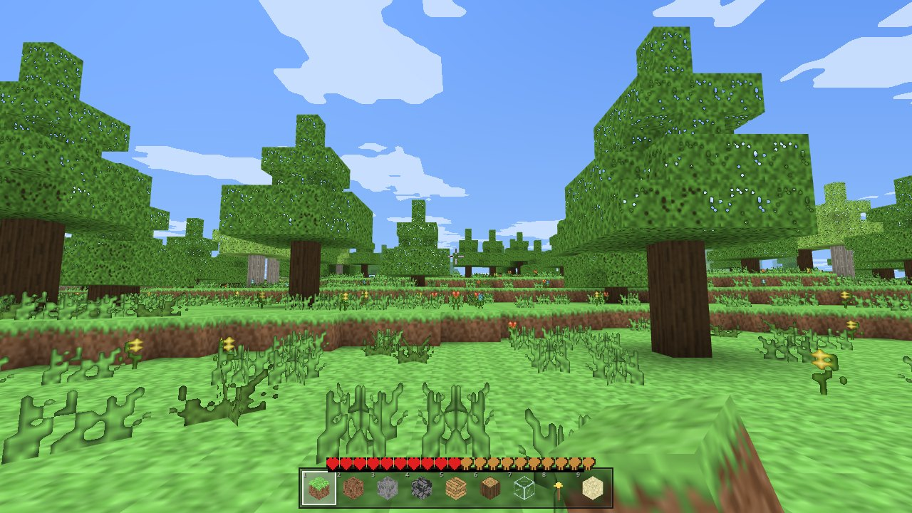
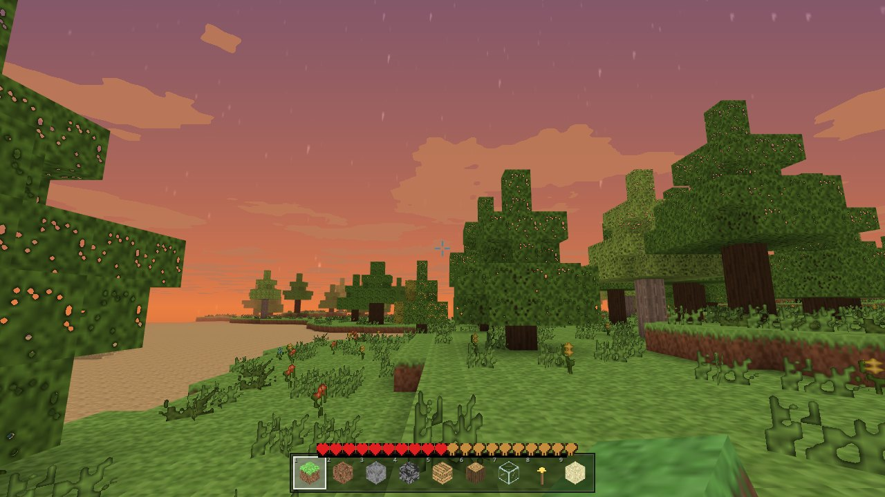
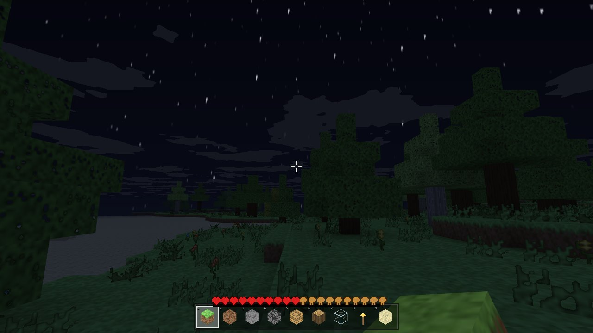
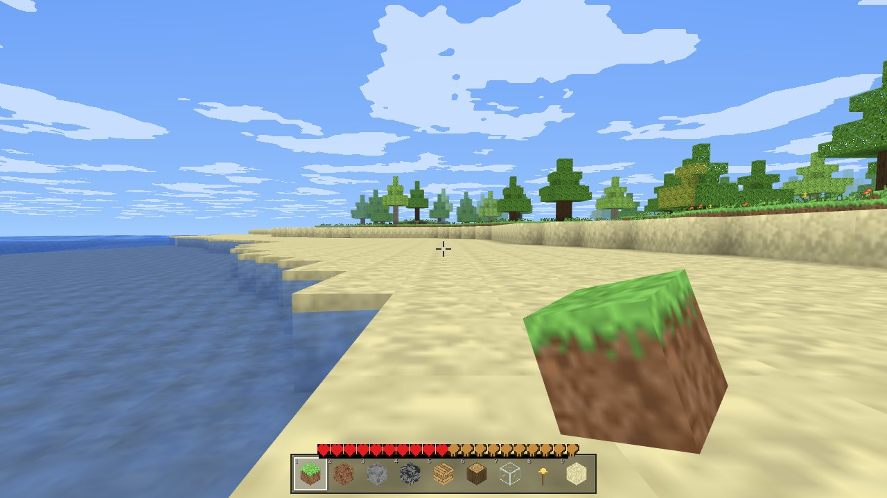
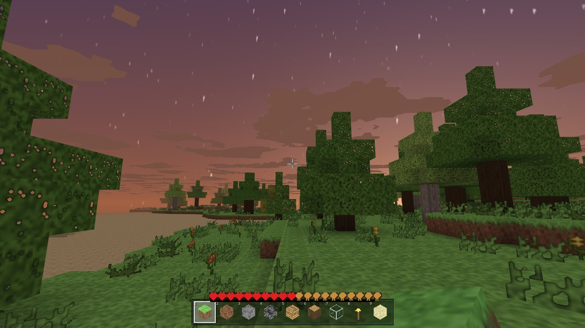
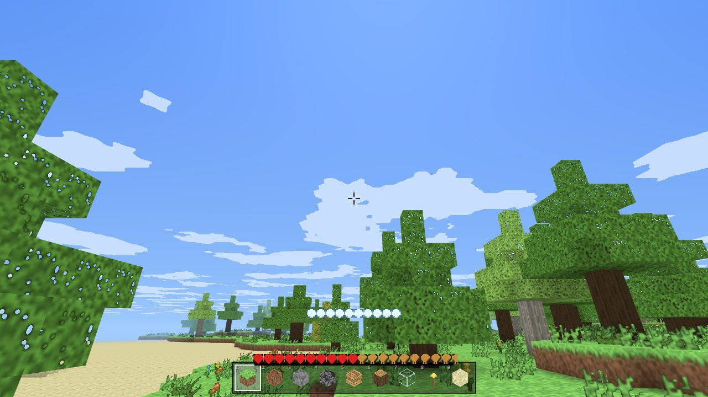

# Minecraft — JavaScript Edition

> **WorkBuddy + DeepSeek-V4.1-Flash**

一个**零依赖、全程序化生成**的 Minecraft 克隆，用原生 **WebGL2** 从零实现。
单文件 `index.html`，双击即开（`file://` 直接运行，无需服务器、无 CDN、无外部资源）。








```
minecraft-clone/
├── index.html          ← 交付物：单文件完整游戏（约 233 KB）
├── README.md
├── shots/              ← 验收截图
└── src/                ← 源码分片 + 构建 / 验收脚本（改代码用这里）
    ├── p00.html … p14.js    分片源码（15 片）
    ├── build.js             拼装 index.html + 抽 JS 做语法检查
    └── test.js              Playwright 真浏览器端到端验收
```

## 操作

| 按键 | 功能 |
|---|---|
| `W A S D` | 移动 |
| `空格` | 跳跃 / 上升（飞行） |
| `Shift` | 潜行 / 下降（飞行） |
| `Ctrl` 或 双击 `W` | 疾跑 |
| 双击 `空格` | 切换飞行（创造模式） |
| 左键 | 挖掘（按住持续） |
| 右键 | 放置（按住连放） |
| 中键 | 取样方块 |
| `1`–`9` / 滚轮 | 切换快捷栏 |
| `E` | 创造模式物品栏 |
| `F3` | 调试信息 |
| `F5` | 切换视角 |
| `R` | 重生 |
| `Esc` | 暂停菜单（选项 / 新建世界 / 导出截图） |

## 已实现的原版特性

**渲染**
- 16×16 手绘像素纹理，逐像素用 Canvas 算法生成（约 90 张），打包进 `TEXTURE_2D_ARRAY`，彻底杜绝 mipmap 渗色
- 六面剔除 + **逐顶点环境光遮蔽（AO）** + **平滑光照**（四邻域光照平均后插值）
- 天空渐变 / 太阳 / 月亮 / 星空（等距柱状投影程序化星图）/ Minecraft 式方块云（滚动、随时间染色）
- 距离雾（雾色取地平线与天顶的中间调，避免硬色带）
- 水面波动（顶点着色器正弦叠加）、半透明水体 + 由远及近排序
- 水下蓝色滤镜 + 浓雾、岩浆滤镜
- 手持方块（含挥动动画）、方块破坏 10 阶段裂纹、选中线框、破坏粒子、掉落物实体

**世界**
- 区块 16×128×16，玩家为中心动态加载 / 卸载（渲染距离 3–16 可调）
- 天光 / 方块光双通道 BFS 泛洪光照，跨区块传播 + 方块变化时的增量式"清除并重新扩散"
- 地形：大陆性 / 湿度 / 温度噪声 → 8 种生物群系（海洋、沙滩、平原、森林、沙漠、雪原、山地、沼泽）
- 洞穴（双层交错蠕虫噪声 + 深层空腔）、矿脉（煤铁金钻红石青金绿宝石）、树木（橡树 / 白桦 / 云杉，可跨区块续写）、花草仙人掌、水与岩浆
- 生物群系着色（草、树叶按温带 / 寒带 / 干旱切换纹理变体）

**玩法**
- AABB 体素碰撞、自动上台阶（0.6）、潜行防掉落
- 参数对齐原版：步行 4.317 / 疾跑 5.612 / 潜行 1.295 / 飞行 10.89 m/s，重力 32 m/s²，起跳 8.95 m/s（跳跃高度 1.2522 格），碰撞盒 0.6×1.8×0.6，眼高 1.62 / 潜行 1.27
- 游泳、摔落伤害、仙人掌 / 岩浆接触伤害、氧气条、生命与饥饿
- 挖掘硬度系统（按原版硬度表 + 工具倍率）、创造模式秒破
- 创造模式物品栏（可搜索）、快捷栏、掉落物拾取

**音效**：全部用 WebAudio 实时合成（噪声爆发 + 带通滤波 + 包络），按材质分（石 / 土 / 草 / 木 / 沙 / 砂砾 / 玻璃 / 羊毛 / 雪），零音频文件。

## 实现要点

**为什么不用 Three.js？** 体素渲染需要完全自定义的顶点格式（位置 + UV + 纹理层 + 天光 + 方块光 + AO 打包成 36 字节）和着色器（光照曲线、雾、水波）。裸 WebGL2 更直接，并且换来真正的零依赖——`file://` 双击即开，没有 CDN 请求。

**顶点布局**（9 个 float32 / 36 字节）
```
[0..2] 世界位置  [3..4] UV  [5] 纹理层  [6] 天光  [7] 方块光  [8] AO
```

**光照**：天光自顶部垂直灌入时不衰减（保留阳光柱），透明方块按 `lightOpacity` 衰减（水 3 / 树叶 1 / 玻璃 0）。方块变化时不是全图重算，而是清除依赖链后从边界重新扩散。

**调试过程中修掉的两个隐蔽 bug**（值得记录）：
1. `Pixels.setc(x, y, 255, 255, 255, a)` 传了 6 个参数但签名是 `(x, y, 数组, a)`，`c[0]` 取下标得 `undefined → 0`，导致云 / 水 / 岩浆 / 树叶四处纹理全是黑色。已在 `setc` 里加了数值兜底。
2. `drawBlockCube` 的 `uOrigin` 应传「方块中心 − 0.5」（着色器里加 `uPivot=0.5`），传成「中心 − 尺寸/2」会让手持方块、掉落物、破坏裂纹整体错位 0.5 格。

## 构建与验收

```bash
cd src
node build.js        # 拼装 ../index.html 并做 node --check 语法检查
node test.js         # 需要 playwright：Playwright 无头 Chromium 多机位截图
```

验收方式为**真浏览器端到端**：加载页面 → 点击开始 → 等待区块流式加载 → 依次截取地面 / 四方向 / 抬头看云 / 高空俯瞰 / 夜晚 / 黄昏 / 黎明 / 挖掘 / 水下共 11 张画面，并断言控制台零错误、区块与网格数量、光照与生物群系数据正确。

## 已知限制

- 流体为静态水体（不含原版的流动扩散模拟）
- 没有生物（Mob）、合成系统、红石、维度
- 无光照遮挡剔除（只用视锥剔除），渲染距离 16 时对 GPU 有一定压力
