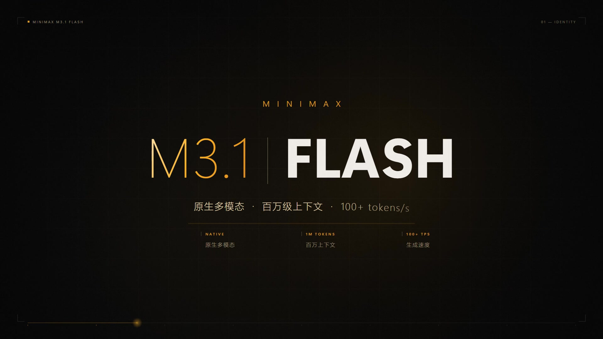

# 瞬光 · MINIMAX M3.1-FLASH 宣传片

> **WorkBuddy + DeepSeek-V4.1-Flash**

40 秒 / 1920×1080 的产品宣传片。全片由代码生成：单文件 Canvas2D 按确定性时间轴绘制画面，逐帧烘焙成 H.264，配乐用 numpy 合成。零外部素材、零视频模型，文字与图形都是矢量级精确渲染，因此不会出现生成式视频常见的文字糊化。制作耗时约 70 分钟。

## 成片规格

| 项 | 值 |
|---|---|
| 时长 / 画幅 | 40.00 s · 1920×1080 · 30 fps（1200 帧） |
| 编码 | H.264 High@4.1, CRF 16, yuv420p, faststart |
| 音轨 | AAC 192 kbps / 44.1 kHz 立体声，numpy 合成，未用采样 |
| 体积 | 55.6 MB（约 11.5 Mbps） |
| 单帧渲染 | 约 240 ms（取值方式见下文，全片约 11 分钟烘焙） |

## 六幕结构

| # | 时码 | 段落 | 画面与文案 |
|---|---|---|---|
| 00 | 00:00–00:04 | 点火 | 黑场中一道竖光立起、横向展开成发丝光线，刻度亮起。「速度，是新的智能单位」 |
| 01 | 00:04–00:11 | 标识 | 光爆切入。`M3.1` 细体琥珀渐变 + `FLASH` 黑体逐字裁切揭示，金属高光横扫字面 |
| 02 | 00:11–00:19 | 能力 | 三栏并置：三路输入汇入同一内核 / 百万 token 长卷与计数 / 柱状增速与折线。主标「不再取舍」 |
| 03 | 00:19–00:27 | 闭环 | 四节点 定位 → 实现 → 验证 → 交付，光点沿节点框内边跑完整圈并逐个点亮，中心「闭环」 |
| 04 | 00:27–00:33 | 成形 | 参数化环面纽结构成的带状曲面实时生成、旋转；竖排标题「让想法直接成形」 |
| 05 | 00:33–00:40 | 落版 | 自绘标记 + 字标 `MiniMax M3.1-Flash`，标语「即刻可用」，收尾回落成一条光丝 |

全片贯穿：左上品牌、右上章节号、四角取景框、底部进度发丝线。

## 关键做法

- **确定性渲染**。画面是 `renderAt(t)` 的纯函数结果，不依赖动画帧回调。因此可以任意 seek、任意帧率重烘焙，也不会掉帧；页面内拖动时间轴与成片逐帧一致。
- **无外部资产**。字体取系统 Segoe UI / 微软雅黑，图形全部由路径与渐变绘制；音效由正弦、噪声、扫频与合成混响生成，整包可离线运行。
- **用光爆而不是溶解做切换**。四段硬切都铺一帧暖白冲光（50 ms 冲白 / 200 ms 回落），同时 HUD 自动避让，切点完全不可见。
- **文字遮罩反光**。把字画到离屏画布，用 `source-in` 抠出扫过的渐变再叠加回主画布，得到金属高光，而不是给整块标题蒙一层半透明色块。
- **取帧方式决定工期**。`page.screenshot()` 走合成器约 900 ms/帧；改用 `canvas.toDataURL('image/png')` 降到约 240 ms/帧，整片烘焙从 18 分钟压缩到 11 分钟。
- **细体数字配黑体单词**。`200 176px` 与 `800 176px` 同字号并置、中间加一道竖细线，是这类片子成本最低的高级感来源。

## 剧照

| 点火 | 标识 | 能力 |
|---|---|---|
|  |  |  |

| 闭环 | 成形 | 落版 |
|---|---|---|
|  |  |  |

## 本地复现

`index.html` 打开即播（可循环，空格暂停，方向键 ±1 秒，底部进度条可拖动）。要重新出片：

```bash
node tools/render.mjs     # 逐帧烘焙 -> frames/（约 11 分钟，4 GB 中间产物）
python tools/audio.py     # 合成配乐 -> soundtrack.wav
python tools/encode.py    # 编码 -> minimax-m31-flash-promo.mp4
python tools/stills.py    # 从成片回抽剧照 -> shots/
```

依赖：Node + playwright（`render.mjs`）、Python + numpy / scipy / imageio-ffmpeg（其余三个）。
成片 MP4 未入库，按上面步骤本地生成即可。

## 事实口径

片中的产品能力表述对齐 2026-09-28 MiniMax 官方发布与公开实测报道：`M3.1-Flash-Preview` 公测上线，
原生多模态、百万级上下文窗口，MiniMax Code 环境下输出速度约 100 tokens/s，能可靠完成 Bug 修复与
完整功能开发。未引用未经官方确认的传闻与第三方跑分对比。
