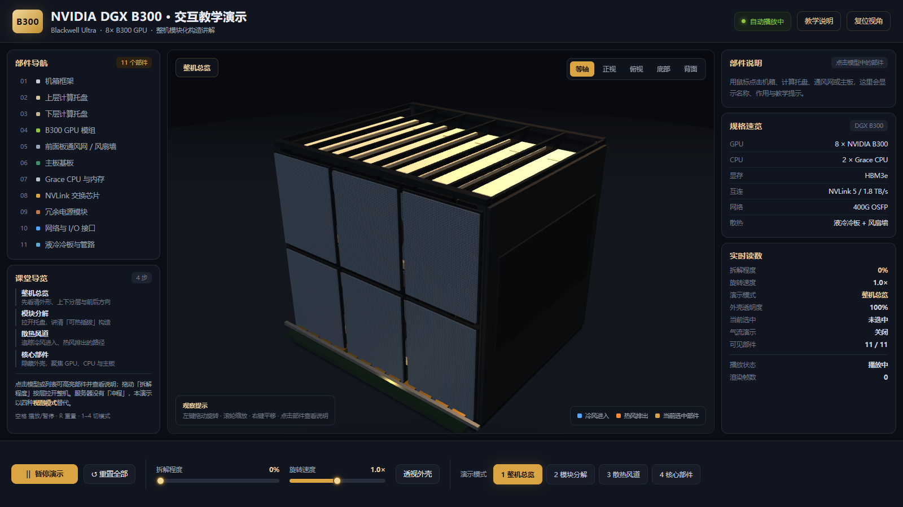
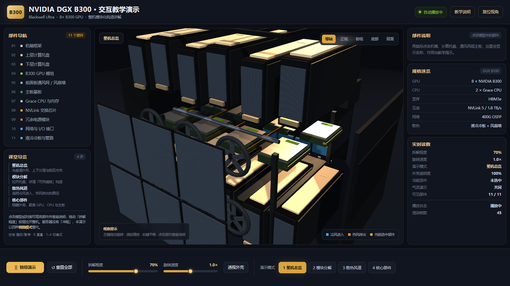
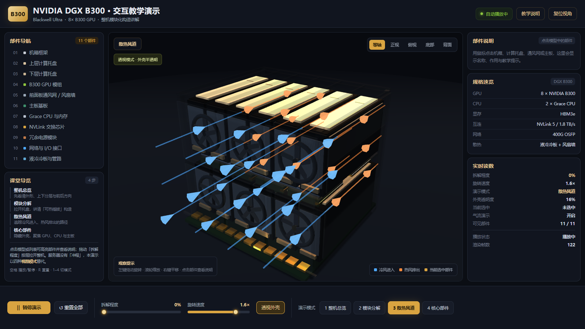
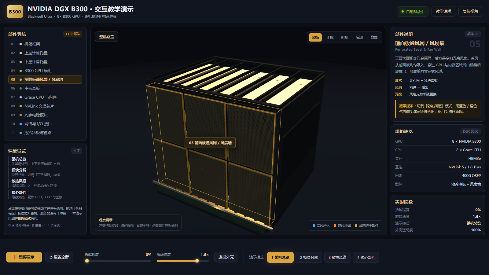

# NVIDIA DGX B300 · 3D 交互式教学演示

> **WorkBuddy + Hy4**

面向课堂教学的单页 Web 工程：用 Three.js 程序化重建一台完整的 DGX B300（Blackwell Ultra）整机，教师可当场旋转、拆解、透视、切换视图并点选部件讲解构造。

**总耗时约 28 分钟。**

**零外部资产、零 CDN、零构建步骤**，整个 `vendor/` 已随工程附带，断网也能用；已收录于 GoodCase.xAI 案例画廊，可直接在浏览器中体验。

---

## 启动方式

| 方式 | 操作 | 说明 |
|---|---|---|
| 最简单 | **双击 `index.html`** | 使用全局版 Three.js，无需本地服务器 |
| 推荐投影 | **双击 `start.bat`** | 自动起 `http://127.0.0.1:8000/index.html` 并打开浏览器 |
| 手动起服务 | 在本目录执行 `python -m http.server 8000 --bind 127.0.0.1` | 浏览器访问 `http://127.0.0.1:8000/index.html` |

建议 1920×1080 全屏投影（F11）。已在 1600×900 / 1366×768 下做过布局适配。

---

## 教学说明（课堂四步）

1. **看外形** — 黑色近立方体机箱，上下两层计算托盘，顶面一排米色拉手标签，前面是穿孔通风网，底部露出主板。
2. **拆模块** — 拖动「拆解程度」，顶板、上下托盘、前面板、主板按层分离，逐层讲算力 / 供电 / 互连的位置。
3. **追风道** — 切「散热风道」，外壳半透，蓝色冷风从前进入、橙色热风从后排出；播放/暂停可随时停住讲解。
4. **看核心** — 切「核心部件」隐藏外壳，只剩 8 组 GPU、Grace CPU、NVLink 芯片与主板。

> 原始验收清单里的「冲程切换」来自四冲程发动机项目，服务器没有冲程概念。本工程用**四种演示模式**（整机总览 / 模块分解 / 散热风道 / 核心部件）替代，功能定位一致：一键切换到一个可讲解的工作状态。

### 交互一览

| 控件 | 作用 |
|---|---|
| 播放 / 暂停 | 控制自动旋转巡览与气流动画 |
| 拆解程度 | 0–100% 手动按层拉开整机 |
| 旋转速度 | 0–2.0× 调节自动巡览速度 |
| 透视外壳 | 机箱外壳半透明，看内部走线 |
| 演示模式 | 四种预设讲解状态（快捷键 1–4） |
| 视角预设 | 等轴 / 正视 / 俯视 / 底部 / 背面 |
| 点选部件 | 点击模型或左侧列表，右侧显示名称、作用、规格与教学提示 |
| 重置全部 | 恢复默认视角、拆解、速度、模式、透视与选中项（快捷键 R） |
| 教学说明 | 顶部按钮打开四步讲解浮层（Esc 关闭） |

鼠标：左键拖动旋转、滚轮缩放、右键平移。快捷键：空格播放/暂停、R 重置、1–4 切换模式。

---

## 工程结构

```
NvidiaB300-Teaching3D/
├── index.html              页面结构（三栏 + 底部控制条 + 教学浮层）
├── start.bat               一键启动
├── README.md               本文档
├── css/style.css           深色投影友好主题（黑底 + 琥珀金）
├── js/
│   ├── data.js             11 个部件知识库 / 演示模式 / 视角预设
│   ├── model.js            程序化建模：机箱、双层托盘、穿孔网、主板、风扇、管路、气流
│   └── app.js              场景、交互、状态、渲染主循环
├── vendor/
│   ├── three.min.js        Three.js（全局 UMD 版，离线）
│   └── OrbitControls.js    轨道控制器（全局版）
├── tools/verify.cjs        浏览器自动化验收脚本
└── render/                 验收截图与 verify-result.json
```

### 模型说明

按参考产品图程序化重建，非照片贴图、非外部 glTF：双层各 6 个可插拔托盘（带米色拉手）、2×3 分块穿孔前面板与风扇墙、底部略微外露的 PCB 与金色连接器、液冷管路、冗余电源与后部 I/O。共 11 类部件、200+ 可点选网格。GPU 数量与规格按 8× B300 教学口径标注，托盘数量为外观示意。

---

## 浏览器验收

```bash
node tools/verify.cjs
```

脚本使用本机 Playwright + Chromium（SwiftShader 软件渲染），真实点击按钮、拖动滑块、点击 3D 模型，逐项检查：渲染与帧循环、播放/暂停、手动调节、四种模式切换、部件说明、教学说明、重置、布局溢出与控制台错误，并在 `render/` 输出各状态截图及 `verify-result.json`。

如需指定浏览器或地址：

```bash
B300_URL="http://127.0.0.1:8000/index.html" node tools/verify.cjs
CHROME_PATH="C:/path/to/chrome.exe" node tools/verify.cjs
```

验收结果 **32/32 项通过**（`file://` 直开与 HTTP 两种方式均验证），0 JS 运行时异常、0 控制台错误、289 drawCalls / 7832 triangles / 288 个可点选网格。

---

## 效果截图








