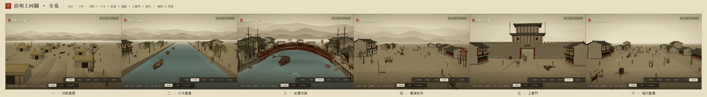
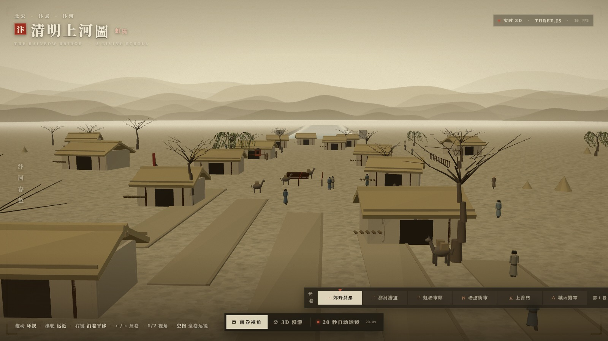
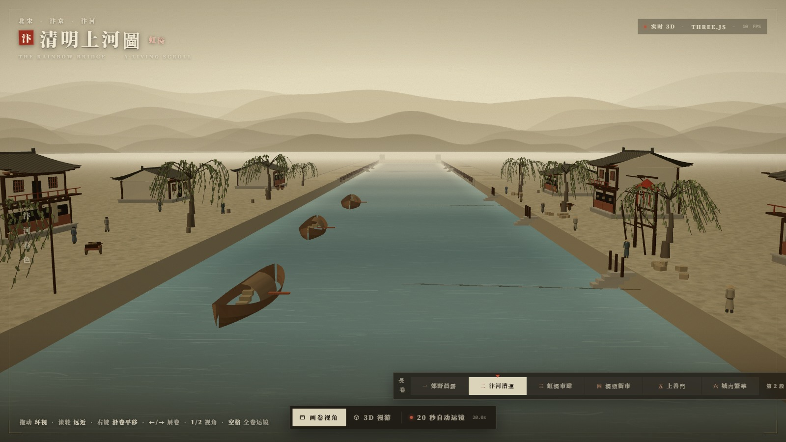
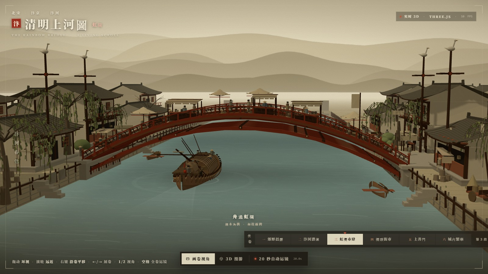
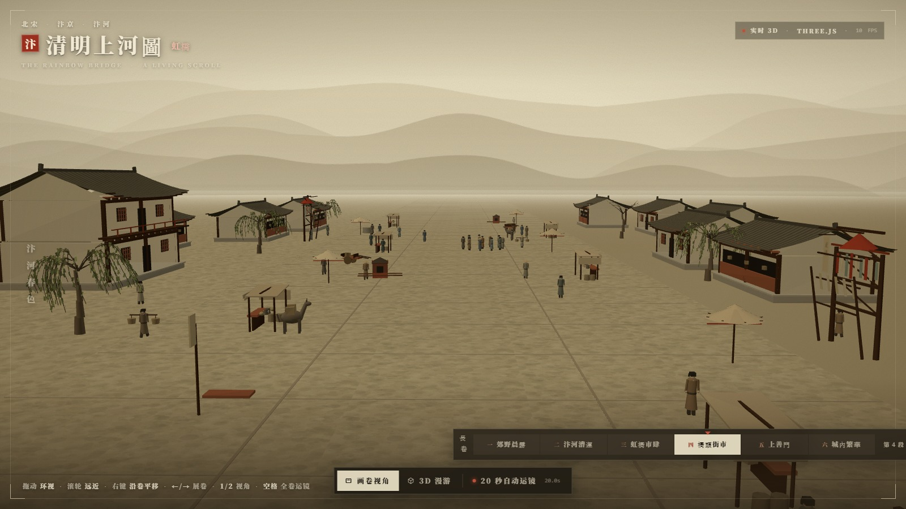
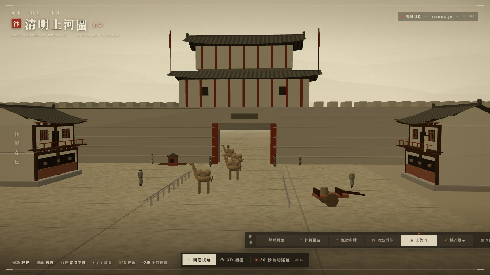
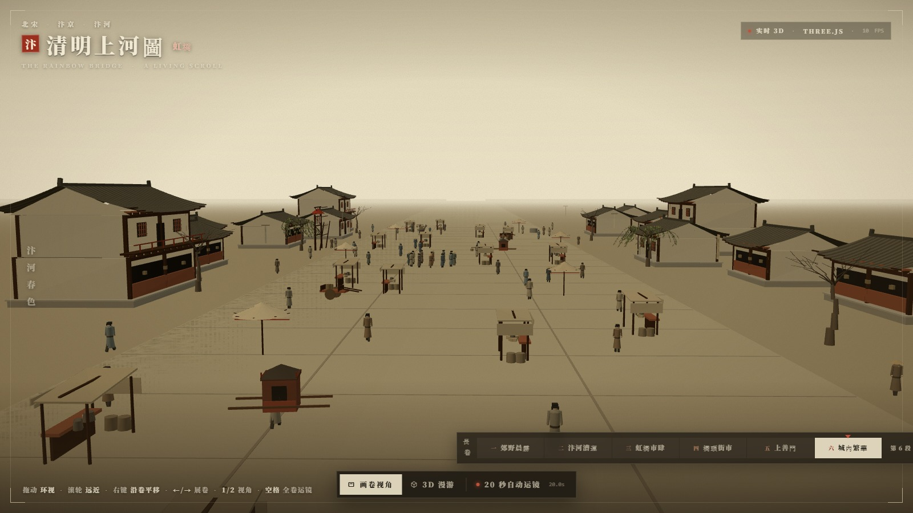
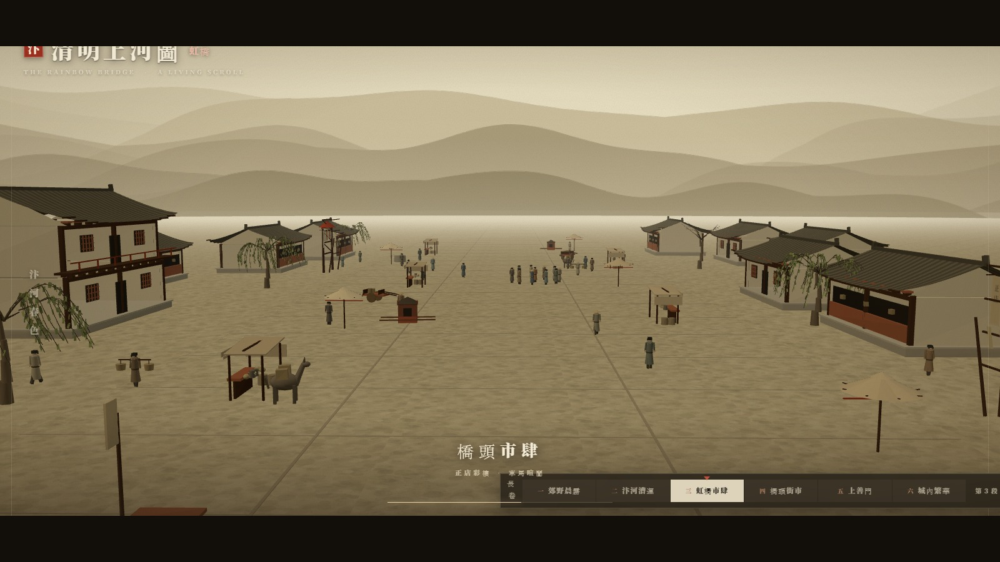

# 清明上河圖 · 全卷 — 汴河活畫卷

> **DeepSeek V4.1 Flash 1017**

以张择端《清明上河图》**全卷**为蓝本的实时 3D 长卷：从卷首郊野晨雾，经汴河漕运、虹桥高潮、桥头街市、上善门，一直铺到卷末城内繁华。六段沿河向首尾相接，总跨度 **1100 m**，可逐段展卷、沿卷平移、自由漫游、20 秒巡览全卷。

单文件 HTML，**零外部素材**——全部几何、纹理、波纹、山影、幌子文字都在运行时程序化生成；Three.js 本地内置（不走 CDN）。画面为实时 WebGL 渲染，非预渲染视频、非贴图烘焙。



---

## 一、运行

ES Module + importmap 在 `file://` 下会被 CORS 拦截，**必须走 HTTP**：

```bash
cd qingming-hongqiao
python -m http.server 8000
# 或 npx serve .
```

浏览器打开 `http://localhost:8000/`。无需 npm install、无需构建。误用 `file://` 时页面会显示启动指引而非空白。

> 依赖已内置：`vendor/three.module.min.js`（Three.js r160，670,681 B，与工作区 pin 版本逐字节一致）。整站离线可用，断网可跑。

---

## 二、全卷六段

长卷沿 Z 轴展开，自卷首（z = +480）向卷末（z = −620）连续推进；六段 `z0/z1` 首尾严格相接，中间无断口。

| 段 | 原画位置 | z 范围 | 标志内容 | 画卷机位 / FOV |
| --- | --- | --- | --- | --- |
| 一 · **郊野晨霧** | 卷首右端 | 480 → 300 | 疏林枯柳、茅舍村落、田畦、小木桥、驮队、轿队、踏青幡、柴垛篱笆、井台 | (2, 11, 452) → (−1, 3.5, 388) / 40° |
| 二 · **汴河漕運** | 郊野入河 | 300 → 120 | 4 艘泊岸粮船、码头石阶与系船桩、粮袋堆、纤夫队列与缆绳、成行垂柳、脚店酒肆、彩楼欢门、酒望 | (2, 11, 268) → (0, 3.5, 205) / 38° |
| 三 · **虹橋市肆** | 全卷高潮 | 120 → −110 | **21 排贯木拱**、宋式勾栏、华表白鹤、石桥台与纤道栏枋、货船放桅过桥、桥市三摊四伞、两岸 12 组店铺 | (5.6, 10.6, 57) → (0, 4.5, 0.5) / 31.5° |
| 四 · **橋頭街市** | 桥西至城门 | −110 → −280 | 孙羊正店、彩楼欢门 ×2、太平车／独轮车／驴／轿、说书围观圈、算命卦幡、街心摊伞、井台 | (1, 11, −132) → (0, 4, −196) / 40° |
| 五 · **上善門** | 城门 | −280 → −420 | 124 m 城墙与雉堞、门洞砖券与匾额、重檐城楼、驼队出城、护城河石栏、门侧店肆与旗幡 | (4, 9, −285) → (0, 6, −350) / 38° |
| 六 · **城內繁華** | 卷末左端 | −420 → −620 | 22 栋店肆、彩楼 ×2、八块幌子（正店／香藥／綢緞／趙太丞家／茶／當／酒／解庫）、街心摊伞、杂耍圈、车马轿、58 名行人 | (1, 11, −452) → (0, 4.5, −520) / 40° |

**段落衔接**：郊野与城内不以河为主——水面只保留在漕运与虹桥两段（z ∈ [−110, 266]），两端以「水门石闸」收口，其余段落填平为石板街与田畴。每段有独立的画卷机位（散点透视）、独立雾距与远山强度：郊野／漕运／虹桥有远山，桥头渐淡，**城门与城内不出现山**（原画城内为屋宇天际线）。

`shots/00-overview.jpg` 为六段定机位画面的横向拼接总览，可直接看到整幅长卷的起伏节奏。








---

## 三、交互

| 操作 | 效果 |
| --- | --- |
| 底部六段题签 / 朱红游标 | 点击任意段，相机平滑飞至该段画卷机位，并浮出题字 3 秒 |
| `←` / `→` | 前一段 / 后一段展卷 |
| `0` | 回到虹桥（默认段） |
| 右键拖动 / Shift+拖动 | 沿卷平移（画卷视角 z ∈ [−640, 480]，漫游视角更宽） |
| 左键拖动 | 环视（画卷视角以当前段机位为基准限幅 ±26°，漫游视角自由绕行） |
| 滚轮 | 推近拉远（画卷 26–88 m / 漫游 7–165 m） |
| 双指捏合 / 拖动 | 触屏缩放与平移 |
| 底部三按钮 | 画卷视角 / 3D 漫游 / 20 秒自动运镜 |
| `1` / `2` | 切换画卷视角 / 3D 漫游 |
| `空格` | 启停 20 秒自动运镜 |
| `R` | 复位当前视角 |

**画卷视角**：长焦压缩透视 + 卷轴四角框 + 绢面纹理，逐段散点机位，带呼吸感；右上角实时 FPS 与「实时 3D · THREE.JS」。
**3D 漫游**：广角解锁，可绕行到桥下、岸边、街道、俯瞰；四角框淡出。
**20 秒自动运镜（全卷巡览）**：12 个关键帧 / 11 段 Catmull-Rom 样条，郊野起幅 → 漕运 → 虹桥画卷机位 → 贴水推进 → **穿桥洞** → 桥头街市 → 上善门 → 城内繁华 → 卷起收束回虹桥；配上下遮幅、**六段题字**与进度线。脚本时长精确 20.0 s，实测相机 z 覆盖 **[−458, +474]**，结束自动交回画卷视角并复位机位。



---

## 四、形制考据

### 史料依据

| 来源 | 关键记载 |
| --- | --- |
| 孟元老《东京梦华录·河道》 | 「自东水门外七里曰虹桥，**其桥无柱，皆以巨木虚架，饰以丹艧，宛如飞虹**」——定桥型、定朱漆 |
| 故宫博物院《关于〈清明上河图〉研究中的几个问题的浅见》 | 桥两头四根顶端带鹤形高竿应为**华表**；引崔豹《古今注》「以横木交柱头，状若花也……或谓之表木」 |
| 河南党史方志网《第一节 木结构桥》 | 跨径近 25 m、净跨约 20 m、拱矢约 5 m、离水面净高 5.5–6 m、桥宽约 8 m；方正琢石桥台、石护岸、步阶、纤道栏枋、华表白鹤、桥檐飞边、横骨端「戏水兽面」板 |
| 唐寰澄复原（1953 起，定名「贯木拱」） | 两套系统交错：**四节苗 11 组 + 三节苗 10 组 = 21 排拱骨**，由 **5 道横木**贯穿联合；拱杆径 30 cm + 间隙 5 cm → 桥宽 ≈7.3 m；宋式勾栏为寻杖／盆唇／蜀柱／地栿／覆斗瘿项，仅桥头两端有望柱 |
| 张择端本（真本）细节 | 汴水湍流呈**「虎眼文」**小漩涡；桥上摊位集中南岸一侧；桥面栏杆内砖石铺装、栏杆外木板 |
| 全卷段落考订 | 卷首郊野踏青驮队 → 汴河漕船纤夫 → 虹桥船桥相撞 → 孙羊正店与彩楼欢门 → 上善门驼队出城 → 城内「赵太丞家」医铺收尾；车制有串车／平头车／太平车，轿、驼、驴骡并行 |

### 史料 → 场景对照

| 形制 | 本场景实现 | 判定 |
| --- | --- | --- |
| 无柱、巨木虚架、饰以丹艧 | 全桥无桥墩；拱骨暗朱，栏杆朱红，仅印鉴与灯笼用正红 | 按史料 |
| 二系统交错 21 排拱骨 | 偶数榀四节苗 / 奇数榀三节苗交替，共 21 排；节点处显榫卯捆扎 | 按史料 |
| 5 道横木贯穿联合 | 均布 5 道，端头微出挑作兽面板含蓄示意 | 按史料 |
| 拱杆径 30 cm + 间隙 5 cm → 桥宽 7.3 m | 拱骨截面 0.30 m；21 排相邻间距 0.43 m（桥宽放大后 ≈0.35×1.26） | 等比放大 |
| 拱矢 5 m / 净高 5.5–6 m / 桥宽 8 m | 矢高 5.4 m；桥腹净空 5.80 m（拱骨下缘）；桥宽 9.2 m | 按真实量级 |
| 跨径 18.5–25 m | **36 m** | 有意放大，见下 |
| 宋式勾栏 | 寻杖 / 盆唇 / 束腰两横木 / 蜀柱 / 地栿 / 覆斗瘿项，仅桥头 4 根望柱 | 按史料 |
| 每边蜀柱 23 根、间距约 0.8 m | 每边 26 跨、跨距 1.38 m ≈0.8×1.8（随跨度等比放大） | 等比放大 |
| 华表四根、横木交柱头、顶立白鹤 | 桥头四根，双横木交柱头，顶端白鹤（身／曲颈／首／喙／尾／足） | 按史料 |
| 石桥台、石护岸、步阶、纤道栏枋 | 石砌桥台 + 石阶引道 + 木桩护岸；桥台临水侧补四柱十二间隔纤道栏枋 | 按史料 |
| 「虎眼文」水涡 | 波纹纹理叠加两三层同心短弧小漩涡 | 按史料 |
| 摊位集中南岸一侧 | 三组桥上摊棚统一布在南岸一侧，伞分列两侧以保持桥市密度 | 按史料 |
| 桥面栏杆内砖石铺装、栏杆外木板 | 全桥木板 + 板缝 + 双侧地栿 | 有意取舍，见下 |
| 画中客船横斜、桅杆放倒、众篙齐撑 | 一艘**正向驶向虹桥的货船**，保留放桅、撑篙、艄公三要素 | 按任务指定，见下 |
| 全卷六段内容 | 郊野驮队 / 漕艘纤夫 / 虹桥 / 正店彩楼 / 城门驼队 / 城内百肆，均落入对应段落 | 按史料分段 |
| 城楼形制 | 城台门洞砖券、雉堞、腰檐与重檐城楼、门额石匾、旗幡 | 按画意 |

### 四处有意取舍（均为长卷构图所需，非遗漏）

1. **虹桥跨度 36 m（真实 18.5–25 m）**：画卷机位在桥南 47–57 m 处，若按真实跨度，桥、船、两岸店铺无法同时入画；按 1.5–1.9× 等比放大后，矢高、净空、桥宽、蜀柱间距、拱骨间距一并按比例放大，矢跨比因此由真实约 1/4 变为约 1/6.7，拱线更平缓，更接近长卷的横向舒展感。
2. **桥面全木板**：张本栏杆内为砖石铺装（车马下桥防滑），但本任务提供的参考画面桥面为朱红木板；以参考画面为准。城内与桥头街面则按张本改为石板铺装。
3. **货船正向驶来**：原画高潮是被水流冲横、船身斜置的客船；任务明确要求「一艘驶向虹桥的货船」，故按任务指定改为正向驶来，保留「舟将及桥、桅杆已降」这一叙事核心：桅杆随距桥远近连续放倒 0.05→1.26 rad，放倒后桅顶 4.47 m，桥腹净空 5.80 m，恰好可通过。
4. **全卷艺术压缩**：原画绢本 25.2 × 528.7 cm、人物八百余、屋宇数百；本作压成 1100 m 连续 3D 长卷、六段代表性场景、约 120 栋建筑与 200 余角色，汴河贯穿漕运与虹桥两段后以水门收口。追求「每一段都认得出、整卷走得通」，不是一比一测绘复原。

---

## 五、视觉基准对照（任务提供的两张图）

| 参考图元素 | 本场景 |
| --- | --- |
| 四格竞品对比（画卷氛围／木构细密／人群桥市密度／低模感） | 取「画卷氛围完整 + 木构细 + 人群桥市最密」：分章远山与雾、21 排拱骨、六段共 200 余角色；规避大范围低模街区 |
| 左上朱印 +「清明上河圖－虹橋」+ 英文副题 | 「汴」朱印 + 繁体标题 + 「虹橋」朱字 + `THE RAINBOW BRIDGE · A LIVING SCROLL` |
| 竖排「汴河春色」 | 左侧竖排，配朱丝栏细线 |
| 右上「实时 3D · THREE.JS · WEBGL」 | 同款状态条，附实时 FPS 读数 |
| 底部三按钮「画卷视角 / 3D 漫游 / 20 秒自动运镜」 | 同构三按钮；其上新增**六段长卷导航条**（题签 + 朱红游标 + 段数） |
| 四角卷轴框、绢面暖赭、灰绿水面、淡墨层山 | 四角 L 形框 + SVG 纸纹 + 暗角 + 分章渐隐的三层山峦剪影 |

---

## 六、技术要点

| 项 | 做法 |
| --- | --- |
| 依赖 | Three.js r160 本地内置，无 CDN、无 npm 包 |
| 几何 | 全程序化：放样船体、参数化屋顶曲面（檐口起翘）、挤出桥面、递归树枝、柳条 TubeGeometry、抛物线拱骨、城台门洞砖券 |
| 复用 | 新增五段沿用虹桥段同一套 `Builder` / `houseGeo` / `treeGeo` / `cartGeo` / `caiLouGeo` / `addStall` / `addBanner` / `makePerson`，构件粒度与配色一致 |
| 合并 | 自写 `Builder`（几何 + 顶点色 + 变换）→ 非索引合并，每段压成 1 个主 mesh |
| 长卷组织 | 6 个 `chapter group`；按相机 z 距段中心 145 m 显隐，雾作掩护，任何时刻只绘 1–2 段 |
| 分章大气透视 | `FOG_BY_CH` 六组 near/far（虹桥 54/335，城内 95/540）；`RIDGE_ALPHA` 六段远山强度（城内 0） |
| 河道收束 | 水面只覆盖 z ∈ [−110, 266]；两端填平为城内石板街与郊野田畴，以水门石闸遮断口 |
| 相机约束 | 画卷摆动限幅以**当前段基准 theta** 为中心 ±0.46；平移放开到全卷 z 范围；段间平滑飞行 |
| 材质 | `MeshLambertMaterial + vertexColors` 为主，水面与天空用自定义 ShaderMaterial |
| 纹理 | 绢纹走 CSS SVG feTurbulence；波纹／山影／尾迹／幌子字全部 canvas 现画 |
| 光照 | 半球光 + 单向光（2048 阴影贴图，±46 m 紧包围）+ 冷色补光，无后处理 |
| 规模 | 单章 54–188 draw call / 5.4–19 万三角面；221 个角色 Group，端到端实测 173 个同时在动 |

### 画面口径

- **绢本设色**色域：底子暖赭，水面灰绿，桥体暗朱（对应「饰以丹艧」），只在印鉴、灯笼、卦幡上留正红。
- 不做实时镜面倒影；桥下、船底改用淡墨投影贴片。
- 画卷视角带 ±0.002 m 呼吸位移；船的字幕只在虹桥段出现。
- 低帧率下 `dt` 钳制 0.10 s；运镜计时另用未钳制帧间隔（上限 0.25 s），脚本内部恒为 20.00 s。

---

## 七、逐项核对（原始要求 → 实现 → 证据）

| # | 要求 | 实现位置 | 证据 |
| --- | --- | --- | --- |
| 1 | 新建目录 | `qingming-hongqiao/` | 交付清单 |
| 2 | 署名 DeepSeek V4.1 Flash 1017 | 本文件第 3 行 | 署名行 |
| 3 | 深度调研 + 参考古画局部图与建筑资料 | 第四节「形制考据」、第五节「视觉基准对照」 | 6 类史料 + 逐条对照 + 4 处取舍 |
| 4 | 交互式 3D 网页 / Three.js + JavaScript | `index.html` 单文件 + `vendor/three.module.min.js` | 探针「importmap / vendor / 零 CDN」 |
| 5 | **完整全卷而非局部** | 六段连续 3D 长卷，z 480 → −620，共 1100 m；虹桥为其中第三段 | `shots/00-overview.jpg`；探针「6 段首尾相接」 |
| 6 | 卷首郊野、汴河、虹桥、桥头、城门、城内都有内容 | `buildCh0/1/3/4/5` + 原虹桥段 | 六张章图；探针「六段内容齐全」 |
| 7 | 很长的画、可从头走到尾 | 六段题签导航 / `←→` / 沿卷平移 / 全卷运镜 | E2E「展卷切段」「运镜 z ∈ [−458, 474]」 |
| 8 | 虹桥形制尽量逼近真实 | 21 排贯木拱、5 道横木、宋式勾栏、华表白鹤、石桥台 | `shots/03-ch2-hongqiao.jpg` |
| 9 | 一艘驶向虹桥的货船、桅杆放倒 | `buildBoat()` / `updateBoat()` | E2E「货船持续行驶」「过桥前桅杆放倒」 |
| 10 | 桥上行人、摊贩、货物 | `buildBridgeFurniture()` + `buildCrowd()` | 虹桥章图 |
| 11 | 两岸宋代店铺与民居 | 全卷约 120 栋：临河 12 组 + 中景 14 + 远景 12 + 各章店肆 | 六张章图 |
| 12 | 鼠标自由旋转 / 缩放 / 平移 | `orbitBy` / `zoomBy` / `panBy` + 指针事件 | E2E 三项交互断言 |
| 13 | 河上的船持续行驶 | `updateBoat()` 循环 + 雾中淡入淡出 | E2E z 13.3→11.1 |
| 14 | 行人在桥面缓慢移动 | `walkers` 路径积分 + 双腿摆动 + 端点停顿 | E2E「173/221 角色在移动」 |
| 15 | 画卷视角 / 3D 漫游切换 | `setMode()` + 两套约束与 FOV | E2E 切换 + 归位断言 |
| 16 | 20 秒自动运镜 | `TOUR` 12 帧样条 + 遮幅 + 六段题字 + 进度 | E2E 内部 t=20.07 s、收束回位 |
| 17 | 自主安装依赖 / 运行 / 查错修复 | vendored r160、本地 HTTP、Playwright、修 NaN 顶点与机位穿模 | 三层验证 |
| 18 | 交付源代码 / 网页入口 / 运行说明 | `index.html` + 本文件 | 交付清单 |
| 19 | 不得用预渲染视频冒充实时 3D | 纯 WebGL 实时渲染，无从视频／贴图烘焙 | 实时 FPS、draw call、可自由交互 |
| 20 | 沿用之前成果、风格与细节粒度一致 | 虹桥段全部几何／材质／动画原样移入第三章，新增五段复用同一构件库 | `scene.children` 归集装配 |

---

## 八、三层验证

```bash
node tools/extract_check.mjs && node --check .tmp-check.mjs   # ① 语法层
node tools/probe.mjs                                          # ② 静态探针
node tools/verify_e2e.mjs                                     # ③ Playwright 端到端
node tools/shots.mjs                                          # 六段定机位 + 运镜 + 长卷拼接总览
```

**① 语法层**：从 `index.html` 抽出内联 module（2,566 行 / 104,714 字符）交 `node --check`，`SYNTAX_OK`。

**② 静态探针（31 项）**：按锚点把**产品代码本身**切出——桥几何常量与 `deckY/archY/walkY`、放桅 `smoothstep`、`hullGeo` 放样、`fovAt`、远山 `ridgeAt`、全卷 `CHAPTERS`——放进 Node `vm` 执行；THREE 只做最小替身，不重写任何被测函数。断言覆盖：

- 桥面顶点 7.30 m、两端落回岸面 1.90 m、左右对称、引道连续；
- 桥腹净空 5.95 m（史载 5.5–6 m），放倒桅顶 4.47 m 低于净空；
- 船体 25 站 × 15 点、长 17.40 m / 宽 4.65 m、左右舷严格对称、**顶点零 NaN**；
- **全卷 6 段首尾相接、总跨度 1100 m、各段机位与 FOV 合法、五段生成函数与分章配置齐全**；
- 运镜 20.0 s / 12 帧 / 跨越 z 首尾 / FOV 44°→31.5° / 终点等于画卷默认机位；
- 远山 t=0 与 t=1 等高（横向无缝）；
- 交付完整性：vendor 逐字节一致、零 CDN、单 module、`file://` 兜底、7 个源文件与 **8 张截图**齐全、零残余标记、文本 LF。

```
=== 静态探针 31/31 PASS ===
```

**③ 端到端（26 项）**：真浏览器起本地 HTTP、逐个操作并断言——场景就绪、无 NaN 顶点、无横向溢出、货船持续行驶、过桥前桅杆放倒、173/221 角色移动、视角切换与 FOV、拖拽环视、滚轮缩放、右键平移、切回画卷归位、**全卷六段 / 展卷切到上善门 / `→` 到城内 / `←` 退回 / 回卷到虹桥**、运镜启动／遮幅／进度／**掠过全卷首尾 z ∈ [−458, 474]**／20.0 s 跑满／收束回位、键 1/2、零 JS 报错与零资源失败。

```
=== 26/26 PASS ===
```

> 软件渲染（SwiftShader）下帧率个位数，运镜墙钟耗时被拉到约 32 s；脚本内部计时恒为 20.00 s，硬件 GPU 下即 20 s 实拍。运镜 z 范围由页面内 `setInterval` 全程采样（不受渲染帧率影响）验证。

---

## 九、交付文件

```
qingming-hongqiao/
├── index.html                    # 全部内容：UI + 样式 + 全卷场景代码（单文件，2,828 行）
├── README.md                     # 运行 / 六段 / 考据 / 逐项核对 / 验证
├── vendor/
│   └── three.module.min.js       # Three.js r160（670,681 B，本地内置）
├── shots/                        # 8 张留档
│   ├── 00-overview.jpg           # 六段横向拼接的全卷总览
│   ├── 01-ch0-country.jpg        # 一 · 郊野晨雾
│   ├── 02-ch1-canal.jpg          # 二 · 汴河漕运
│   ├── 03-ch2-hongqiao.jpg       # 三 · 虹桥市肆（原局部成果）
│   ├── 04-ch3-street.jpg         # 四 · 桥头街市
│   ├── 05-ch4-gate.jpg           # 五 · 上善门
│   ├── 06-ch5-city.jpg           # 六 · 城内繁华
│   └── 07-tour.jpg               # 全卷运镜中途
└── tools/
    ├── extract_check.mjs         # ① 语法层：抽 module
    ├── probe.mjs                 # ② 静态探针：切产品代码进 vm
    ├── verify_e2e.mjs            # ③ Playwright 端到端
    ├── shots.mjs                 # 六段出图 + 长卷拼接
    └── look.mjs                  # 快速视觉巡检
```

> 上表 8 张为交付留档。`look.mjs` 运行时会在 `shots/` 额外生成 `look-*.jpg` 巡检中间图，可直接删除，不影响交付或三项验证。

---

## 十、范围与结论

本作把 25.2 × 528.7 cm 的绢本长卷，按散点透视重建成一条 **1100 m 连续、六段相接、可从头走到尾** 的实时 3D 长卷；虹桥只是其中第三段，此前局部成果的全部几何、材质、动画、交互与形制考据均原样保留并整合。

20 项要求逐项落地，三层验证 **语法 OK / 静态探针 31/31 / 端到端 26/26**，零 JS 报错、零资源失败、零外部依赖、零残余标记。形制差异与艺术压缩均已在第四节列明出处与理由，画面以任务提供的参考图为视觉基准，未新增参考之外的场景或功能。

<sub>史料来源：孟元老《东京梦华录·河道》；故宫博物院《关于〈清明上河图〉研究中的几个问题的浅见》；河南党史方志网《第一节 木结构桥》；唐寰澄「贯木拱」复原与宋式勾栏考订；张择端《清明上河图》真本（故宫博物院藏）全卷分段。全部几何与纹理为程序化生成，未使用任何扫描件、外部模型或预渲染视频。</sub>
