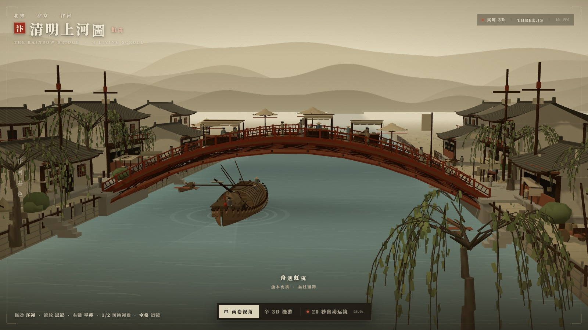
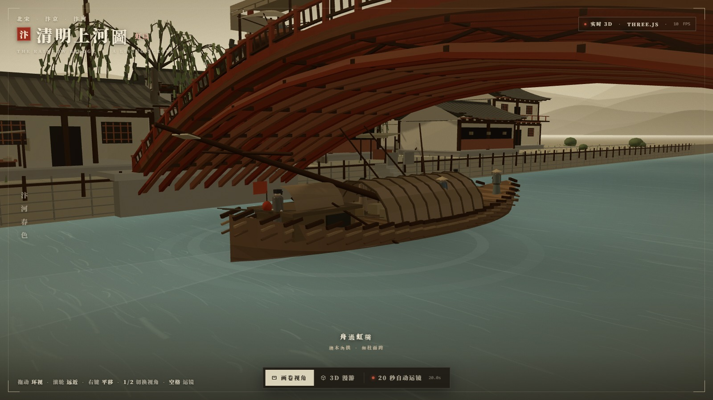
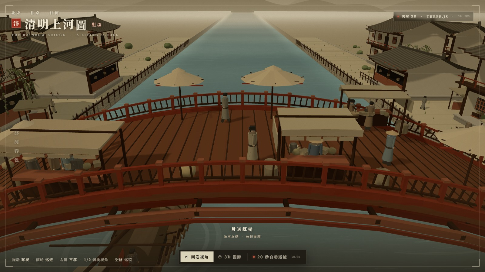
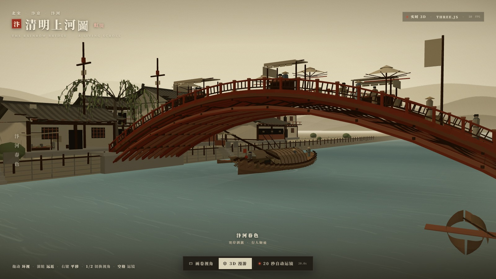
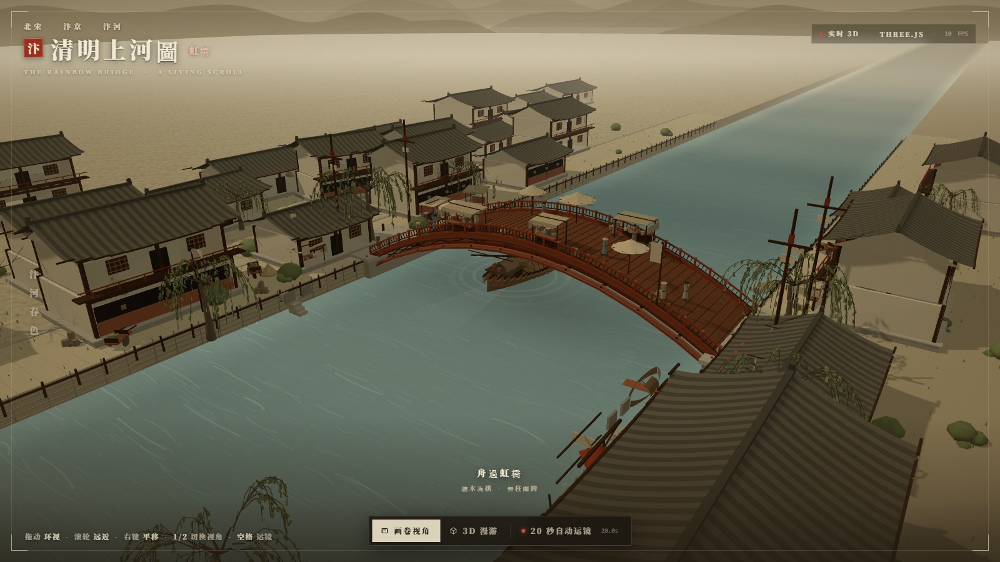

# 清明上河圖 · 虹橋 — 汴河活畫卷

> **WorkBuddy + DeepSeek-V4.1-Flash**

以《清明上河图》虹桥段为蓝本的**实时 3D 交互场景**：编木拱虹桥横跨汴河，货船降下桅杆驶向桥洞，桥上摊贩行人往来，两岸宋代店铺与柳树，远处平远山峦。

单文件 HTML，**零外部素材**——全部几何、纹理、波纹、山影都在运行时程序化生成；Three.js 本地内置（不走 CDN）。画面为实时 WebGL 渲染，非预渲染视频、非贴图烘焙。

制作耗时约 45 分钟（单会话完成，含 20 项端到端断言与六张定机位出图）。



---

## 运行

ES Module + importmap 在 `file://` 下会被 CORS 拦截，**必须走 HTTP**：

```bash
cd qingming-hongqiao
python -m http.server 8000
# 或 npx serve .
```

浏览器打开 `http://localhost:8000/`。无需 npm install、无需构建。

> 依赖已内置：`vendor/three.module.min.js`（Three.js r160，670,681 B）。整站离线可用，断网可跑。

---

## 交互

| 操作 | 效果 |
| --- | --- |
| 左键拖动 | 环视（画卷视角下限幅摆动，漫游视角下自由绕行） |
| 滚轮 | 推近拉远（画卷 26–88 m / 漫游 7–165 m） |
| 右键拖动 / Shift+拖动 | 平移视点（画卷限幅 ±7 m，漫游自由） |
| 底部按钮 | 画卷视角 / 3D 漫游 / 20 秒自动运镜 |
| `1` / `2` | 切换画卷视角 / 3D 漫游 |
| `空格` | 启停 20 秒自动运镜 |
| `R` | 复位当前视角 |

**画卷视角**：机位锁在桥南水面上方，长焦（31.5°）压缩透视，限幅摆动（左右 ±26°、俯仰固定）与小范围平移 + 呼吸感，配卷轴四角框与绢面纹理，接近立轴构图。
**3D 漫游**：广角（44°）解锁，可绕行到桥下、岸边、俯瞰；四角框淡出。
**20 秒自动运镜**：8 段 Catmull-Rom 关键帧，起幅高空全景 → 贴水面推进 → **从桥洞下穿过** → 上游回望 → 升空 → 回到画卷机位；配上下遮幅、四段题字与进度线，脚本时长精确 20.0 s，结束自动交回画卷视角。

---

## 场景里有什么

**虹桥（主角）**
- **编木拱**结构：11 榀拱骨 + 上弦贴梁 + 节点横木贯通全宽 + 隔榀剪刀撑，形成宋式「贯木拱」的交错木构观感；桥腹从侧面和桥下都能看见，不是一块实心板。
- 抛物线桥面（跨度 36 m，矢高 5.4 m）、板缝、双侧地栿、望柱栏杆（26 跨/侧，含蜀柱）。
- 桥头四根**表木**（高杆 + 横木 + 小幡），宋代虹桥的标志物。
- 石砌桥台、木桩护岸、桥头石阶。

**汴河**
- 36 m 宽河道，两层手绘波纹纹理滚动叠加 + 距离雾化的自定义 ShaderMaterial；桥下与船底为淡墨投影贴片（绢画里没有镜面倒影，故不做实时反射）。
- **货船**：17.4 m 木构货船，参数化放样船体（22 站 × 15 点截面）、编席拱篷、舵楼、舵、橹、货箱酒坛、5 名艄公持篙。**桅杆随与桥的距离连续放倒**（0.05 → 1.26 rad），过桥后重新立起——即画中「舟将及桥，桅杆已降」的那一刻。船持续行驶，出画后在雾中淡出、于上游重新入画。
- 岸边两条系泊小舟。

**两岸**
- 6 组临河店铺/民居（悬山顶、檐口起翘、瓦垄条纹、斗栱带、格心窗、腰檐平坐），另有中景二排与远景街市共 30 余栋，全部合并为 1 个 draw call。
- 幌子「新酒 / 茶 / 香藥 / 正店 / 腳店」、酒望旗杆、**彩楼欢门**（酒楼前的竹木扎彩）、独轮车、酒坛堆、木栅栏、草垛、窝棚、1100 丛杂草与灌木。

**人**
- 10 名桥面行人（上下桥往返、到端点转身停顿）、8 名街道行人、4 名桥上摊贩、4 名桥头歇脚者、5 名船上艄公。
- 直领袍 + 腰带 + 幞头/斗笠/巾，双腿摆动 + 身体起伏，朝向沿路径平滑转向。

**远景**
- 三层山峦剪影（圆柱贴图，随视角视差），山脚化入云气；雾色与天色统一为绢本暖赭，形成平远三段景深。

---

## 技术要点

| 项 | 做法 |
| --- | --- |
| 依赖 | Three.js r160 本地内置，无 CDN、无 npm 包 |
| 几何 | 全程序化：放样船体、参数化屋顶曲面（檐口起翘）、挤出桥面、递归树枝、柳条 TubeGeometry |
| 合并 | 自写 `Builder`（几何 + 顶点色 + 变换）→ 非索引合并，把整座桥/整片屋群/全部草压成单个 mesh |
| 材质 | 以 `MeshLambertMaterial + vertexColors` 为主（哑光、近绘画），水面与天空用自定义 ShaderMaterial |
| 纹理 | 绢纹走 CSS SVG feTurbulence；波纹/山影/尾迹/幌子字全部 canvas 现画 |
| 光照 | 半球光 + 单向光（2048 阴影贴图，±46 m 紧包围）+ 冷色补光，无后处理 |
| 规模 | 约 120 draw call / 18 万三角面 / 13 张运行时纹理 |

### 画面口径

- 采用**绢本设色**色域：底子暖赭，水面灰绿，桥体暗朱，只在印鉴与灯笼上留两处正红。
- 不做实时镜面倒影：宋代绢画的水面只有波纹墨线，加了倒影反而假。桥下、船底改用淡墨投影贴片。
- 相机在画卷视角带 ±0.002 m 的呼吸位移，避免「死机位」的塑料感。

---

## 验证

三层验证，全绿：

```bash
node tools/extract_check.mjs && node --check .tmp-check.mjs   # 1 语法
node tools/verify_e2e.mjs                                     # 3 Playwright 端到端（20 项断言）
node tools/shots.mjs                                          # 出图（1600×900）
```

第三层覆盖 20 项断言：场景就绪、**无 NaN 顶点**、无横向溢出、货船持续行驶、过桥前桅杆放倒、19/27 角色在移动、视角切换与 FOV、拖拽环视、滚轮缩放、右键平移、切回画卷归位、运镜启动/遮罩/进度/20.0 s 跑满/收束回位、键 1/2、零 JS 报错与零资源失败。

```
=== 20/20 PASS ===
```

> 说明：软件渲染（SwiftShader）下帧率仅个位数，运镜墙钟耗时会被拉长到 38–53 s；脚本内部计时恒为 20.00 s，硬件 GPU 下即 20 s 实拍。






---

## 文件

```
qingming-hongqiao/
├── index.html              # 全部内容：UI + 样式 + 场景代码（单文件）
├── vendor/
│   └── three.module.min.js # Three.js r160（本地内置）
├── shots/                  # 交付截图
├── tools/
│   ├── extract_check.mjs   # 语法层
│   ├── verify_e2e.mjs      # 端到端层（Playwright）
│   ├── shots.mjs           # 定机位出图
│   └── look.mjs            # 快速视觉巡检
└── README.md
```

**范围说明**：只重建虹桥及两岸一小段，不追求整座汴京。桥南水面上方为默认机位，也是最接近原画构图的角度。

---

<sub>参考：张择端《清明上河图》虹桥段（故宫博物院藏）· 宋代贯木拱桥 / 悬山顶 / 彩楼欢门形制。全部几何与纹理为程序化生成，未使用任何扫描件或外部模型。</sub>
