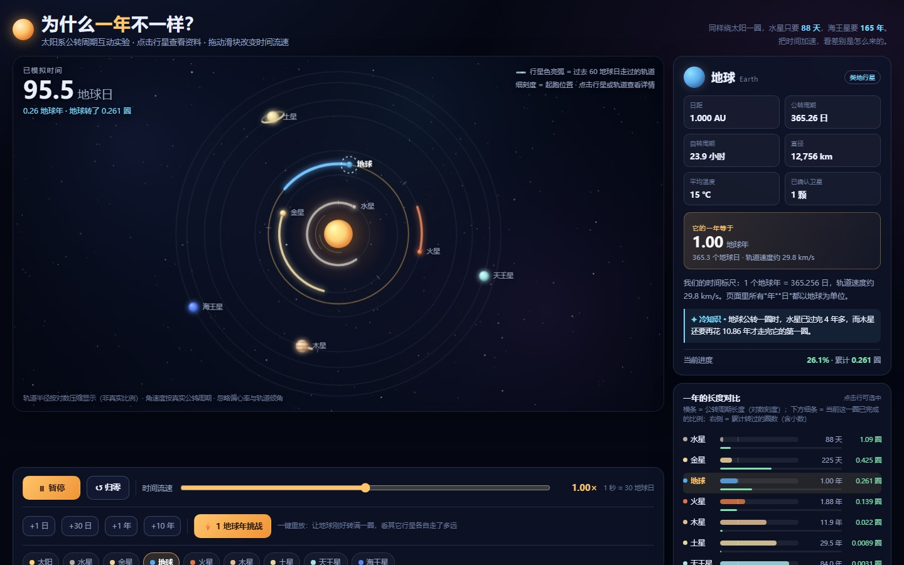
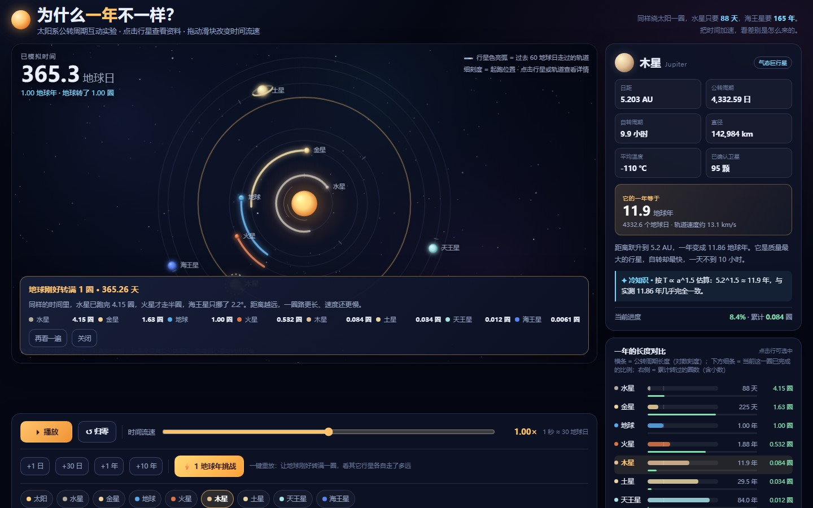
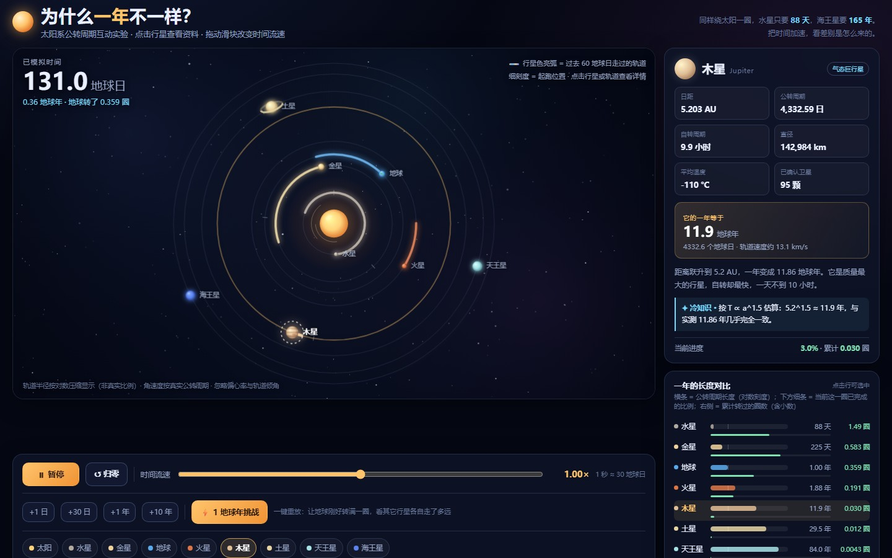
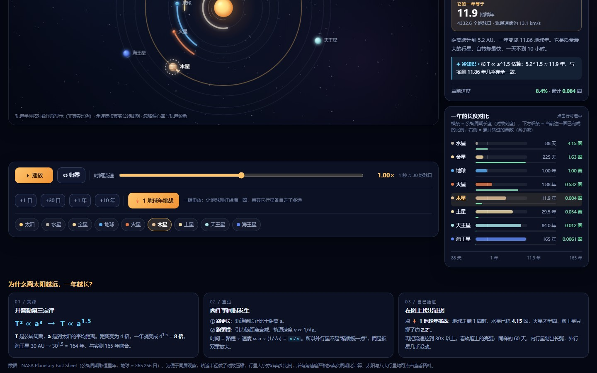
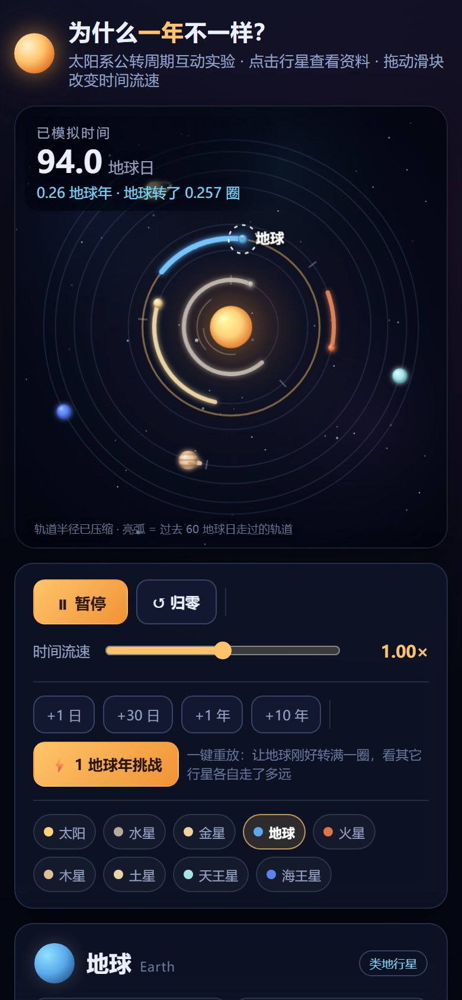

# 太阳系公转周期 · 一年为什么不一样

> **WorkBuddy + DeepSeek-V4.1-Flash**

面向大学生的太阳系互动教学页：八大行星按**真实周期比**公转，点行星看资料，拖滑块调时间流速，一键重放「1 地球年」看每颗行星各转了多少圈——回答「为什么不同星球的一年长短不同」。

单文件 HTML，**零外部资源**——星空、轨道、行星、亮弧全部 Canvas2D 程序化绘制，无图片、无字体、无网络请求。

制作耗时约 25 分钟（单会话完成：页面本体 + 三层验证）。



---

## 打开

双击 `index.html` 即可（无 ES Module、无 importmap，`file://` 直接可跑）。也可 `python -m http.server` 后访问。

---

## 教学设计的四个支点

| 支点 | 做法 | 学生看到什么 |
| --- | --- | --- |
| 真实周期比 | 角速度严格按真实公转周期（T ∝ a^1.5，最大误差 0.076%） | 水星飞转、海王星几乎不动 |
| 轨道亮弧 | 每条轨道高亮「过去 60 地球日走过的弧」 | 内行星拖出长弧、外行星只是一个小点 |
| 周期对比条 | 对数刻度条 + 本圈进度 + 累计圈数 | 88 天 vs 165 年，量级差一目了然 |
| 1 地球年挑战 | 3.4 秒重放并冻结在 **365.256 天** | 水星 **4.15 圈**，海王星只走 **2.2°** |

页面右侧固定三张讲解卡：为什么「路更长 + 跑更慢」是双重效应、T² ∝ a³ 的来历、以及「一年」这个词必须以某颗行星为基准才有意义。



---

## 操作

| 操作 | 位置 / 快捷键 |
| --- | --- |
| 选中行星看资料 | 点球体、点轨道环、或底部行星胶囊 |
| 播放 / 暂停 | 左下按钮，或 `空格` |
| 时间流速 0.01×–100× | 对数滑块（1 秒 ≈ 30 地球日 @1×） |
| 精确定位 | `+1 日` / `+30 日` / `+1 年` / `+10 年`；方向键微调 |
| 归零重来 | `↺ 归零` |
| 1 地球年挑战 | `⚡ 1 地球年挑战`，结束后弹层可「再看一遍」 |





---

## 数据口径

- 公转周期取 IAU 常用值（地球 365.256 天），轨道半径按 `log(a)` 压缩显示——**图上的距离不是真实比例**，右下角脚注已声明
- 角速度 = 360° / 周期，直接按天推进，不做近似
- 「亮弧」窗口固定 60 地球日，方便横向比较
- 行星资料含日距、公转 / 自转周期、直径、平均温度、卫星数、冷知识

---

## 技术要点

| 项 | 做法 |
| --- | --- |
| 渲染 | Canvas2D 顶视图；太阳光晕绘制在轨道与亮弧**之前**，避免盖住内两圈 |
| 相位 | 起跑相位用黄金角错开，否则首帧所有行星共线、第一印象全毁 |
| 命中 | 先球体（半径 22px）后轨道环（内圈间距仅 10px，只点球会误选相邻行星） |
| 自适应 | DPR 上限 2；桌面双栏、移动端单栏；620px 以下隐藏 legend、脚注换短文案 |
| 时间 | 单一 `days` 状态 + 速度倍率，暂停即冻结；挑战模式用独立计时器冻结在 365.256 |

---

## 验证

```bash
node --check（内联脚本语法）
静态探针 18/18（切出产品纯函数在 vm 里跑：T ∝ a^1.5 全行星最大误差 0.076%，1 地球年 = 水星 4.1521 圈 / 海王星 2.185°）
Playwright 34/34（桌面 1440×900 + 移动 390×844：点击选中、播放推进、暂停冻结、滑块、跳转、挑战结论、触摸命中、零 console error）
```

---

## 文件

```
solar-year-lab/
├── index.html          # 全部内容（867 行，HTML + CSS + Canvas2D）
├── README.md
└── shots/              # 交付截图（JPEG）
```

**范围说明**：这是一个「理解周期差异」的教学演示，不是天文模拟器——轨道半径经过压缩、忽略轨道倾角与偏心率，行星资料为科普级口径。
