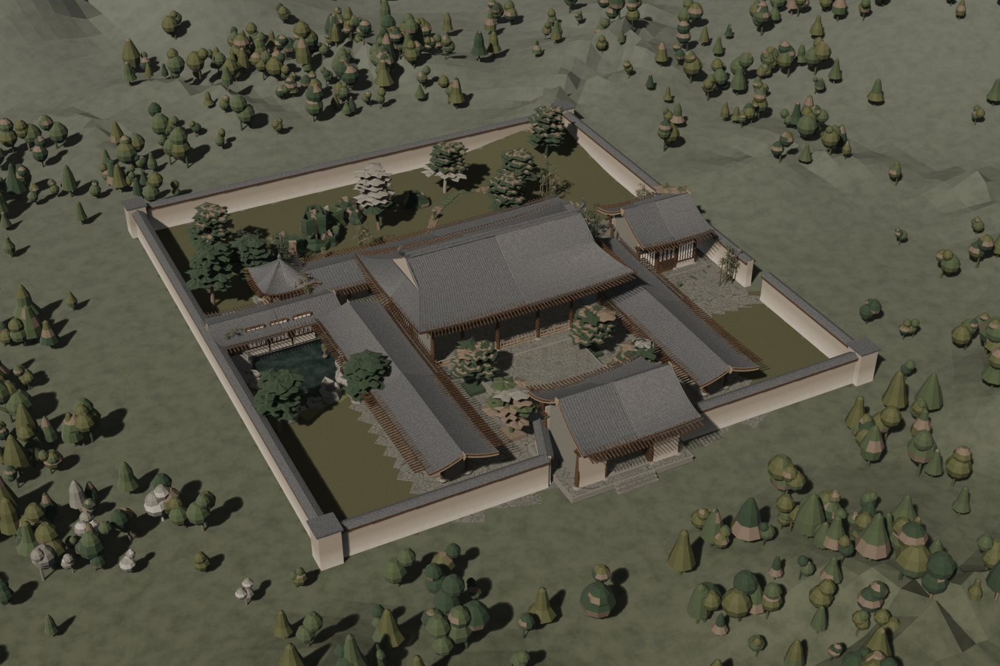

# 宋代中式庭院 · Song Dynasty Courtyard

> **WorkBuddy + DeepSeek-V4.1-Flash**

一座宋代风格的院落，**从地形到每一根斗拱、每一片筒瓦全部由 `bpy` 程序化生成**，
不导入任何外部模型 / 贴图 / HDRI，用 Eevee 出一张 2200×1467 的三分之四俯视图。

设计规格取自一篇讲「宋式建筑工作流」的文章——它没给图纸，但把**布局合同**与**风格合同**写成了可检查的清单，
于是我把两张合同直接当规格书用：南主入口 · 南北主轴 · 中央大殿 · 西侧水院 · 东侧书院 · 北侧后园 ·
围墙 · 连廊；灰陶瓦配克制起翘、深出檐、深色原木柱梁与稳定开间、暖白石灰墙、青灰石铺地、松竹山石静水雾山；
并且明确排除明清红金、日式神社符号与奇幻屋顶。



## 成品参数

| 项目 | 值 |
|---|---|
| 视角 | 三分之四视角，方位角 −27° / 仰角 35°，50mm 等效 |
| 构图 | 主体居中占画幅 **76%**（投影包围盒归一化后两阶段阻尼求解） |
| 渲染 | Eevee · 2200×1467 PNG · 192 spp · 光线追踪 + Fast GI · AgX |
| 规模 | 451,625 面 / 579,366 顶点 · 14 个对象 · 21 种程序化材质 |
| 场地 | 院落 69 × 74 m，围墙内五路院落，地势由单一极坐标地形场给出（半径 0.75 → 390 m） |
| 脚本 | `build_courtyard.py` 3729 行 / 97 个函数，单文件 |

## 结构细节

- **中央大殿**：五开间面阔 23.2 m、进深 12.8 m，檐柱高 5.2 m。**单檐歇山顶**——正脊一、垂脊四、戗脊四，
  共九脊；收山 2.35 m，屋面在举高 56% 处转折长出山花板。
- **斗拱**：严格按《营造法式》材份制推演。材广 0.21 m = 15 份，栌斗 / 华拱 / 双下昂 / 泥道拱 /
  瓜子拱 / 令拱 / 交互斗 / 散斗 / 耍头 / 撩檐方逐件搭出；**六铺作**总高约 2.23 m，出跳 1.80 m。
- **屋面**：举折曲面 `z = 檐口 + 举高·τ^1.38`，檐口平缓、脊部陡峻；**翼角起翘**只在角部按 `|u|³`
  抬起 0.72 m，配合平面外凸 0.36 m 形成四面轻挑的檐口；正脊两端用**宋式鸱尾**（内卷鱼尾），刻意避开明清龙吻。
- **檐下**：深出檐 2.72 m，露出一排檐椽与飞子，拱眼壁为暖白粉墙——俯视时斗拱投在拱眼壁上的阴影带是整个画面的重心。
- **其余建筑**：山门（悬山顶，板门内开、侧间直棂窗）、东侧书院（三开间悬山顶）、临水茶亭（攒尖顶 + 宝顶）、
  两道廊庑与后廊（一斗三升）、廊桥、带瓦顶压顶的围墙与角柱。
- **长物**：甬道与牙子石、树池、石缸、石灯、太湖石（环面加噪声位移，天然带「透」孔）、松 / 竹 / 假山、溪流。
- **材质**：21 种全部为程序化节点——灰陶瓦、深色原木、暖白灰墙、青灰石铺地、静水、苔痕、远山雾化等，
  无一张贴图。

## 文件

```
song-courtyard/
├── index.html                          ← 案例页（可直接打开）
├── README.md
├── build_courtyard.py                  ← 3729 行单文件脚本：地形 / 建筑 / 材质 / 布光 / 自动构图
├── ChineseCourtyard.blend              ← Blender 5.2.2 工程文件（13.6 MB）
└── shots/
    ├── render-final.png                ← 定稿 1600×1067
    └── iter-01..13-*.png               ← 十三轮迭代留档(520px)
```

## 迭代过程

每轮先回看上轮出图再改脚本，共出图 17 次 / 改脚本 12 版。前六轮几乎都在填硬性缺陷，第七轮之后才转入外观打磨。

| 轮次 | 主要改动 |
|---|---|
| v1 | 初版。自动取景**数学发散**（相机跑到 10 km 外）；所有屋顶**整体瘫在 1.5 m 高**（斗拱函数返回的是局部累积高度）；布局骨架已可见 |
| v2 | 光照与材质大改：世界光 1.0→0.42、日照 3.3→4.1，材质整体压暗，檐下阴影与明暗层次出现 |
| v3 | 加长物：甬道 / 牙子石 / 树池 / 石缸 / 石灯 / 太湖石 / 竹丛；铺地石板缝加大 |
| v4 | 远山改"平远"丘陵。**按俯角反推合理丘高**（H ≈ 96 − 0.285·D），删掉塔状远山 |
| v5 | 地貌改为可求值高度场，树按 `ground_z()` 落位——此前树被山体整个吞掉 |
| v6 | 树按视距缩放（初版 15 m 高、压过房子）；地面统一材质 |
| v7 | **雾的近场遮罩在 r=46 m 形成可见圆环**，改为全域渐变 |
| v8 | 丘陵高度场被构建两次，两份共面几何互相 z-fighting |
| v9 | 地面材质统一，消除 r=88 m 的材质分界圆盘 |
| v10 | 地形改极坐标网格（矩形网格 + 丘陵场两块拼接始终留缝） |
| v11 | 统一为单张极坐标地形，接缝从构造上不可能存在 |
| v12 | 确认接缝消失；补齐丢失的修补（水面岸线 / 地形起伏幅度） |
| final | 定稿：陶瓦压暗出青灰质、田野色块、溪流、林地分布平衡 |

## 实现要点（这轮真正决定成败的几条）

1. **一套参数化屋面引擎覆盖三种宋式屋顶**。`SongRoof` 用 `(sy, u, τ)` 参数化：悬山 `s=0 & break=1`、
   庑殿 `s=hd & break=1`、歇山 `s & break<1`。前坡 `u=±1` 边与撒头 `w=±1` 边在 `σ=τ/break` 处严格重合，
   保证曲面水密；山花则是同一曲面上 `τ∈[break,1]` 段的竖板。
2. **斗拱必须返回绝对高度**。`puzuo()` 内部从栌斗起累加，初版直接把它当世界 z 用，
   整座屋顶就掉到了 1.5 m——而俯视图里它看起来"只是矮了点"，靠埋点打印才发现。
3. **地面必须是一张连续网格**。先后试过"矩形网格 + 丘陵场"、"材质分界"、"共享高度场"，
   无论怎么调都会在 r=44 / r=88 m 留下肉眼可见的圆盘或矩形分界。最终改为**以院落为中心的单张极坐标网格**
   （半径 0.75→390 m 几何级数，122 × 240），近处约 1 m 精度、远处自动变粗——接缝从构造上不可能存在。
4. **这个俯角下不可能看到远山**。相机在 105 m 高俯视 32~35°，画面顶边对应的地面只有约 310 m 远，
   更远的全在画外。所以背景只能做**平远**丘陵，做成"高远"的巍峨山峰反而会像贴在近处的沙丘。
5. **大气透视烘焙进材质**：`Camera Data → View Z Depth → Map Range → Mix` 到雾色，
   比体积雾可控且几乎零开销；体积雾只用来做分层。
6. **相机自动取景用两阶段阻尼迭代**：先只解距离，再做有界重定中心，并以投影包围盒的 min/max 求归一化尺寸。
   直接"算一次 k 再乘距离"会正反馈发散。
7. **Python 的 `(-0.003) ** 1.38` 返回 complex**。屋面参数的 τ/σ 必须 clamp 到 `[0,1]`，
   否则有限差分求法线时会抛 `Vector() expected a number, found 'complex'`。
8. **不要用字符串切片给大脚本打补丁**。`s[:s.index(A)] + new + s[s.index(B):]` 在文件里已有重复函数时
   会把整段代码复制多份；而 `str.replace(count=1)` 只改第一份、随后又被追加的副本覆盖，
   结果是"改了却没生效"。本次一度出现 3 份 `terrain_z`、3 份 `build_ground`。

## 复现

```bash
blender -b --factory-startup --python build_courtyard.py -- final 2200
```

参数：第一个是输出标签（渲染到 `render/song_courtyard_<标签>.png`），第二个是分辨率宽度（高按 3:2 计算）。
脚本全程无外部依赖，`--factory-startup` 下可复现。
