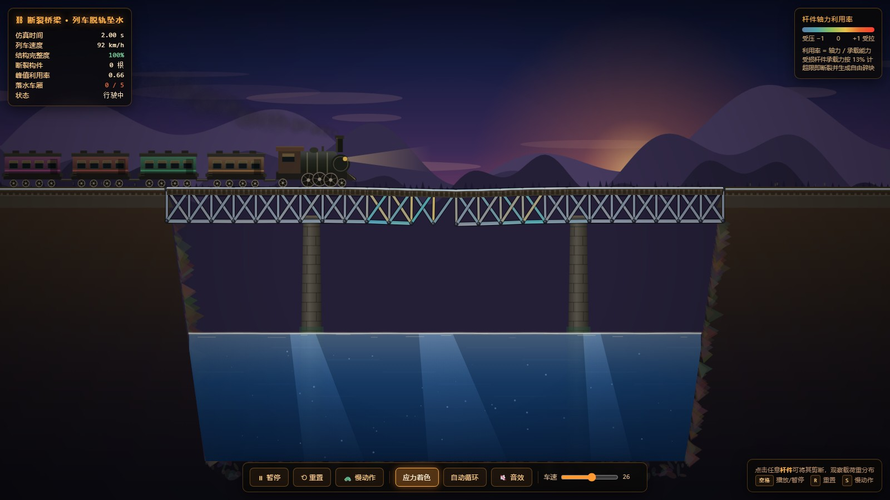
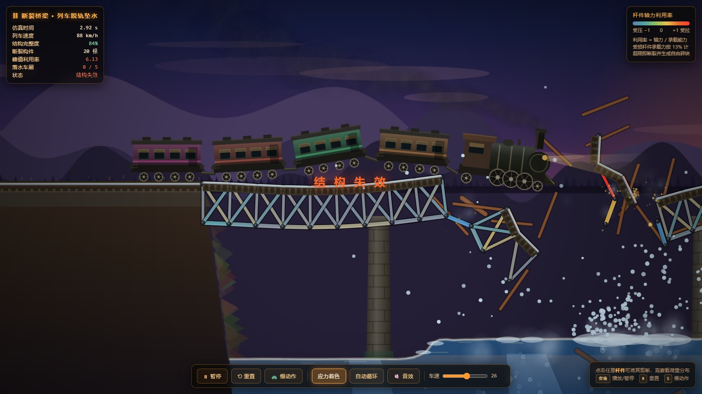
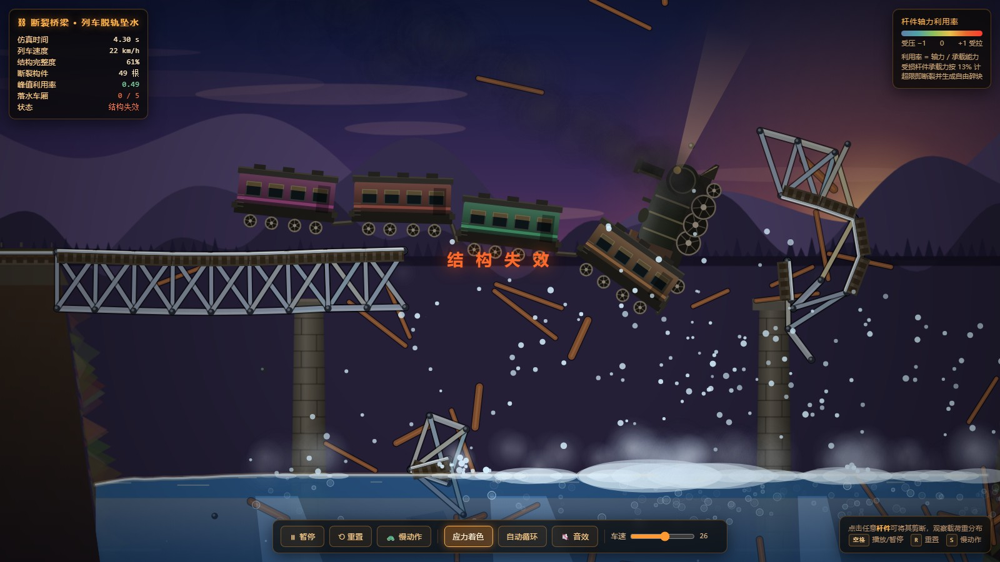
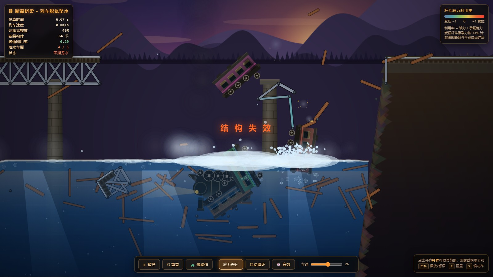
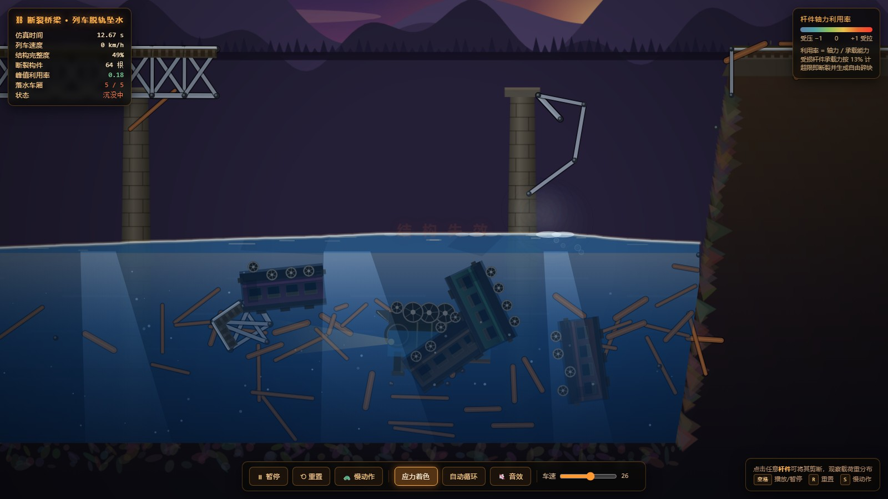
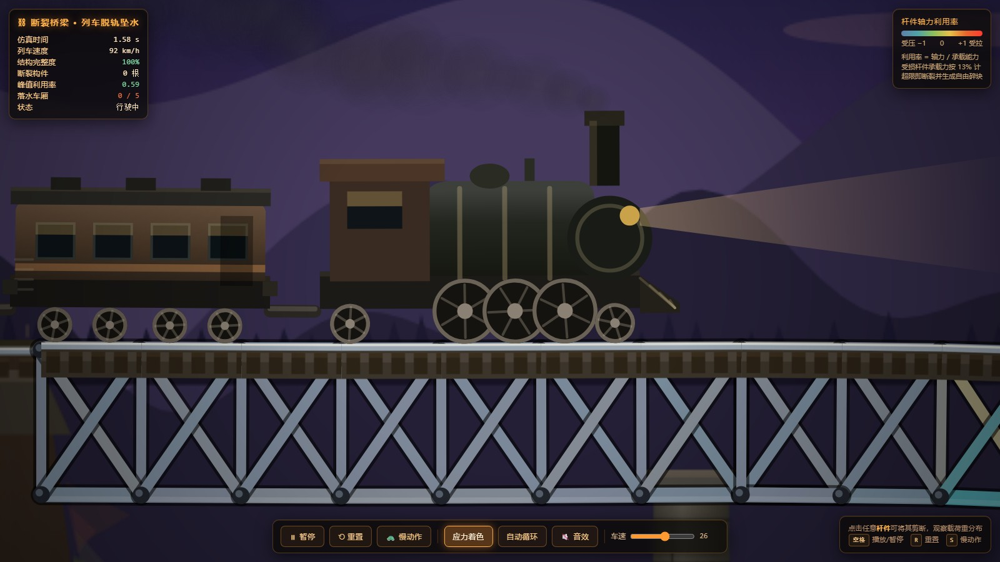

# 断裂桥梁 · 列车脱轨坠水

> **WorkBuddy + DeepSeek-V4.1-Flash**

一个**零依赖、全程序化生成**的 HTML5 Canvas 物理仿真：一列蒸汽机车以 92 km/h 驶上存在既有损伤的钢桁架桥，
损伤跨在列车动载下渐进坍塌，轨排随跨塌落，整车脱轨俯冲入水，最终进水沉没。

单文件 `index.html`，双击即开（`file://` 直接运行，无需服务器、无 CDN、无图片、无字体文件）。








```
train-bridge-collapse/
├── index.html          ← 交付物：单文件完整仿真（约 86 KB）
├── README.md
├── shots/              ← 验收截图（真浏览器渲染）
└── tools/
    ├── verify.js       Playwright 端到端验收（叙事链 + 零错误 + 帧率）
    └── shots.js        按叙事节点自动出图
```

## 事件时间轴（实测）

| 时刻 | 事件 |
|---|---|
| 0.0–2.3 s | 以 25.5 m/s 匀速驶过全桥，桥面仅在荷载下轻微挠曲 |
| **2.27 s** | **首次失效**：损伤跨桥面杆件受压屈曲（轴力 −5354，承载力 8096，利用率 1.08） |
| 2.3–5.0 s | 裂缝前沿以 325 px/s 推进（快于列车 208 px/s），阶梯式断裂 20 → 49 → 64 根 |
| 3.8–4.3 s | 轨排随跨塌落 → 机车脱轨、俯冲下坠，车钩被拉断 |
| **6.5 s** | **入水**，激起水花、泡沫与辐射状涟漪 |
| 8.1 s | 5/5 节车厢全部落水，浮力随进水衰减 |
| **13.6 s** | 全部灌满、沉落河床 |

## 操作

| 按键 / 控件 | 功能 |
|---|---|
| `空格` | 播放 / 暂停 |
| `R` | 重置 |
| `S` | 慢动作（0.26×，便于观察断裂次序） |
| 鼠标点击杆件 | 剪断该杆件，观察载荷重分布（会有邻杆随之超载） |
| 应力着色 | 切换杆件按轴力利用率着色 |
| 自动循环 | 静置后自动重置重放 |
| 车速滑块 | 12–38 m/s（车越慢，损伤跨受载时间越长 → 越早坍塌） |
| 音效 | WebAudio 实时合成（断裂、水花、轰鸣），零音频文件 |

## 物理模型

**1. 约束求解 —— XPBD**
按柔度 α 求解、子步内累积拉格朗日乘子 λ。6 子步/帧 @60 Hz，每子步 8 次 Gauss-Seidel 迭代。
桁架杆件为线弹性距离约束；车体 / 车轮 / 碎块为刚性约束（α = 0）。

**2. 内力测量 —— 本构式 F = Δ/α**
在求解前读取杆件当前弹性伸长，除以柔度得到轴力。**这是全篇最关键的一处选择**：
若改用 XPBD 的 `λ/h²` 反推内力，稳态信号会被 3~5 倍的迭代顺序噪声污染（实测 p99 64 827，
平滑后仍有 27 159），车钩会被误判拉断、列车解体成堆。改用本构式测量后与迭代次数、求解顺序
完全无关，轴向力峰值从 106 043 降到 45 270。平滑 0.1 s 得稳态轴力作"持续超载"判据，
另设瞬时冲击判据（×2.6 裕度）。

**3. 失效判据 —— 轴力利用率**
`利用率 = 轴力 / 承载能力`，|利用率| > 1 即断裂。受损杆件承载力按 9.2% 折减；
裂缝前沿按半径渐进削弱承载力，形成「局部超载 → 断裂 → 内力重分布 → 邻近杆件相继失效」
的渐进倒塌。断裂速率限 1 根 / 0.03 s（≈33 根/s），使倒塌过程肉眼可见而非同一帧整体湮灭。

标定依据（实测，单位：仿真力）：

| 工况 | 内力 |
|---|---|
| 恒载（自重） | ≈ 5 000 |
| 列车满载 | 10 000 ~ 30 000 |
| 贯通冲击瞬态峰值 | ≈ 45 000 |
| 完好杆件承载力 | 66 000 ~ 88 000（贯通工况利用率 ≈ 0.5~0.7，明显"吃力"但不失效） |
| 受损杆件承载力 | ≈ 8 000（**恒载之上、满载之下** → 列车荷载一到即真实超载） |

**4. 接触 —— 点 vs 线段**
面区取杆件法向、端部走圆角，避免大半径车轮在 40 px 节间上产生法线锯齿而耗散能量。
摩擦按「粒子类型 × 地面类型」查表：轮轨≈滚动（0.05%）、脱轨后啃地 / 刮擦为强摩擦。

**5. 水**
按浸没比例施加浮力（阿基米德）+ 二次阻力；车厢进水后浮力衰减至 6% → 4~5 s 内沉没。
一维浅水波场（弹簧-阻尼格式）生成水面几何，溅水按冲击能量注入波速，涟漪自然向外辐射。

**6. 数值稳定**
速度钳制（1500 px/s）+ 穿透修正钳制（4 px），抑制「约束图突变 → 一次巨大位置修正 →
被隐式转成极大速度」的爆炸伪影。

## 调试过程中修掉的隐蔽 bug（值得记录）

| # | 现象 | 根因 |
|---|---|---|
| 1 | 列车飞过桥面冲出世界 | Verlet 存的是**每子步**位移，初速度却按 `v·DT` 设 → 被放大 6 倍（152 m/s）。HUD 的 km/h 换算用了同一个错误 DT，显示值同步偏小 |
| 2 | 26 → 13 m/s 莫名急刹 | 引桥被当作"地面"，车轮在引道上吃了 0.58 的强摩擦 |
| 3 | 桥永远不会断 | 失效判据用「应变超 5%」，但刚性约束下最大应变只有 0.05% —— 判据在构造上不可达 |
| 4 | 车钩被误判拉断、列车解体堆叠 | 力估计被迭代顺序噪声污染 3~5 倍（见上文本构式测量） |
| 5 | 整座桥被搅成麻花 | 裂缝中心跟着列车跑，把全桥完好杆件逐一退化。改为定点于既有断裂处、且前沿推进快于列车 |
| 6 | **列车莫名升空 50 px 并持续弹跳** | 引桥轨面 `ht=1`、桥面 `ht=3` → 接缝处 2 px 台阶。208 px/s 撞上 2 px 台阶即可弹起 50 px。**最隐蔽的一处** |
| 7 | 列车被 11.7 g 上抛到 y=−1100 | PBD 爆炸伪影：断裂使约束图突变，一次巨大位置修正被隐式转成速度 |
| 8 | 列车被"挤"着向上弹射（约 6 g） | 断裂带内残存的变形杆件把车轮挤住并向上挤出。按物理建模为「轨排随跨塌落、断裂带内不再提供导向」，成熟后取消该区接触面 |
| 9 | 机车被渲染成上下颠倒 | 车辆局部系变换 `[[fx,fy],[fy,−fx]]` 行列式 = −1，是**镜像**而非注释所称的 y 向下旋转系；而 `wheelLocal` 的逆变换是按旋转系推导的，两者矛盾。改用 `[[fx,−fy],[fy,fx]]` |
| 10 | 烟往车头方向飘 | 相对气流方向写反（`+fx` 应为 `−fx`） |

> 另有 3 次"故障"其实是**观测方式本身的问题**，不是产品缺陷：俯仰会把角速度污染进"速度"指标
> （改用质心速度后其实是匀速 25.5 m/s）；`car.contact` 在 `updateCars` 里清零，在 `step()` 之后读
> 永远为 0；`cap=Infinity` 会让平滑器整段跳过、读数恒为 0。定位物理问题时，先怀疑尺子。

## 构建与验收

```bash
node tools/verify.js     # 需要 playwright：无头 Chromium 端到端验收
node tools/shots.js      # 按叙事节点输出 shots/*.jpg
```

验收为**真浏览器端到端**，含 4 条断言：

1. 控制台零错误、零 pageerror；
2. 叙事链完整：首次失效（损伤杆件、受压、利用率 > 1）→ 断裂数单调递增 → 出现溅水事件
   → 5/5 车厢落水 → 5/5 车厢沉没；
3. 交互可用：空格暂停 / `S` 慢动作 / `R` 重置 / 车速滑块 / 点击杆件剪断后邻杆超载；
4. 渲染朝向正确：渲染车体顶边 = 物理顶边、渲染车轮 y = 物理车轮 y（防止镜像类回归）。

JS 侧单帧耗时约 3 ms（物理 2.46 + 渲染 0.59），软件光栅化下约 29 fps，GPU 环境满帧。
文件头注释写明了完整物理模型、标定依据与可调参数位置。

## 已知限制

- **二维侧视**：车体为刚体多边形 + 轮系，无转向架悬挂、无扭转（roll）
- 桁架按线弹性建模，柔度经过放大以便在像素尺度上获得稳定可读的内力；真实钢材挠度肉眼不可见
- 断裂速率上限（33 根/s）为现象学设定，用于保证倒塌过程可观察
- 车厢按"舱室进水"整体衰减浮力，不含真实的破损舱室划分与进水流量计算
- 无玩家操作介入（除点击剪断杆件），本质是参数可调的观演式仿真
