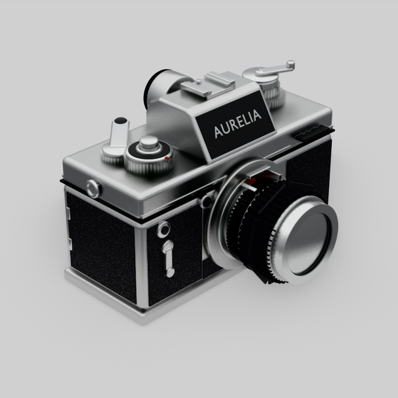

# 复古胶片单反 · 1970s Film SLR

> **WorkBuddy + DeepSeek-V4.1-Flash**

一台 1970 年代风格的 35mm 胶片单反相机，**从几何到材质到摄影棚灯光全部由 `bpy` 程序化生成**，
不导入任何外部模型 / 贴图 / HDRI 文件，用 Eevee 出一张 800×800 的杂志级产品图。

银色顶盖与底盖夹黑色荔枝纹皮革的经典配色，五棱镜坡面上是品牌铭牌，镜头为 50mm f/1.8 的「银鼻」结构。



## 成品参数

| 项目 | 值 |
|---|---|
| 视角 | 三分之四视角，方位角 −45° / 仰角 29°，等效 105mm |
| 构图 | 主体居中占画幅 **70.0%**（`world_to_camera_view` 迭代自动求解） |
| 渲染 | Eevee · 800×800 PNG · 256 spp · 光线追踪 + Fast GI |
| 背景 | 纯色浅灰 `#E8E8E8`（实测 0.816 线性值），配柔和三点光 |
| 阴影 | 主体下方自然接触阴影，暗部比背景低 17% |
| 规模 | 125 个 mesh 对象；整体包围盒 0.148 × 0.110 × 0.101 m |

## 结构细节

- **机身**：142 × 60 × 72.5 mm，银色顶盖 / 底盖 + 黑色荔枝纹皮革，顶盖带 0.7mm 台阶与抛光肩棱线
- **五棱镜**：46mm 深 × 51mm 宽，斜切坡面承载品牌铭牌（黑色珐琅底板 + 0.35mm 抛光铬字）
- **镜头**：43mm 卡口向外扩至 49mm；滚花对焦环与光圈环、pre-AI「兔耳」联动爪、光圈与距离刻度、
  7 片光圈叶片、三层镜片组（**前组为真折射玻璃**，430nm 单层镀膜薄膜干涉）
- **控制件**：快门速度盘 + 快门钮、过片扳手（带滚花轴环）、卷片旋钮 + 折叠摇柄、帧计数器窗、
  热靴、圆目镜 + 橡胶眼罩、PC 同步口、自拍杆、景深预览钮、背带环、三脚架螺丝、后背胶片盒提示框

**所有滚花都是真几何**——对焦环、光圈环、快门盘、ASA 盘、卷片钮的齿由 `knurl()` 逐齿生成梯形齿廓的
星形截面环，不是法线贴图。

## 文件

```
vintage-slr-camera/
├── index.html                          ← 案例页（可直接打开）
├── README.md
├── build_camera.py                     ← 1280 行单文件脚本：几何 / 材质 / 影棚 / 自动构图 / 像素校准
├── vintage_slr_1970s.blend             ← Blender 5.2.2 工程文件
└── shots/
    ├── render-final.png                ← 定稿 800×800
    └── iter-01..08-*.png               ← 八轮迭代留档(420px)
```

## 迭代过程

每轮先回看上轮出图再改脚本，共出图 8 版。前 5 轮主要在填硬性缺陷，v5 之后才转入外观打磨。

| 轮次 | 主要改动 |
|---|---|
| v1 | 初版。**顶盖漏建**（几何缺口，但渲染上看不出来）、背景是暗渐变、光过平、镜片成灰球 |
| v2 | 补上带台阶的银色顶盖；世界背景改为平色；整体提亮 |
| v3 | 世界换成程序化摄影棚梯度（顶亮 / 中灰地平线 / 下半球提亮）；镜头改为真实比例；接触阴影可读 |
| v4 | 提亮环境下半球，解决镜片「黑洞」；构图从 80mm 改 105mm，消除透视畸变 |
| v5 | 改 1970s 经典「银鼻」镜身；镜头内筒提亮；加厚镜片镀膜 |
| v6 | 金属粗糙度收窄使反射更锐；热靴落位；加顶盖肩棱线与铭牌细节 |
| v7 | 强化光比，金属出现从亮到暗的雷登梯度 |
| final | 曝光校准，背景精确压回 `#E8E8E8` |

## 实现要点（这轮真正决定成败的几条）

1. **Eevee 玻璃必须用 `DITHERED`**。打开 `use_raytrace_refraction` 后能透过前镜片看到内部折射畸变；
   一旦改成 `BLENDED`，玻璃立刻退化成一块平板灰。
2. **「镜片像塑料灰球」的根因不是折射，而是环境没有结构**。给 World 加一段
   `Generated.Z → ColorRamp` 的摄影棚梯度（顶部亮带 + 中灰地平线 + 下半球不能纯黑），
   金属与玻璃才会真正「活」起来。纯灰环境 = 灰塑料。
3. **Eevee 里做「平色背景 + 接触阴影」的正解**：地板材质用
   `MixShader(Emission(#E8E8E8), Diffuse)`。恒定发光保证背景绝对平整无渐变，
   漫反射项被主体遮挡后自然形成柔和的接触阴影。
4. **曝光与背景色靠回读像素校准**，不靠目测。`bpy.data.images.load(png).pixels` 读出的是线性值，
   `#E8E8E8` 对应线性 **0.8079**，采样四角比对后调发光强度即可锁定。
5. **Blender 5.x 的 API 坑**：倒角修改器是 `use_clamp_overlap`（不是 `clamp_overlap`）；
   按角度平滑用 `bpy.ops.object.shade_auto_smooth()`；Principled 的透射输入名已改为 `Transmission Weight`。
6. **手写网格后必须 `bmesh.ops.recalc_face_normals`**，否则玻璃法线翻转会直接毁掉折射。
7. **「渲染看着对」不等于几何对**——v1 那个缺失的顶盖在图上完全看不出来（透过缝隙看到的是壳体内壁），
   是靠关键字检索才发现的。

## 复现

```bash
blender -b --factory-startup --python build_camera.py -- final
```

脚本末尾会把渲染图和若干采样点的线性像素值一并打印出来，便于核对背景是否落在 `#E8E8E8`。
